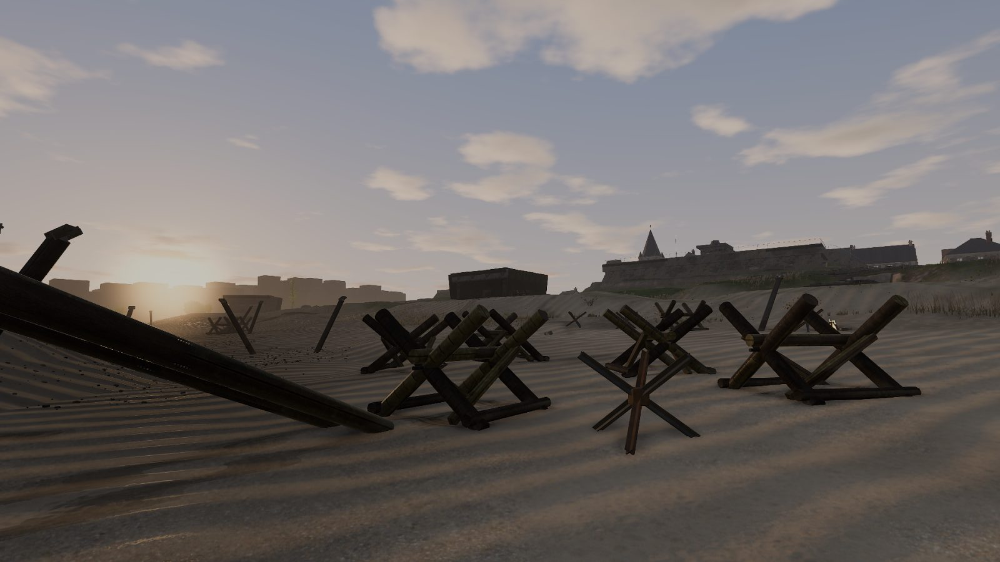
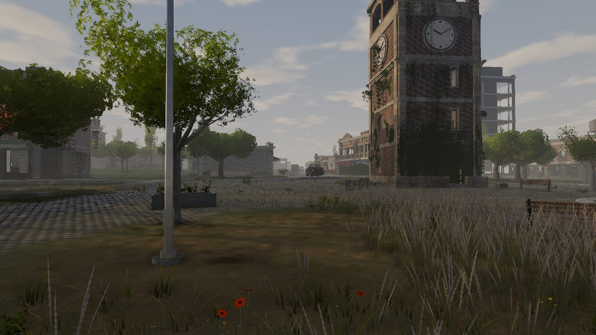
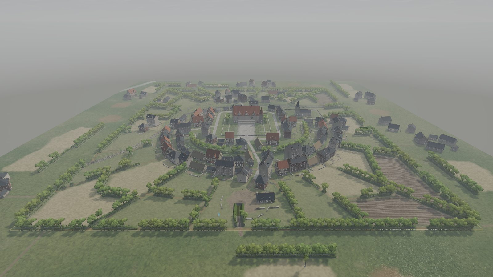
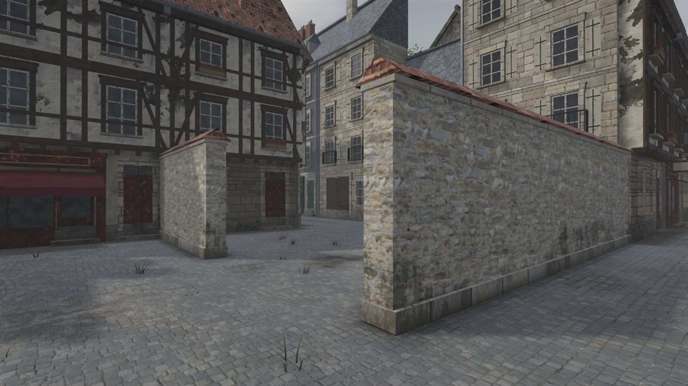
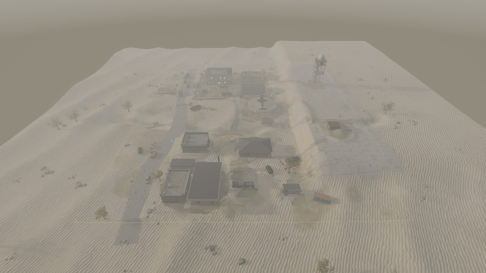
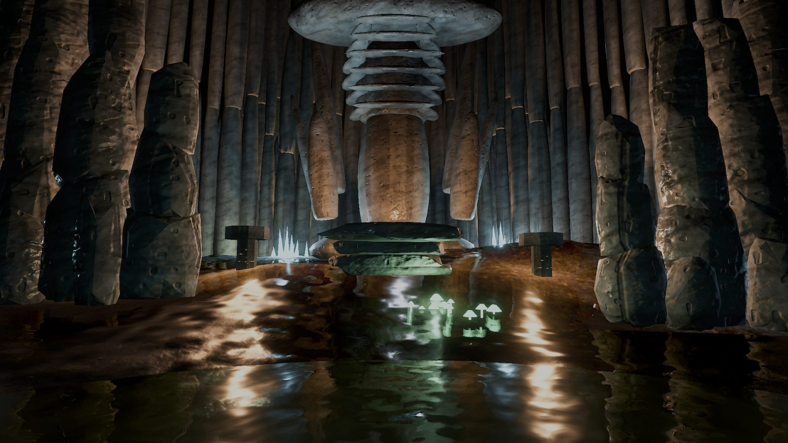
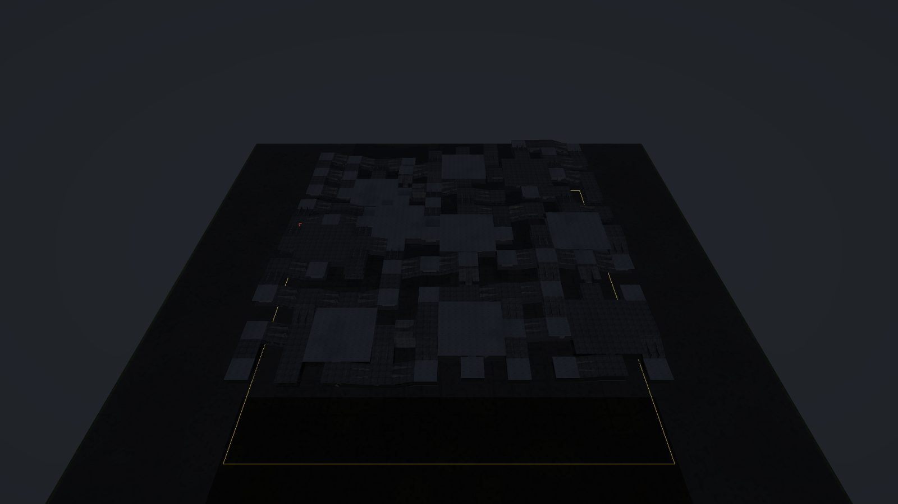
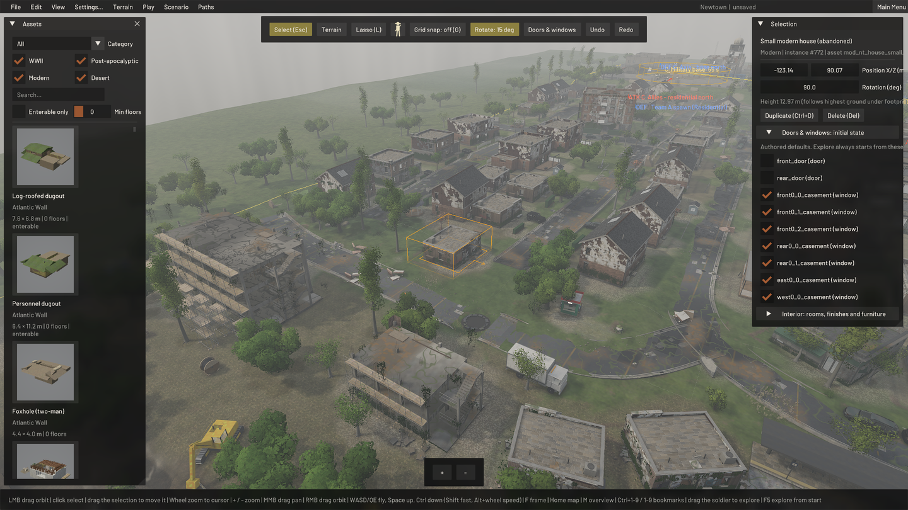

# Battle Foundry

Battle Foundry is a first-person shooter with a full map editor built in. Build a battlefield in **Creative** mode, press **F5** to walk it in first person, then fight over it alone against bots or with friends over LAN. It began as a Normandy 1944 map maker and now covers WWII and modern-day settings. Written from scratch in C++20 on OpenGL 4.5 (Windows); a Metal port for macOS lives in a separate fork. The executable is still named `NormandyMapmaker`.



| Newtown (battle royale) | Chateau town | Search and Destroy town |
|---|---|---|
|  |  |  |

| Desert outpost | Caverns | Tunnels |
|---|---|---|
|  |  |  |

The editor:



## Main features

**Game modes**
- **Assault** (attack and defend objectives), **Team Deathmatch**, **Solo** (free-for-all), **Search and Destroy** (plant or defuse, round based) and **Battle royale** (parachute in from a bomber, loot buildings, outlast a shrinking storm).
- Play alone against hundreds of bots or with friends over LAN.
- Pick the enemy type per side: soldiers of several factions (WWII Allied and German, modern, desert, special forces), zombies, and creature types such as brutes, spiders and mechs.

**Maps**
- Ready-made maps: D-day, Omaha Easy Red, Chateau town, Village Assault, Battle 1, Hollow village, Newtown (nine-district modern town), woodland and desert outposts, four Search and Destroy maps (town, yard, desert, Ashwood Hollow village), plus Caverns, Tunnels and Backrooms.
- Every map opens in the editor and can be changed or used as a starting point.

**Map editor**
- Hundreds of placeable assets: enterable, furnished houses and large buildings, bunkers, ruins, vehicles, field guns and scenery.
- Terrain sculpting, hills and biome generators, ground paint, water, and a lasso tool for selecting, moving and painting regions.
- Trenches, fences, barbed wire, walls and hedgerows are drawn as lines; trenches are dug into the terrain.

**Combat**
- More than 60 weapons, WWII and modern: rifles, submachine guns, machine guns, shotguns, sniper rifles, pistols, launchers, flamethrowers, grenades and melee, with calibrated iron sights and scopes.
- Battle royale loot: limited-weight inventory, backpacks, three levels of armour and helmets, healing items, and attachments (sights, suppressors, muzzle brakes, extended magazines).
- Seven soldier classes with their own weapons and abilities, chosen on a deploy screen with a choice of spawn point.
- Drivable tanks and jeeps, crewed anti-tank guns and machine-gun emplacements, called-in artillery.
- Destructible walls, roofs, doors and windows; craters; barbed wire that slows you down.
- Bots that use cover, flank, suppress, clear buildings, loot and move with the storm.

**Rendering**
- Image-based materials with 2K ground textures, time of day with a moon and night lighting, cloudy weather with moving cloud shadows, fog and light shafts.
- Dense grass and foliage, global illumination from light probes, temporal upscaling.
- Graphics presets from Ultra Low to High.

Third-party models, textures and sounds are listed with their authors and licences in [docs/credits.md](docs/credits.md).

## Download and install

There are no packaged releases yet, so you build the game from source. It takes a few minutes.

**Windows 10 / 11** (a GPU driver with OpenGL 4.5)

1. Install [CMake](https://cmake.org/download/) 3.24 or newer, [Ninja](https://ninja-build.org/) and a C++20 compiler. The reference toolchain is [LLVM-MinGW](https://github.com/mstorsjo/llvm-mingw/releases) (UCRT).
2. Get the code: press **Code > Download ZIP** on GitHub and unzip it, or clone it:

   ```bash
   git clone https://github.com/jarchenn/enlistedv2.git
   ```

3. Configure and build from the project folder. CMake downloads every library itself.

   ```bash
   cmake -S . -B build -G Ninja -DCMAKE_BUILD_TYPE=Release -DCMAKE_C_COMPILER=clang -DCMAKE_CXX_COMPILER=clang++
   ```

   ```bash
   cmake --build build
   ```

4. Run `build/NormandyMapmaker.exe`. The build copies `content/` next to it; keep the two together if you move the game.

**macOS:** the Metal version lives in a separate fork; this repository builds the Windows (OpenGL) game.

## First steps

The game opens on the **main menu**:

| Entry | What it does |
|---|---|
| CREATE MAP | Opens the editor (Creative) on a blank map |
| PLAY | Singleplayer, Host LAN or Join LAN |
| CHARACTER | Your soldier's body and primary weapon, and the AI types |
| SETTINGS | The settings window (below) |
| GUNS / VEHICLES | Stat editors for weapons and vehicles |
| CREDITS / QUIT | |

Menu keys: Up/Down (or W/S) to choose, Enter to open, Esc to go back.

**Start a match.** **PLAY > Singleplayer** (or **Play > Singleplayer...** in the editor) opens the setup window: pick a map, then a mode: Solo (free-for-all), Team Deathmatch, Assault (objectives), Battle royale or Search and Destroy. Each mode has its own rules (kill cap, respawns, rounds, loot era for battle royale), the bot counts and enemy types per side, and a bot difficulty (Recruit, Regular, Veteran). Press **START MATCH**.

**LAN.** One PC chooses **Host LAN**, sets up the match and opens the lobby; the others choose **Join LAN**, then **Search LAN** or type the host's address. The game uses UDP port 27960. Every PC needs the same build, content and map file; internet play is not supported.

**Edit a map.** **CREATE MAP** starts a blank map. In the editor, **File > Open** loads a built-in map (D-day, Chateau town, Newtown, Tunnels, Backrooms, Caverns, Outpost Woods, Outpost Desert) as an editable copy, or one of your own. Click a thumbnail in the **Assets** panel and left-click the ground to place it. Press **F5** to walk the map in first person, or drag the soldier icon from the toolbar onto the ground to start from that spot. Maps are saved as `.nmap.json` in `maps/` next to the executable. You can also pass a map file on the command line to open it in the editor.

## Settings

**SETTINGS** (main menu, the editor's **Settings...** menu, or the pause menu) has five tabs. Your choices are saved in `settings_user.json` next to the executable.

| Tab | Contains |
|---|---|
| Video | Preset (Ultra Low, Low, Medium, High, Custom), resolution scale and upscaling, shadows, ambient occlusion, reflections, bloom, light shafts, anti-aliasing, grass (Off to Ultra), render distance, time of day and weather, field of view (55-100), gamma, V-sync, FPS cap |
| Gameplay | Mouse and aiming sensitivity, invert Y, reduced motion, minimap, markers, reticle, gore |
| Audio | Master, effects, gunfire, interface, ambience |
| Keybindings | Rebind the first-person keys (defaults below); fixed keys cannot be rebound. **Reset keys** restores the defaults |
| Interface | UI scale, developer overlay, editor camera speeds, caches |

The game runs in a 1600x900 window; there is no fullscreen option yet.

## Controls

**Editor (Creative)**

| Action | Control |
|---|---|
| Orbit | Drag with the right mouse button (or the left, starting off the selection) |
| Pan | Drag with the middle mouse button |
| Zoom | Mouse wheel, toward the cursor |
| Fly | WASD; Q or Ctrl down, E or Space up; Shift faster; Alt+wheel sets the speed |
| Frame selection / whole map | F / Home |
| Overview map | M |
| Camera bookmarks | Ctrl+1-9 saves, 1-9 returns (saved with the map) |
| Place an asset | Click its thumbnail, then left-click the ground (repeats until Esc). The wheel rotates it |
| Select / move | Click an object; drag it to move it |
| Rotate selection | Z / X (15° steps, or smooth with **Rotate: free** on the toolbar) |
| Duplicate / delete | Ctrl+D / Del |
| Undo / redo | Ctrl+Z / Ctrl+Y |
| Grid snap / grid overlay | G / H |
| Lasso | L: select, raise or lower, paint ground or move land inside a drawn region, or draw lines. See [docs/lasso.md](docs/lasso.md) |
| Terrain brush | **Terrain** on the toolbar: raise, lower, smooth, flatten, hills, cliffs |
| New / open / save | Ctrl+N / Ctrl+O / Ctrl+S |
| Play-test | F5 |
| Stats | F3 |

A new blank map can be 100-4000 m on each side in 100 m steps.

**First person** (rebindable keys show their default)

| Action | Control |
|---|---|
| Move / sprint | WASD / Shift |
| Crouch (hold) / prone | Ctrl or C / Z |
| Jump / climb | Space / hold Space at a wall or obstacle |
| Lean | Hold Q / E (a tap is next weapon / interact) |
| Fire / aim | Left / right mouse button |
| Reload / fire mode | R / F |
| Weapons | 1, 2 guns; 3 knife; 4 grenades; Q or wheel cycles |
| Throw frag / smoke | H / J (smoke in matches) |
| Hold breath | Shift while aiming |
| Scope / iron sights | V (guns with both) |
| Interact | E: doors, windows, crates, weapon racks, guns, vehicles, loot |
| Flashlight | N |
| Map / scoreboard | M / hold Tab |
| Loadout panel | L |
| Artillery | 7 (classes that have it): click a target, then **Call in** |
| Pause menu | Esc (Resume, Controls, Settings, Return to start marker, Return to Creator, Main menu, Keep session changes) |
| Back to the editor | F5 |
| Return to start | Backspace |

**Vehicles and guns** (E to get in or out)

| Vehicle | Controls |
|---|---|
| Tank | WASD drive, mouse aims; LMB main gun; RMB zoom; Ctrl sight / open hatch; Space machine gun; R next shell (HE / AP) |
| Car / jeep | W/S throttle and brake, A/D steer, Space handbrake; Ctrl to the mounted gun and back |
| Helicopter | Space up, Ctrl down; W/S tilt; Shift+W/S fly forward / back; A/D strafe; LMB cannon, R rocket |
| Field gun | E, then 1 (aim) or 2 (move); LMB fire, R reload, X next round (HE / AT), T switch position |

**Battle royale**

| Action | Control |
|---|---|
| Jump from the bomber | Space |
| Free fall | Mouse steers (look down to dive), W/S/A/D, hold Left Alt to look around |
| Parachute | Space opens it; A/D turn, W faster, S or Space brake |
| Pick up / open a case | E |
| Inventory | Tab or I (drop, use, fit attachments) |
| Bandage / medkit | 7 / 8 |

**Search and Destroy**

| Action | Control |
|---|---|
| Plant / defuse | Hold E (plant 3.2 s; defuse 10 s, 5 s with a kit) |
| Drop the bomb | G |
| Buy menu | B |

**Build mode** (B, in the editor's play-test or a drop-in)

| Action | Control |
|---|---|
| Asset palette | Tab (a pick fills the current hotbar slot) |
| Hotbar slot | 1-9, 0 |
| Place / select / remove | Right mouse / left mouse / Del |
| Rotate | Wheel, Z / X, R |
| Undo | Ctrl+Z |
| Leave | B or Esc |

In a match, B gives the **Engineer** class a fixed menu instead: 1-5 pick an outpost, AT gun, barbed wire, sandbags or an ammo box, and holding the left mouse button builds it. See [docs/builder.md](docs/builder.md).

**Play-tests are not saved.** Everything you change while walking a map from the editor (breached walls, craters, built defences, opened doors) is thrown away when you go back, unless you choose **Keep session changes** in the pause menu.

## Build from source

CMake 3.24 or newer, Ninja and a C++20 compiler (reference: LLVM-MinGW clang, UCRT; MSVC has a project setup but is untested). Dependencies are pinned and fetched by CMake:

| Library | Version |
|---|---|
| GLFW | 3.4 |
| GLM | 1.0.1 |
| Dear ImGui | 1.91.5 |
| Jolt Physics | 5.6.0 |
| nlohmann/json | 3.11.3 |
| miniaudio | 0.11.21 |
| Recast & Detour | 1.6.0 |
| stb | pinned commit |

The OpenGL loader (GLAD, GL 4.5 core) is in `third_party/glad`. The build commands are under [Download and install](#download-and-install). If a path gets longer than Windows' 260-character limit, use a short build directory such as `C:\nmk\build`.

Assets are defined by `tools/build_assets.mjs` (Node.js). The generated JSON in `content/assets/` is committed, so you only need Node if you change an asset:

```bash
node tools/build_assets.mjs
```

## Tests

The self-tests drive the real game: editor operations, physics, weapons, AI and matches. Each writes a report to `build/selftest_out/`. To run every suite and print each tally:

```bash
bash tools/run_all_tests.sh build
```

Add `--bench` for the benchmarks or `--net` for the LAN test. A single suite runs with its own flag, for example:

```bash
build/NormandyMapmaker.exe --selftest-editor
```

Main suites:

| Flag | Covers |
|---|---|
| `--selftest`, then `--selftest-reopen maps/selftest_regression.nmap.json` | Editing, saving and reopening a map |
| `--selftest-editor`, `--selftest-terrain`, `--selftest-lasso`, `--selftest-snap`, `--selftest-autopath` | The editor's tools |
| `--selftest-damage`, `--selftest-pak`, `--selftest-env` | Destruction, ordnance, craters, building |
| `--selftest-weapons`, `--selftest-fps`, `--selftest-sights`, `--selftest-arsenal` | Weapons, sights, racks |
| `--selftest-move`, `--selftest-swim`, `--selftest-prone` | Movement |
| `--selftest-tanks`, `--selftest-interiors`, `--selftest-structures` | Vehicles and buildings |
| `--selftest-modes`, `--selftest-match`, `--selftest-rules`, `--selftest-royale`, `--selftest-sd` | Game modes |
| `--selftest-ai`, `--selftest-ai-course` | Bots and navigation |
| `--selftest-maps`, `--selftest-render`, `--selftest-lights`, `--selftest-textures`, `--selftest-grass`, `--selftest-settings` | Maps, rendering, settings |
| `--benchmark`, `--benchmark-stress` | Frame-time benchmarks |

Set `NMK_MUTE=1` to silence a normal launch (test runs are silent by default). [docs/testing.md](docs/testing.md) describes what the checks cover.

## Layout

```
src/            engine and game (renderer, physics, assets, map format, editor, first person, modes, AI, self-tests)
tools/          asset authoring kit (Node), test scripts and helpers
content/assets  asset definitions (data only; adding a file adds a catalog entry)
content/templates  built-in maps
content/examples   example and regression maps
content/settings   tuning data (movement, classes, bindings, modes)
docs/           design notes, formats, testing, credits, screenshots
third_party/glad   generated GL 4.5 core loader
```
