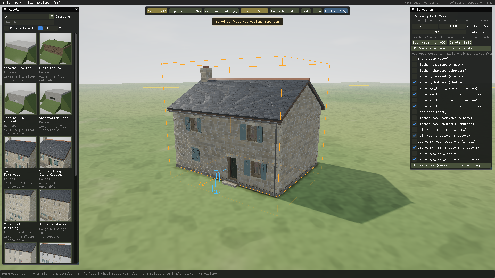
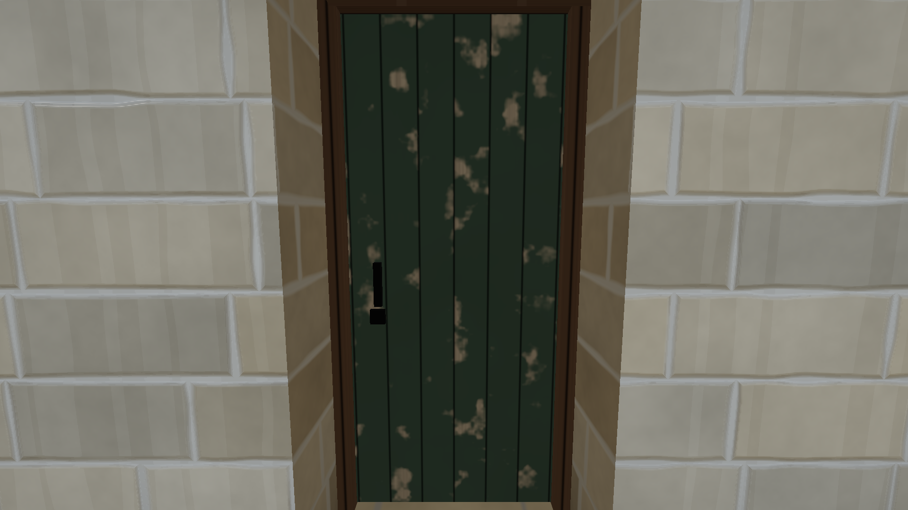
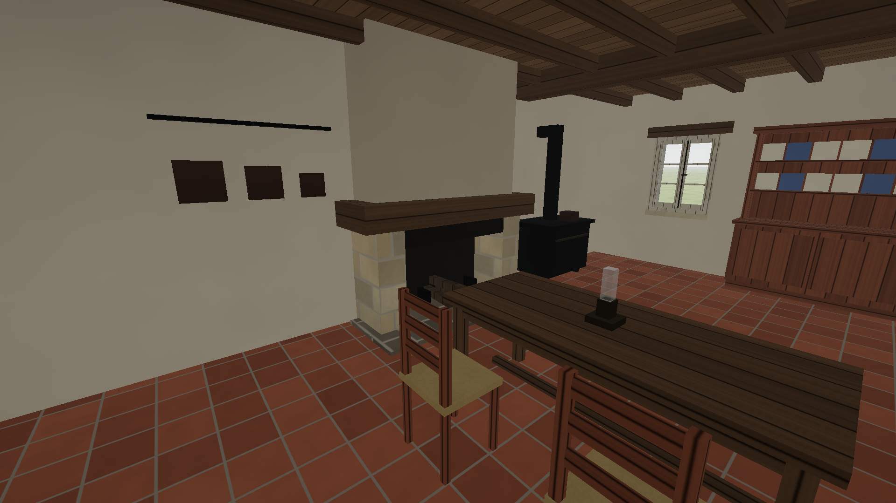
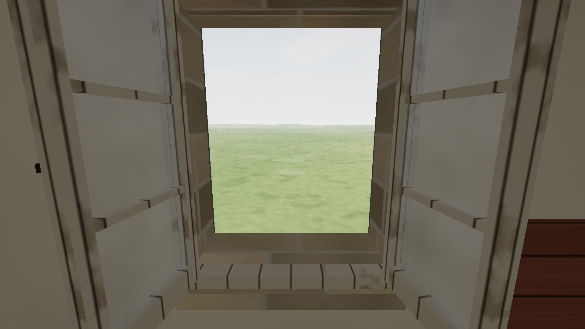

# Normandy Mapmaker

A first-person WWII map editor and shooter, set in Normandy in 1944. Build a battlefield in **Creative** mode, press **F5** to walk it in first person, then fight over it alone against bots or with friends over LAN. Written from scratch in C++20 on OpenGL 4.5 (Windows), with a Metal port for macOS.



| Explore: front door | Furnished kitchen | Upper-floor view |
|---|---|---|
|  |  |  |

## Main features

**Map editor**
- Hundreds of placeable assets: enterable, furnished houses and large buildings, bunkers, ruins, vehicles, field guns and scenery.
- Terrain sculpting, hills and biome generators, ground paint, water, and a lasso tool for selecting, moving and painting regions.
- Trenches, fences, barbed wire, walls and hedgerows are drawn as lines; trenches are dug into the terrain.
- Ready-made maps, including a D-day beach landing and a Chateau town.

**Combat**
- Game modes: Assault (objectives), Team Deathmatch and Solo, against bots or over LAN, with a zombie AI option.
- Seven soldier classes (Ranger, Recon, Heavy, Engineer, Machine Gunner, Assaulter, Tanker) with their own weapons and abilities, chosen on a deploy screen with a choice of spawn point.
- Period weapons with calibrated iron sights and scopes, launchers, a flamethrower, grenades, sticky explosion packs and called-in artillery.
- Drivable tanks, crewed anti-tank guns and machine-gun emplacements.
- Destructible walls, roofs, doors and windows; craters; barbed wire that slows you down.
- Bots that use cover, flank, suppress and clear buildings.

**Rendering**
- Image-based materials, time of day with a moon and night lighting, cloudy weather with moving cloud shadows, environmental fog and light shafts.
- Dense grass and foliage, global illumination from light probes, temporal upscaling.
- Graphics presets from Ultra Low to Ultra.

## Download and install

There are no packaged releases yet, so you build the game from source. It takes a few minutes.

**Windows 10 / 11** (a GPU driver with OpenGL 4.5)

1. Install [CMake](https://cmake.org/download/) 3.24 or newer, [Ninja](https://ninja-build.org/) and a C++20 compiler. The reference toolchain is [LLVM-MinGW](https://github.com/mstorsjo/llvm-mingw/releases) (UCRT).
2. Get the code: press **Code > Download ZIP** on GitHub and unzip it, or clone it:

   ```bash
   git clone https://github.com/jarchenn/enlistedv2.git
   ```

3. Configure and build from the project folder (all libraries are downloaded by CMake):

   ```bash
   cmake -S . -B build -G Ninja -DCMAKE_BUILD_TYPE=Release -DCMAKE_C_COMPILER=clang -DCMAKE_CXX_COMPILER=clang++
   ```

   ```bash
   cmake --build build
   ```

4. Run `build/NormandyMapmaker.exe`. The `content/` folder is copied next to it; keep them together if you move the game.

**macOS** (Apple silicon): the game runs through a Metal layer kept in a separate repository; it is built the same way with CMake and packaged as an app bundle with `tools/package_mac.sh`.

**First steps:** the game opens in the editor. Use **File > Open** to load D-day or Chateau town, or **File > New** for a blank map; pick an asset and click the ground to place it; press **F5** to walk around; use the **Play** menu to start a match. Saved maps go in `maps/` next to the executable. More build details are under [Build from source](#build-from-source).

## Controls

**Creative**

| Action | Control |
|---|---|
| Orbit | Hold the right mouse button and drag: orbits the ground point under the cursor (turns in place over the sky) |
| Pan | Hold the middle mouse button and drag: the ground follows the cursor |
| Zoom | Mouse wheel toward the cursor (when nothing is being placed or dragged) |
| Fly | WASD; Q/E to go down/up; speed follows the height above ground; Shift faster; Alt+wheel sets a speed multiplier |
| Frame | F frames the selection; Home frames the whole map |
| Overview map | M: top-down map with objectives, spawns and the attack path; wheel zoom, drag pan, click to move the camera there |
| Camera bookmarks | Ctrl+1-9 saves the view, 1-9 returns to it (saved with the map) |
| Place asset | Click a thumbnail, then left-click the ground. Placement repeats until you press Esc |
| Rotate | Mouse wheel while placing or dragging. Z/X rotate the selection. Toolbar toggles 15° snap or free rotation |
| Select / move | Left-click a building, including through a window, then drag. One drag is one undo step |
| Precise transform | X/Z position and rotation fields in the **Selection** panel |
| Duplicate / delete | Ctrl+D / Del |
| Lasso | L or the toolbar button: draw a freehand loop or a circle on the map (Shift adds, Alt cuts). **Objects**: select everything inside, drag one to move the group, Z/X turn it about its centre, Ctrl+D / Del. **Elevation**: raise or lower the region with a falloff ring, optionally fill the hollow with water up to its lip. **Paint**: 12 ground types (marsh, dirt, mud, gravel, sand, cobbles, rock, dry grass, ploughed field, leaf litter, scorched earth, pebbles). **Move land**: drag inside the region to slide the ground and what is on it. See [docs/lasso.md](docs/lasso.md) |
| Undo / redo | Ctrl+Z / Ctrl+Y |
| Grid snap / grid overlay | G / H |
| Door & window defaults | Checkboxes in the Selection panel, or the **Doors & windows** toolbar view (click labels in 3D) |
| Drop in | Drag the soldier from the toolbar onto the terrain; the drag direction sets the facing. Release to walk from there in first person; Esc returns the editor camera to where it was, P pauses. The drop point becomes the map's explore start |
| Explore from start | F5 or the toolbar button |
| Map size | New map (Ctrl+N): width and depth 400-4000 m in 100 m steps, presets 600x600 to 2000x4000, with a memory estimate |
| Save / open / new | Ctrl+S / Ctrl+O / Ctrl+N |
| Stats | F3 |

**Explore**

| Action | Control |
|---|---|
| Walk | WASD (run 2.875 m/s); Shift to sprint (5.75 m/s); hold Left Ctrl (or C) to crouch; Z toggles prone; Space to jump, or to get up when prone (Ctrl held: into a crouch). Getting up takes time: prone to standing 1.1 s, prone to crouch 0.75 s, crouch to standing 0.45 s, at the lower posture's pace with no sprint or jump until done. Hold Space at a 0.6–1.35 m obstacle (wall, sandbags, fence) to vault it; a tap is still a normal jump. Recoil climbs with every shot until you pull down or stop firing (crouched ×0.7, prone ×0.2; a bipod helps only when deployed). Interaction reach is 2.5 m (guns, crates, racks 3.0 m). Settings: `content/settings/movement.json` |
| Interact | E (aim within about 2 m; the prompt reads, e.g., `E — Open window`). Also crews a gun, leaves it, and draws ammunition from a crate |
| Fire / aim down sights | Left mouse / right mouse. A fresh press is needed after switching position, weapon or fire mode |
| Fire mode | F: AUTO / SEMI on the Thompson, MP 40, MG 42, FG 42 and the M2HB (AUTO default) |
| Weapon racks | E at an Allied or Axis rack opens its arsenal (Up/Down or mouse, Enter to equip, Esc to close). Launchers and the carried M2 come from racks |
| Carried M2HB | LMB deploys it on its tripod where you look and crews it; G beside your deployed M2 packs it up |
| Reload | R |
| Next weapon / loadout panel | Q / L (the panel holds the strict 6 June 1944 preset, range presentation, reduced motion and the grass preset) |
| Iron sights on a scoped rifle | V (M1C only) |
| At a gun | E then 1 (Aim, gunner at the sight) or 2 (Move, handler). T switches position. As handler, WASD rolls and turns the carriage; T again deploys it |
| Hold breath | Left Shift while aiming down the sights (5 s, then a 3 s recovery) |
| PaK 40 ammunition | X at the gun: next round HE / AT (takes effect at the next reload) |
| Build defences | B: 1 tank trap, 2 sandbags (again for the curved piece), Q cycle, R or wheel rotate, LMB place, RMB / B cancel. Green = valid, red = too steep (> 35°), in water or blocked. Sandbags snap end to end within 0.6 m |
| Damage debug | F4 (panel outlines and states) |
| Return to start | Backspace, or from the Esc menu |
| Menu | Esc (Resume / Return to start / Return to Creative). F5 also returns to Creative |

Every walkthrough is a playtest. Doors and windows start in their authored state each time you enter Explore, and returning to Creative throws away what you changed while exploring: breached walls, craters, moved guns, spent ammunition and emptied crates all reset. Defences built with B, broken windows, doors and shutters, and felled trees are part of the same overlay. To keep it, use **Esc → Apply session changes to map + return** (one undo step); **Edit → Clear applied damage** removes applied damage again.

**Grass** has four presets, Off, Low, Medium (default) and High, under **View → Grass** in Creative or in the loadout panel (L) in Explore. `--grass off|low|medium|high` sets it at launch.

**Render quality** (shadow cascades and softness, cloud shadows, ambient occlusion, light shafts, bloom, reflections, temporal AA, haze) is under **Render quality** in the loadout panel (L). `--legacy-look` restores the previous look, and `--rq-off taa|ssr|ssao|bloom|shafts|cascade|cloudshadow|wind` turns one feature off at launch. See [docs/rendering.md](docs/rendering.md). Sight blur (ADS depth of field) has been removed.

**Weapons and environment.** Five of the personal weapons (Garand / M1C, Thompson, BAR, MP 40, MG 42) use the supplied GLB models, aligned so ADS puts the real rear sight and front post on the screen centre; aimed shots leave the front sight along the sight line. The Kar98k, Carbine, Thompson, Garand, BAR (rear leaf folded, front sight only) and Panzerschreck (seen from its right side, shield to the left) have per-weapon sight calibration, and aiming in and out takes 0.25 s (`adsTime_s` in `content/settings/movement.json`).

**Grenades and knife.** Mk 2 / M24 grenades and a knife are in the roster: LMB throws or strikes, and **H** throws your side's grenade from any weapon.

**New placeables:**
- three barbed-wire obstacles;
- gravel, dirt and concrete paths (length and width in the Selection panel; they join end to end);
- an 8.8 cm Flak 18 emplacement.

See [docs/entities.md](docs/entities.md). Glass breaks, shutters and doors are shot off, and rounds penetrate them with an energy budget. HE and the PaK 40 AT round dig craters by the formula in [docs/fps-weapons.md](docs/fps-weapons.md). Trees (apple, oak, poplar) sway and can be felled; the sky has procedural clouds (View → Sky). View → First person toggles the sight blur and the arms.

**Range example.** Open **content/examples → Range: walls, bunker, ordnance**. It is a copy of Blank Slate with a masonry dairy, an MG casemate rotated 155°, an open grassy plot, a PaK 40, an M2HB on its tripod, and two crates.

## Build from source

You need CMake 3.24 or newer, Ninja, and a C++20 compiler. The reference toolchain is LLVM-MinGW clang 23 (UCRT). MSVC 2022 should also work but hasn't been tested. All dependencies are pinned and fetched by CMake:

GLFW 3.4, GLAD (GL 4.5 core, pre-generated in `third_party/glad`), GLM 1.0.1, Dear ImGui 1.91.5, Jolt Physics 5.6.0, nlohmann/json 3.11.3, stb_image_write, miniaudio 0.11.21, Recast & Detour 1.6.0 (zlib, bot navigation; see docs/credits.md).

```bash
cmake -S . -B build -G Ninja -DCMAKE_BUILD_TYPE=Release -DCMAKE_C_COMPILER=clang -DCMAKE_CXX_COMPILER=clang++
```

```bash
cmake --build build
```

The executable and a copy of `content/` end up in `build/`. With some toolchains the full path can exceed Windows' 260-character limit; if it does, use a short build directory (for example `C:\nmk\build`).

**Content** is generated by `tools/build_assets.mjs` with Node 18 or newer. The generated JSON is committed, so you only need Node if you change an asset:

```bash
node tools/build_assets.mjs
```

## Tests

The self-test drives the real editor operations, physics and character controller. It has two phases with a full process restart between them:

```bash
build/NormandyMapmaker.exe --selftest
```

```bash
build/NormandyMapmaker.exe --selftest-reopen build/maps/selftest_regression.nmap.json
```

```bash
build/NormandyMapmaker.exe --benchmark
```

The destruction / ordnance / environment suites and tools:

| Command | What it does |
|---|---|
| `--selftest-damage` | Wall panels on all 14 assets and ground deformation (impacts injected through `App::explode`) |
| `--selftest-pak` | PaK 40 with real fired shells: breach, stops, reposition, crater, crate |
| `--selftest-weapons` | The eight weapon entries: ammunition accounting, reloads, sights, recoil, resupply |
| `--selftest-grass` | Grass determinism, exclusion masks, rebuild on crater / reset / undo / apply |
| `--benchmark-stress` | Dense-grass flyover (Off, High, Medium on one path) and 40 HE impacts with smoke |
| `--build-range-map` | Regenerates `maps/range_example.nmap.json` (shipped as `content/examples/range.nmap.json`) |
| `--record-range` | Scripted run of the range example, written to `selftest_out/range_recording.avi` (MJPEG). Add `--no-video` for checks only |
| `--capture-materials <tag>` | Five fixed-camera material shots, `selftest_out/mat_<tag>_*.png` |
| `--selftest-fps` | Imported weapons, ADS alignment at three FOVs, sight-origin shots, sway / bob / breathing, IK arms, depth of field, hip and ADS stills |
| `--selftest-env` | Glass / shutter / door damage and penetration, crater formula, climbing out, PaK AT round, trees, clouds, tank trap, sandbags, blast occlusion, builder slope and snapping, Apply and undo |
| `--import-weapon-models <glb dir> [content dir]` | Bakes the GLB weapon models (`assets_src/weapons/` is not in git) into `content/weapons/models/` |
| `--weapon-sheets <dir>` | Orthographic side / rear calibration sheets of every weapon with sights and hand sockets marked |
| `--box-weapons` | Draw the procedural box weapons instead of the imported models |

`bash tools/run_all_tests.sh build` runs every functional suite and prints each tally.

Reports and screenshots are written to `build/selftest_out/`. The latest results are in [docs/report_A.txt](docs/report_A.txt) (212/212 passed), [docs/report_B.txt](docs/report_B.txt) (68/68 passed) and [docs/benchmarks.md](docs/benchmarks.md). [docs/testing.md](docs/testing.md) describes what each check covers.

## Layout

```
src/            engine + game (renderer, physics wrapper, assets, map format, editor, explore, self-test)
tools/          asset authoring kit (Node) that emits content/assets/*.json
content/assets  asset definitions (data only; adding a file adds a catalog entry)
content/templates  terrain templates
content/examples   example / regression map
docs/           status, formats, testing, benchmarks, research plans, screenshots
third_party/glad   generated GL 4.5 core loader
```
