# Furniture change requests (PR2 audit)

Every in-house furniture asset (`content/assets/furn_*.json`, built by `tools/gen_furniture.py`, `tools/gen_furniture_mil.py` and `tools/catalog_modern_furniture.mjs`) was captured from 1 m at standing eye height (1.62 m), 35 degrees off its front (`NMK_PROPS_NEAR=1.0 NMK_PROPS_NEAR_ONLY=1 --capture-props`), and set beside a reference photo of the real object (Wikimedia Commons, linked per item). The 92 imported paintings (`furn_art_*`) are models already and were not audited.

**Outcome:** 37 assets **replaced** by scanned Poly Haven models (CC0), 165 **kept** with a change request below. Replacement keeps the asset id, its parts as colliders / stand-ins, its furnishing envelope, its broken remains and its cover (content/settings/furniture_models.json, `src/assets.cpp` furnitureModelFor, fitted by `tools/props/furn_fit.py`), so placement, nav and gameplay do not change.

**How to execute a request:** edit the asset's builder (period pieces: `tools/gen_furniture.py`, military: `tools/gen_furniture_mil.py`, modern: `tools/catalog_modern_furniture.mjs`), keep the stated outer size (the footprint and height the furnishing planner reserves), regenerate, recapture with the command above (`NMK_PROPS=<id>`), and compare with the reference. Colours are linear albedo (r, g, b); roughness 0 = mirror, 1 = matte. A request may also be met by replacing the asset with an imported model of the same size and era: add it to `tools/props/furn_replace.json` and run `tools/props/furn_fit.py` (it refuses a model that would distort more than 30 %).

**About the references:** the photos were found automatically by searching Commons for each object; for some objects nothing usable came back (marked *no usable reference photo*). For those the request describes the real object from period sources instead.

**Shared fix for modern materials (applies wherever an entry says "brushed steel" or "laminate"):**
- *Brushed stainless:* albedo 0.62, 0.62, 0.60; metallic 1; roughness 0.30 with a fine directional brush normal (0.0005 m streaks along the panel's long axis); fingerprints / smudges only as a roughness variation (0.25-0.4) near handles, no dark blotches in the albedo.
- *White laminate:* albedo 0.85, 0.85, 0.83, roughness 0.45, a very fine stipple normal; edge banding 0.002 m slightly darker; no grain, no stains.
- *Painted steel (lockers, cabinets):* flat colour, roughness 0.4, wear only on edges and around handles (bare steel 0.6 grey, metallic), not overall mottling.
- *Product packaging (shop shelves):* replace plain colour blocks with a packaging atlas (cereal boxes, cans, bottles, detergent jugs: 8-12 designs, abstract graphics, no brand names or legible text), at least 3 distinct package shapes per shelf, faced and slightly irregular.

## Church

### `furn_bench`: Bench
*Rooms:* barn, church, class, hall, kitchen, mil_fighting, mil_passage, tavern, utility, workshop. *Size:* 1.4 x 0.3 m footprint, h 0.45 m.
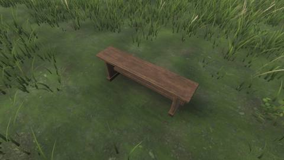
*Reference:* no usable reference photo found automatically; the request is written from the real object.
**KEEP: change request.** **Wrong:** one plank on two blocks; the trestle legs, through stretcher and wedges described in the asset are not legible.
**Change:** keep 1.40 x 0.30 x 0.45. Seat plank 0.05 m thick with eased edges (bevel 0.008). Two trestle legs 0.05 m thick boards with a 0.12 m arch cut-out at the foot, 0.08 m in from each end. Through stretcher 0.04 x 0.08 m at 0.15 m height, passing through both legs with a 0.04 m tusk wedge outside each leg. Oak, worn grey-brown (0.25, 0.18, 0.12), seat polished smooth (roughness 0.4) with darker hand grime in the middle, legs rough (0.7).

### `furn_candlesticks`: Candlesticks
*Rooms:* attic, bedroom, church, class, hall, kitchen, office, sitting, sitting_modern, tavern. *Size:* 0.24 x 0.1 m footprint, h 0.33 m.
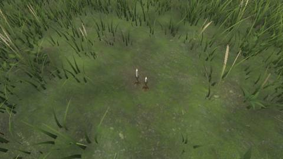
*Reference:* [Pair of candlesticks MET 47593.jpg](https://commons.wikimedia.org/wiki/File:Pair_of_candlesticks_MET_47593.jpg) (CC0)
**KEEP: change request.** **Wrong:** two tiny sticks; the pair reads as noise at 1 m.
**Change:** keep 0.24 x 0.10 x 0.33. Same construction as furn_candlestick scaled to 0.30 m (stem knops 0.010-0.018 m, base 0.085 m), set 0.13 m apart; candles at different burn heights (0.12 and 0.07 m) with drips. (Poly Haven brass_candleholders was tried as a replacement and refused: its pair is 1.05 m wide.)

### `furn_chair_ladder`: Ladder-back chair
*Rooms:* attic, bedroom, bedroom_modern, church, hall, kitchen, mil_command, office, office_modern, sitting, tavern. *Size:* 0.44 x 0.44 m footprint, h 0.95 m.
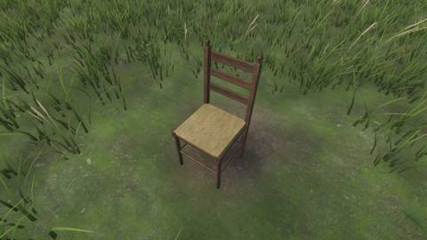
*Reference:* [Ladder-back side chair, by Charles Rennie Mackintosh, 1903, ebonized oak with rush seat - Huntington Art Museum - San Marino, CA - DSC01820.jpg](https://commons.wikimedia.org/wiki/File:Ladder-back_side_chair,_by_Charles_Rennie_Mackintosh,_1903,_ebonized_oak_with_rush_seat_-_Huntington_Art_Museum_-_San_Marino,_CA_-_DSC01820.jpg) (Public domain)
*After:* 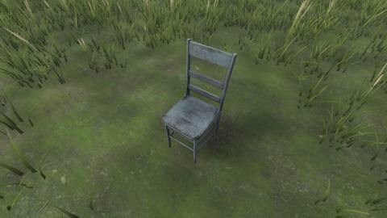
**REPLACED** by the Poly Haven model `painted_wooden_chair_02`: worn painted ladder-back chair (PR3) Fitted: turn 0 degrees, scale 0.72; baked into `content/assets/models/fr_chair_ladder/`.
*(The in-house version's audit note, kept for the stand-in that shows while the bake is missing):* **Wrong:** close to the reference (ladder back, rush seat), but the rails are all one thickness, the rush seat is a flat tan plate and the back slats are flat. **Change:** keep 0.44 x 0.44 x 0.95. Back posts 0.035 m round, slightly raked back (8 degrees) above the seat, finials 0.03 m. Four ladder slats 0.06 m tall, 0.012 m thick, bent (concave 0.02 m toward the sitter), decreasing spacing upward. Front legs 0.03 m round, two stretchers per side at 0.12 and 0.25 m. Seat: rush in the albedo / normal: four triangular quadrants of twisted rush meeting at the centre (diagonal X), rolls 0.012 m, straw-olive (0.42, 0.37, 0.22), 0.03 m thick rounded edge. Wood: dark stained beech (0.18, 0.11, 0.07), worn lighter on the front stretcher.

### `furn_chest`: Blanket chest
*Rooms:* attic, barn, bedroom, church, hall, office, sitting, utility, workshop. *Size:* 1.03 x 0.53 m footprint, h 0.57 m.
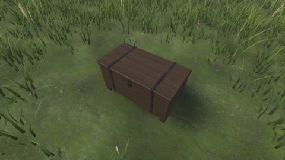
*Reference:* [Coffre Anglais en cuir à décor de clous de cuivre, 1227.jpg](https://commons.wikimedia.org/wiki/File:Coffre_Anglais_en_cuir_%C3%A0_d%C3%A9cor_de_clous_de_cuivre,_1227.jpg) (CC0)
*After:* 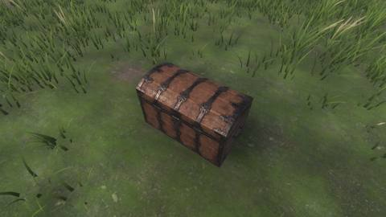
**REPLACED** by the Poly Haven model `treasure_chest`: strapped wooden trunk (PR3) Fitted: turn 0 degrees, scale 1.00; baked into `content/assets/models/fr_chest/`.
*(The in-house version's audit note, kept for the stand-in that shows while the bake is missing):* **Wrong:** box with two straps; the reference coffer has bracket feet, a moulded lid, studs and a big lock plate. **Change:** keep 1.03 x 0.53 x 0.57. Lid: 0.04 m board with a moulded edge (0.015 m round-over), overhanging 0.02 m. Front: three panels (0.28 m) in a frame (0.06 m stiles), panels raised 0.01 m. Iron: two straps 0.04 m over the lid and down the front with rows of 0.012 m round-head studs every 0.05 m; a 0.10 x 0.14 m lock plate with a hasp; side handles (0.12 m loops). Bracket feet 0.07 m tall, ogee cut. Oak, dark waxed (0.15, 0.09, 0.05, roughness 0.45), lighter worn edges; iron black with rust in the corners.

### `furn_frame_dusk`: Painting (evening)
*Rooms:* bedroom, church, hall, sitting. *Size:* 0.5 x 0.05 m footprint, h 0.75 m.
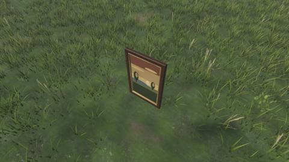
*Reference:* no usable reference photo found automatically; the request is written from the real object.
**KEEP: change request.** **Wrong (1 m capture, hung in the air without its wall):** frames read (thin wood moulding); paintings blurry, frames too thin and flat.
**Change:** Gilt frames: moulded profile 0.05-0.08 m (two steps and a bead), gold leaf (0.75, 0.58, 0.28, metallic, roughness 0.3) worn to red bole on the corners; canvas with craquelure in the normal and a slight varnish sheen (roughness 0.35). Since DEC1 most wall pictures are the imported paintings (furn_art_*): keep these as the fallback.

### `furn_pew`: Church pew
*Rooms:* church. *Size:* 2.1 x 0.55 m footprint, h 1.02 m.
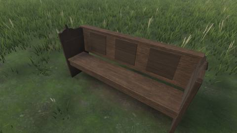
*Reference:* [Oak pews in Broomfield Church - geograph.org.uk - 1086535.jpg](https://commons.wikimedia.org/wiki/File:Oak_pews_in_Broomfield_Church_-_geograph.org.uk_-_1086535.jpg) (CC BY-SA 2.0)
**KEEP: change request.** **Wrong:** panelled back pew reads, but the ends are plain boards and the back panels are flat recesses.
**Change:** keep 2.1 x 0.55 x 1.02. Ends: 0.05 m oak boards with a scrolled top (carved C-scroll, 0.15 m) and a moulded edge; back: three raised panels with a 0.04 m moulded top rail; book ledge 0.12 m on the back with a 0.02 m lip; kneeler 0.10 m board. Oak darkened by age (0.16, 0.10, 0.06), polished seat and top rail (roughness 0.35).

### `furn_picture`: Picture frame
*Rooms:* bedroom, church, class, hall, kitchen, mil_quarters, office, sitting, tavern. *Size:* 0.56 x 0.04 m footprint, h 0.42 m.
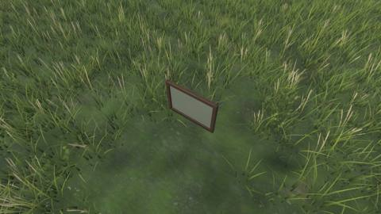
*Reference:* no usable reference photo found automatically; the request is written from the real object.
*After:* 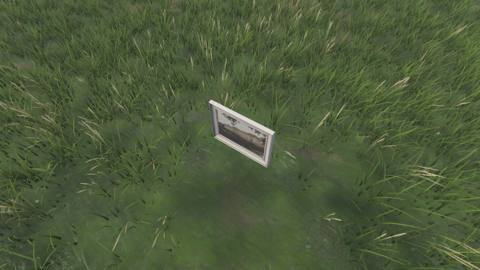
**REPLACED** by the Poly Haven model `hanging_picture_frame_02`: framed print (PR3) Fitted: turn 0 degrees, scale 0.85; baked into `content/assets/models/fr_picture/`.
*(The in-house version's audit note, kept for the stand-in that shows while the bake is missing):* **Wrong (1 m capture, hung in the air without its wall):** a plain flat frame with a pale print. **Change:** Picture frame: as the furn_frame_* request; the portrait as a sepia photograph (0.62, 0.52, 0.38 tones) behind glass (reflection, roughness 0.05) in a black or oak frame.

### `furn_sconce_candle`: Candle sconce
*Rooms:* bedroom, church. *Size:* 0.32 x 0.12 m footprint, h 0.28 m.
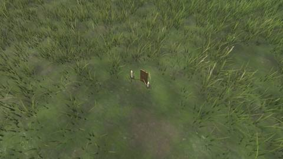
*Reference:* no usable reference photo found automatically; the request is written from the real object.
**KEEP: change request.** **Wrong (1 m capture, hung in the air without its wall):** a tiny brass plate with two specks.
**Change:** Repoussé brass back plate 0.20 x 0.28 m with a shell motif, two scrolled arms, drip pans and tallow candles.

### `furn_table_dining`: Dining table
*Rooms:* church, kitchen, office, sitting, tavern. *Size:* 1.7 x 0.86 m footprint, h 0.76 m.
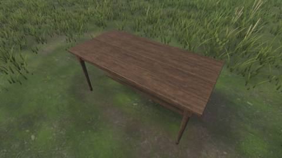
*Reference:* no usable reference photo found automatically; the request is written from the real object.
*After:* 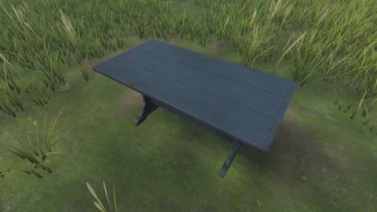
**REPLACED** by the Poly Haven model `painted_wooden_table`: painted farmhouse table (PR3) Fitted: turn 0 degrees, scale 0.75; baked into `content/assets/models/fr_table_dining/`.
*(The in-house version's audit note, kept for the stand-in that shows while the bake is missing):* **Wrong:** reads; tapered legs plain; board joints invisible; top too clean. **Change:** keep 1.70 x 0.86 x 0.76. Top: 4 boards with 0.003 m gaps, end cleats, wear (lighter, polished) in the middle and around the edges, knife marks; apron 0.10 m with a drawer at one end; legs 0.07 m square tapering to 0.045 m. Oak (0.32, 0.22, 0.12).

## School (period classroom)

### `furn_bookcase`: Bookcase
*Rooms:* class, office, sitting. *Size:* 1.06 x 0.38 m footprint, h 2.04 m.
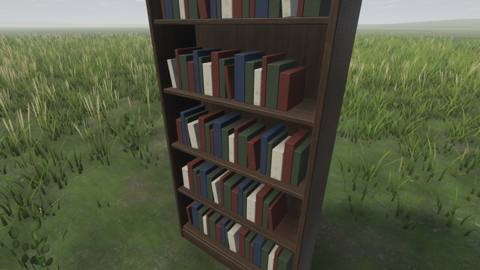
*Reference:* no usable reference photo found automatically; the request is written from the real object.
*After:* 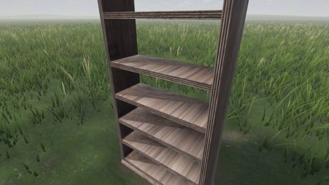
**REPLACED** by the Poly Haven model `wooden_bookshelf_worn`: worn wooden bookcase (PR3) Fitted: turn 0 degrees, scale 0.79; baked into `content/assets/models/fr_bookcase/`.
*(The in-house version's audit note, kept for the stand-in that shows while the bake is missing):* **Wrong:** books are uniform flat coloured blocks in saturated primaries (red / blue / white) all the same height, shelves without depth shadow; the oak case is fine. **Change:** keep 1.06 x 0.38 x 2.04. Books: 3-4 height classes per shelf (0.18-0.30 m), widths 0.025-0.06 m, 5-15 % leaning, gaps; spines in muted cloth colours (oxblood 0.35, 0.08, 0.06; bottle green 0.08, 0.18, 0.10; navy 0.08, 0.10, 0.20; tan 0.45, 0.35, 0.22; faded black), two 0.006 m gilt bands per spine (normal + 0.6 roughness brass); spines set back 0.02 m from the shelf front so the shelf edge casts a line. Case: add a 0.06 m cornice and a 0.08 m plinth; shelf fronts 0.02 m lipped.

### `furn_books`: Book stack
*Rooms:* attic, bedroom, bedroom_modern, class, class_modern, hall, kitchen, lobby, mil_command, office, office_modern, sitting, sitting_modern, ward, workshop. *Size:* 0.26 x 0.2 m footprint, h 0.14 m.
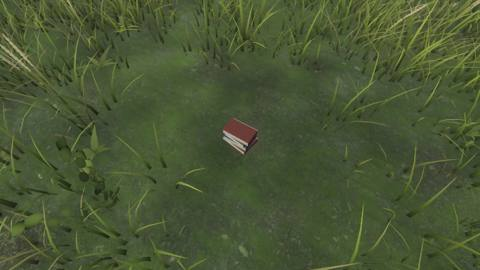
*Reference:* [Old Books 01.JPG](https://commons.wikimedia.org/wiki/File:Old_Books_01.JPG) (CC0)
**KEEP: change request.** **Wrong:** four flat blocks in one colour family; no spine bands, no page block, no cloth corners.
**Change:** keep 0.26 x 0.20 x 0.14. Four books 0.03-0.045 m thick, slightly different sizes (0.20-0.24 m long), stacked with 3-8 degree twists; cloth covers in oxblood, bottle green, navy and tan (see furn_bookcase), worn lighter on corners, page blocks cream (0.82, 0.78, 0.66) with fine page lines in the normal, raised spine bands, a gilt title block (abstract, no text). (Poly Haven book_encyclopedia_set_01 was tried and refused: a 0.55 m row of standing books, the wrong shape for a stack.)

### `furn_bucket`: Bucket
*Rooms:* attic, barn, bedroom, bedroom_modern, cellar, class, hall, kitchen, mil_command, office, office_modern, ruin, sitting, utility, workshop. *Size:* 0.3 x 0.3 m footprint, h 0.37 m.
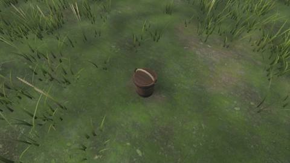
*Reference:* no usable reference photo found automatically; the request is written from the real object.
*After:* 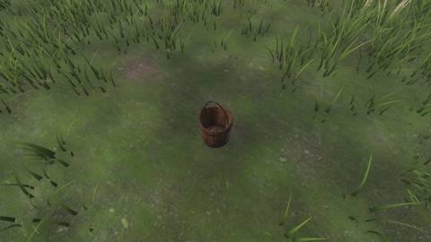
**REPLACED** by the Poly Haven model `wooden_bucket_01`: coopered pail with handle Fitted: turn 0 degrees, scale 0.84; baked into `content/assets/models/fr_bucket/`.

### `furn_chair_slat`: Slat-back chair
*Rooms:* attic, bedroom, bedroom_modern, class, kitchen, mil_command, mil_radio, office, office_modern, ruin, sitting, tavern. *Size:* 0.44 x 0.44 m footprint, h 0.95 m.
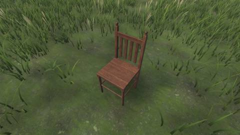
*Reference:* no usable reference photo found automatically; the request is written from the real object.
*After:* 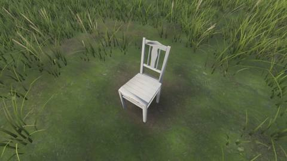
**REPLACED** by the Poly Haven model `painted_wooden_chair_01`: painted farmhouse chair, slatted back Fitted: turn 0 degrees, scale 0.91; baked into `content/assets/models/fr_chair_slat/`.

### `furn_coat_hooks`: Coat hooks
*Rooms:* attic, barn, bedroom, class, hall, kitchen, office, tavern, utility, workshop. *Size:* 0.82 x 0.12 m footprint, h 1.06 m.
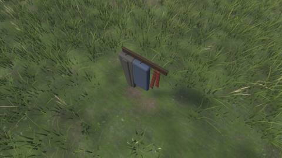
*Reference:* no usable reference photo found automatically; the request is written from the real object.
**KEEP: change request.** **Wrong (1 m capture, hung in the air without its wall):** the garments are grey and blue slabs with no folds; hooks hidden.
**Change:** Oak board 0.82 m with 3 cast-iron double hooks; the greatcoat must hang with folds (see furn_coat_stand), not as a slab.

### `furn_coat_rack`: Coat pegs
*Rooms:* bedroom, class, hall, kitchen, mil_command, mil_passage, mil_quarters, mil_radio, office, tavern, utility, workshop. *Size:* 0.9 x 0.12 m footprint, h 0.93 m.
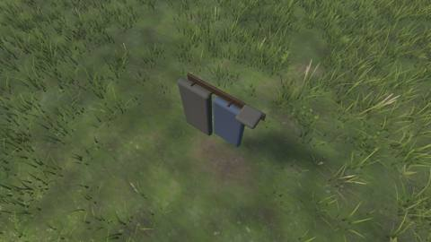
*Reference:* no usable reference photo found automatically; the request is written from the real object.
**KEEP: change request.** **Wrong (1 m capture, hung in the air without its wall):** as furn_coat_hooks: slabs, cap not readable.
**Change:** Peg rail with turned pegs, a wool coat, a work jacket (blue cotton, bleu de travail) and a flat cap: folds as furn_coat_stand.

### `furn_desk`: Writing desk
*Rooms:* bedroom, bedroom_modern, class, mil_command, office, office_modern, sitting. *Size:* 1.15 x 0.62 m footprint, h 0.82 m.
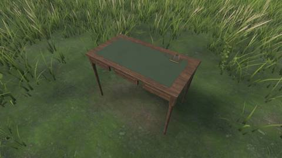
*Reference:* [Writing table (bureau plat) MET ES2403.jpg](https://commons.wikimedia.org/wiki/File:Writing_table_(bureau_plat)_MET_ES2403.jpg) (CC0)
**KEEP: change request.** **Wrong:** straight square legs and a flat green top; the bureau plat in the reference has cabriole legs, a curved apron and gilt mounts.
**Change:** keep 1.15 x 0.62 x 0.82. Top: 0.03 m with a moulded edge, inset leather 1.0 x 0.5 m (deep green 0.10, 0.18, 0.12, roughness 0.6, gold tooled border line in albedo). Apron 0.10 m with a shallow serpentine curve (3 arcs) on the front, three drawers outlined (0.005 m gaps), brass pulls. Legs: cabriole, 0.72 m, S-curve (4-5 segments), 0.05 m at the knee tapering to 0.03 m, brass sabot at the foot. Wood: walnut (0.22, 0.13, 0.07), polished (0.3). Inkwell (glass with brass lid) and blotter keep.

### `furn_frame_landscape`: Painting (landscape)
*Rooms:* bedroom, bedroom_modern, class, hall, office, sitting, sitting_modern, tavern. *Size:* 0.9 x 0.05 m footprint, h 0.62 m.
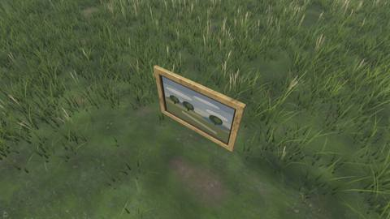
*Reference:* no usable reference photo found automatically; the request is written from the real object.
**KEEP: change request.** **Wrong (1 m capture, hung in the air without its wall):** frames read (thin wood moulding); paintings blurry, frames too thin and flat.
**Change:** Gilt frames: moulded profile 0.05-0.08 m (two steps and a bead), gold leaf (0.75, 0.58, 0.28, metallic, roughness 0.3) worn to red bole on the corners; canvas with craquelure in the normal and a slight varnish sheen (roughness 0.35). Since DEC1 most wall pictures are the imported paintings (furn_art_*): keep these as the fallback.

### `furn_frame_small`: Painting (small)
*Rooms:* attic, bedroom, bedroom_modern, class, hall, kitchen, mil_command, office, office_modern, sitting, utility. *Size:* 0.36 x 0.05 m footprint, h 0.28 m.
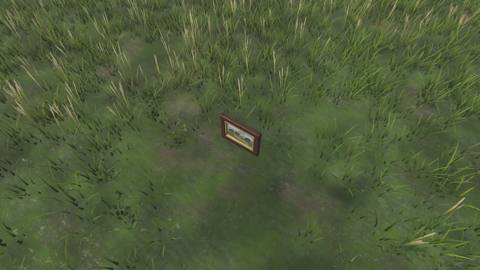
*Reference:* no usable reference photo found automatically; the request is written from the real object.
**KEEP: change request.** **Wrong (1 m capture, hung in the air without its wall):** frames read (thin wood moulding); paintings blurry, frames too thin and flat.
**Change:** Gilt frames: moulded profile 0.05-0.08 m (two steps and a bead), gold leaf (0.75, 0.58, 0.28, metallic, roughness 0.3) worn to red bole on the corners; canvas with craquelure in the normal and a slight varnish sheen (roughness 0.35). Since DEC1 most wall pictures are the imported paintings (furn_art_*): keep these as the fallback.

### `furn_jars`: Preserving jars
*Rooms:* attic, barn, cellar, class, kitchen, kitchen_modern, office, prokitchen, tavern, utility, workshop. *Size:* 0.22 x 0.2 m footprint, h 0.21 m.
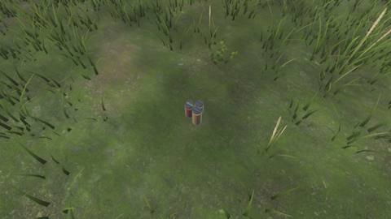
*Reference:* [Preserved lemon in a clip top jar, 4 years old.jpg](https://commons.wikimedia.org/wiki/File:Preserved_lemon_in_a_clip_top_jar,_4_years_old.jpg) (CC BY-SA 4.0)
**KEEP: change request.** **Wrong:** three tiny grey cylinders; the zinc lids and the contents do not read.
**Change:** keep 0.22 x 0.20 x 0.21. Three jars 0.09-0.11 m diameter, 0.14-0.19 m tall, rounded shoulders; glass (alpha 0.35, slight green, roughness 0.05) with visible contents: halved apricots / plums / beans (orange 0.75, 0.45, 0.10; deep purple; green), a wire bail clamp and an orange rubber seal on one (Le Parfait type), screw zinc lids (dull grey, roughness 0.5) on the others.

### `furn_lamp`: Oil lamp
*Rooms:* attic, barn, bedroom, bedroom_modern, class, hall, kitchen, mil_command, mil_plant, mil_quarters, mil_radio, office, office_modern, sitting, tavern, utility, workshop. *Size:* 0.12 x 0.12 m footprint, h 0.35 m.
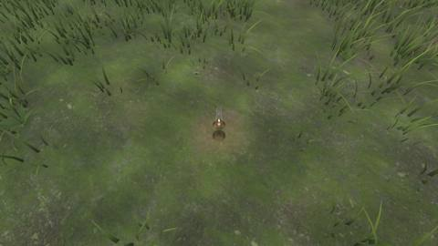
*Reference:* [History of Inventions USNM 06 Lamp 02.jpg](https://commons.wikimedia.org/wiki/File:History_of_Inventions_USNM_06_Lamp_02.jpg) (Public domain), partial match
*After:* 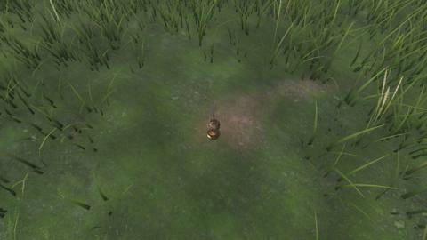
**REPLACED** by the Poly Haven model `vintage_oil_lamp`: brass oil lamp with glass chimney Fitted: turn 0 degrees, scale 0.56; baked into `content/assets/models/fr_lamp/`.

### `furn_papers`: Scattered papers
*Rooms:* bedroom, bedroom_modern, class, class_modern, kitchen, lobby, mil_command, mil_quarters, mil_radio, office, office_modern, sitting, sitting_modern. *Size:* 0.6 x 0.6 m footprint, h 0.03 m.
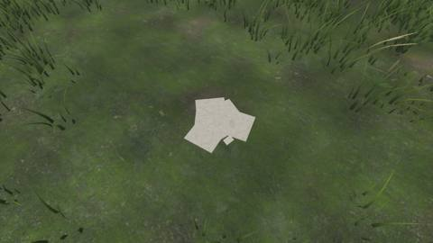
*Reference:* [DSC 7584 Dust-covered dilapidated interior of an abandoned building with debris scattered across the floor and a broken balcony railing overlooking a misty treeline.jpg](https://commons.wikimedia.org/wiki/File:DSC_7584_Dust-covered_dilapidated_interior_of_an_abandoned_building_with_debris_scattered_across_the_floor_and_a_broken_balcony_railing_overlooking_a_misty_treeline.jpg) (CC BY-SA 4.0), partial match
**KEEP: change request.** **Wrong:** fine at 1 m; sheets are pure white and perfectly flat.
**Change:** keep 0.60 x 0.60 x 0.03. Off-white / yellowed paper (0.85, 0.82, 0.72), 2 sheets with a 0.01 m curl at a corner, printed text texture (generic, unreadable) on a folded newspaper, one envelope; slight dirt.

### `furn_portrait`: Portrait
*Rooms:* attic, bedroom, bedroom_modern, class, hall, mil_command, office, office_modern, sitting. *Size:* 0.3 x 0.03 m footprint, h 0.36 m.
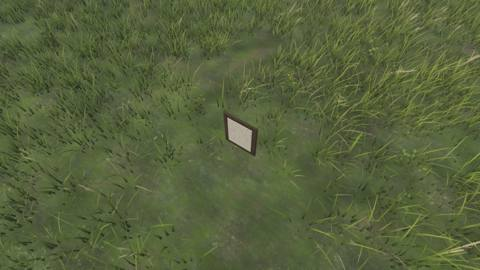
*Reference:* no usable reference photo found automatically; the request is written from the real object.
**KEEP: change request.** **Wrong (1 m capture, hung in the air without its wall):** a plain flat frame with a pale print.
**Change:** Picture frame: as the furn_frame_* request; the portrait as a sepia photograph (0.62, 0.52, 0.38 tones) behind glass (reflection, roughness 0.05) in a black or oak frame.

### `furn_school_desk`: School desk
*Rooms:* class. *Size:* 1.1 x 0.8 m footprint, h 0.76 m.
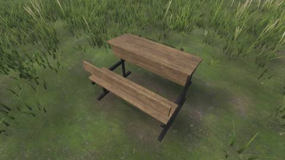
*Reference:* [School efficiency; a manual of modern school management (1917) (14595648730).jpg](https://commons.wikimedia.org/wiki/File:School_efficiency;_a_manual_of_modern_school_management_(1917)_(14595648730).jpg) (No restrictions)
**KEEP: change request.** **Wrong:** twin desk on iron ends reads; the sloped lid, inkwell holes and cast-iron scroll ends are faint.
**Change:** keep 1.1 x 0.8 x 0.76. Desk top: sloped 12 degrees, 0.03 m, with a flat 0.08 m strip at the back holding two inkwell holes (0.03 m with brass lids) and a pen groove. Bench: one 0.25 m seat plank and a back rail. Ends: cast iron with scrollwork (cut-out pattern in an alpha / normal panel), black (0.04, 0.04, 0.04). Wood: pine varnished honey (0.45, 0.30, 0.15) with carved initials scratches.

### `furn_shelf`: Shelf unit
*Rooms:* cellar, class, kitchen, mil_command, office, sitting, tavern, utility, workshop. *Size:* 1.0 x 0.32 m footprint, h 1.60 m.
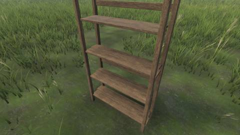
*Reference:* no usable reference photo found automatically; the request is written from the real object.
*After:* 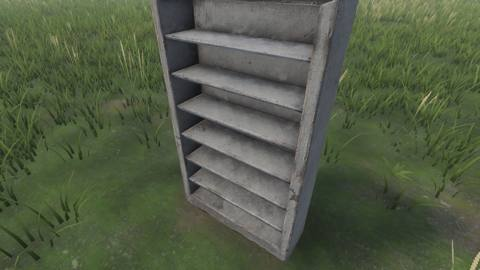
**REPLACED** by the Poly Haven model `shelf_01`: tall wooden shelf (PR3) Fitted: turn 0 degrees, scale 0.98; baked into `content/assets/models/fr_shelf/`.
*(The in-house version's audit note, kept for the stand-in that shows while the bake is missing):* **Wrong:** reads; uprights plain, shelves bare in the capture. **Change:** keep 1.0 x 0.32 x 1.60. Uprights 0.04 m with notched supports; shelves 0.025 m pine with a worn front edge; the planner already puts items on it; pine colour (0.50, 0.36, 0.20).

### `furn_stove`: Cooking range
*Rooms:* class, kitchen. *Size:* 1.02 x 0.65 m footprint, h 1.82 m.
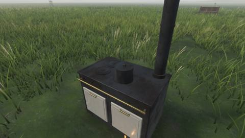
*Reference:* no usable reference photo found automatically; the request is written from the real object.
**KEEP: change request.** **Wrong:** black box with white oven doors; the cuisinière has a brass rail, enamelled doors with nickel trim, hot plate rings and a flue.
**Change:** keep 1.02 x 0.65 x 1.82 (with flue). Body: cast iron black (roughness 0.5) on 0.10 m legs; two oven doors in cream enamel (0.85, 0.80, 0.68, roughness 0.15) with nickel frames and handles; a 0.02 m brass towel rail along the front; top with 3 concentric hot plate rings (0.20 m, removable centre discs in the normal); a 0.12 m flue rising and bending into the wall; a marmite on top.

### `furn_stove_potbelly`: Pot-bellied stove
*Rooms:* class, kitchen, mil_quarters. *Size:* 0.42 x 0.42 m footprint, h 1.80 m.
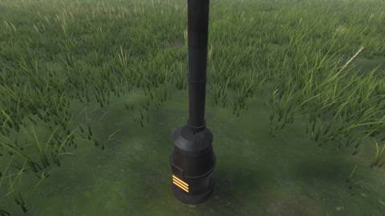
*Reference:* [Romesse pot belly stove in Leasowe Lighthouse.jpg](https://commons.wikimedia.org/wiki/File:Romesse_pot_belly_stove_in_Leasowe_Lighthouse.jpg) (CC BY-SA 4.0)
**KEEP: change request.** **Wrong:** thin black cylinder with a glowing slot; the reference pot-belly is a fat round body on legs.
**Change:** keep 0.42 x 0.42 x 1.80. Body: bulging cylinder 0.36 m max diameter at mid height (5-6 ring frustums), a 0.20 m fire door with a mica window (orange emissive behind), a draught grate below, 3 cabriole legs 0.12 m, a top collar and a 0.12 m flue pipe with one elbow. Cast iron black, roughness 0.55, rust ring near the base.

### `furn_wall_clock`: Wall clock
*Rooms:* bedroom, bedroom_modern, class, kitchen, mil_command, mil_radio, office, office_modern, sitting, tavern. *Size:* 0.32 x 0.11 m footprint, h 0.61 m.
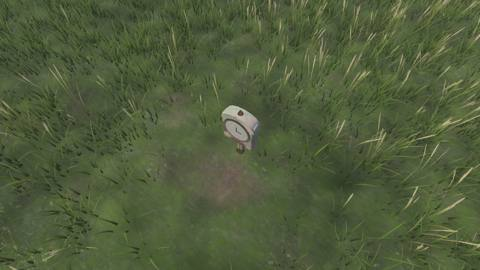
*Reference:* no usable reference photo found automatically; the request is written from the real object.
**KEEP: change request.** **Wrong (1 m capture, hung in the air without its wall):** (not in the wall shots).
**Change:** Cartel clock: violin-shaped painted case 0.32 x 0.61 m (cream with flowers or green), a convex enamel dial 0.16 m with black numerals and hands, a pendulum window with a brass bob. (Poly Haven wall_clock was tried and refused: it is a round 0.32 m clock; it now replaces furn_mod_wall_clock.)

### `furn_wall_shelf`: Wall shelf
*Rooms:* barn, bedroom, cellar, class, kitchen, office, sitting, tavern, utility, workshop. *Size:* 0.9 x 0.26 m footprint, h 0.20 m.
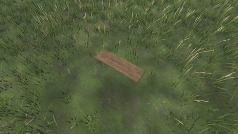
*Reference:* no usable reference photo found automatically; the request is written from the real object.
**KEEP: change request.** **Wrong (1 m capture, hung in the air without its wall):** (not in the wall shots).
**Change:** Pine board 0.9 x 0.26 x 0.025 on two shaped brackets (ogee cut), worn edge.

## Café, tavern and shop

### `furn_barrel`: Cask
*Rooms:* barn, cellar, kitchen, mil_plant, ruin, tavern, utility, workshop. *Size:* 0.6 x 0.6 m footprint, h 0.88 m.
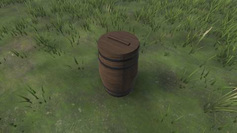
*Reference:* no usable reference photo found automatically; the request is written from the real object.
*After:* 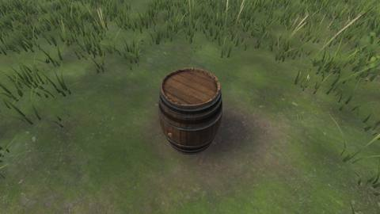
**REPLACED** by the Poly Haven model `wine_barrel_01`: oak cask, real staves and hoops Fitted: turn 0 degrees, scale 0.79; baked into `content/assets/models/fr_barrel/`.

### `furn_barrel_rack`: Casks on a cradle
*Rooms:* barn, cellar, tavern, utility. *Size:* 0.85 x 1.15 m footprint, h 0.70 m.
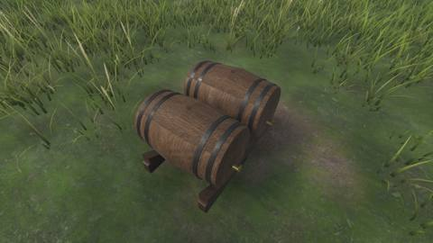
*Reference:* no usable reference photo found automatically; the request is written from the real object.
**KEEP: change request.** **Wrong:** casks are smooth cylinders with flat painted hoop bands; no bilge (belly), no head chime, taps are tiny stubs; cradle is two plain beams.
**Change:** keep 0.85 x 1.15 x 0.70. Each cask: bilge diameter 0.56 m tapering to 0.48 m at the heads (frustum pairs or 6 stacked rings), 28 staves visible as vertical grooves in the normal map; 4 iron hoops per cask, 0.04 m wide, 0.006 m proud, dark rusty iron (0.10, 0.08, 0.07, roughness 0.6, metallic 0.7); heads recessed 0.02 m inside a chime lip, head boards horizontal with a bung. Brass tap 0.10 m in the lower head. Cradle: two 0.10 x 0.10 m oak sleepers with two shaped saddles each (concave top following the cask), pegged. Wine stain darkening under the taps and on the floor-facing staves.

### `furn_bottles`: Bottles
*Rooms:* attic, barn, cellar, kitchen, mil_command, mil_plant, mil_quarters, office, sitting, tavern, utility, workshop. *Size:* 0.26 x 0.2 m footprint, h 0.28 m.
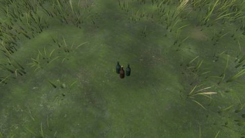
*Reference:* [A Post Medieval glass wine bottle dating from AD 1690-1700. (FindID 891131) (cropped).jpg](https://commons.wikimedia.org/wiki/File:A_Post_Medieval_glass_wine_bottle_dating_from_AD_1690-1700._(FindID_891131)_(cropped).jpg) (CC BY 2.0), partial match
**KEEP: change request.** **Wrong:** three dark cylinders the size of a thumb at 1 m; no shoulders, necks or corks.
**Change:** keep 0.26 x 0.20 x 0.28. One 0.75 l Burgundy bottle (green 0.04, 0.10, 0.05, glass alpha 0.6, roughness 0.05: sloping shoulders, punt), one cider bottle (brown, rounded shoulder, swing-top stopper with a white ceramic cap and wire), one stone gin / Calvados flask; corks, a paper label shape on two (cream, no legible text), liquid level visible through the glass. (Poly Haven wine_bottles_01 was tried and refused: five bottles in a 0.68 m row.)

### `furn_commode`: Commode (chest of drawers)
*Rooms:* attic, bedroom, hall, kitchen, office, ruin, sitting, tavern. *Size:* 1.09 x 0.53 m footprint, h 0.85 m.
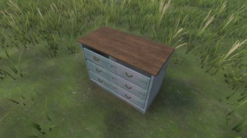
*Reference:* no usable reference photo found automatically; the request is written from the real object.
*After:* 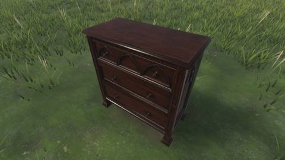
**REPLACED** by the Poly Haven model `gothiccommode_01`: three-drawer chest with pulls Fitted: turn 0 degrees, scale 0.93; baked into `content/assets/models/fr_commode/`.

### `furn_crockery`: Crockery stack
*Rooms:* attic, bedroom, cellar, dining, kitchen, kitchen_modern, office, prokitchen, sitting, sitting_modern, tavern, utility. *Size:* 0.42 x 0.32 m footprint, h 0.07 m.
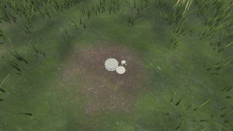
*Reference:* no usable reference photo found automatically; the request is written from the real object.
**KEEP: change request.** **Wrong:** flat white discs and a white blob; no rims, no glaze, no blue decoration typical of Norman faience.
**Change:** keep 0.42 x 0.32 x 0.07. Stack of 5 plates 0.22 m (each 0.012 m, raised rim 0.02 m wide, slight dish), a 0.14 m bowl beside it, a cup with handle on a saucer. Faience: cream-white (0.85, 0.82, 0.74), glossy (roughness 0.12), blue / manganese hand-painted border band and a centre flower (albedo), crazing in the normal; a chip on one rim showing buff clay.

### `furn_dresser`: Buffet bas (dresser)
*Rooms:* attic, kitchen, sitting, tavern. *Size:* 1.3 x 0.555 m footprint, h 0.95 m.
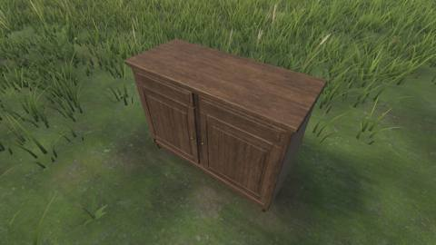
*Reference:* [Buffet composé par Victor Hugo, 1026.jpg](https://commons.wikimedia.org/wiki/File:Buffet_compos%C3%A9_par_Victor_Hugo,_1026.jpg) (CC0), partial match
*After:* 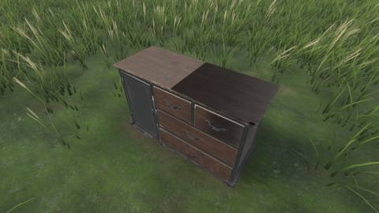
**REPLACED** by the Poly Haven model `woodentable_03`: low buffet: drawers over doors Fitted: turn 0 degrees, scale 0.99; baked into `content/assets/models/fr_dresser/`.

### `furn_frame_seascape`: Painting (seascape)
*Rooms:* bedroom, bedroom_modern, hall, sitting, sitting_modern, tavern. *Size:* 0.7 x 0.05 m footprint, h 0.50 m.
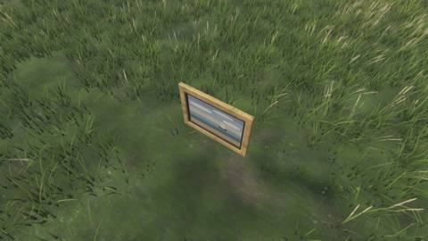
*Reference:* no usable reference photo found automatically; the request is written from the real object.
**KEEP: change request.** **Wrong (1 m capture, hung in the air without its wall):** frames read (thin wood moulding); paintings blurry, frames too thin and flat.
**Change:** Gilt frames: moulded profile 0.05-0.08 m (two steps and a bead), gold leaf (0.75, 0.58, 0.28, metallic, roughness 0.3) worn to red bole on the corners; canvas with craquelure in the normal and a slight varnish sheen (roughness 0.35). Since DEC1 most wall pictures are the imported paintings (furn_art_*): keep these as the fallback.

### `furn_gramophone`: Gramophone
*Rooms:* attic, sitting, tavern. *Size:* 0.36 x 0.36 m footprint, h 0.76 m.
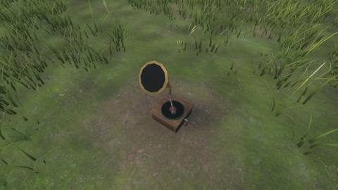
*Reference:* [Gramophone (AM 1998.60.217-1).jpg](https://commons.wikimedia.org/wiki/File:Gramophone_(AM_1998.60.217-1).jpg) (CC BY 4.0), partial match
**KEEP: change request.** **Wrong:** horn reads as a flat disc; cabinet small and plain; tonearm invisible.
**Change:** keep 0.36 x 0.36 x 0.76. Oak cabinet 0.32 x 0.32 x 0.15 with a moulded base and a crank on the side. Turntable 0.25 m with green felt and a black shellac record (glossy, groove rings). Tonearm: nickel 0.012 m tube curving to a 0.05 m soundbox. Horn: flower horn 0.40 m mouth, 8 petals (8 segment frustum with petal edges in the normal), painted dark red inside and black outside with gold edge lines, supported by a crane arm from the back.

### `furn_jug_bowl`: Jug and basin
*Rooms:* attic, bedroom, kitchen, mil_quarters, office, sitting, tavern, ward. *Size:* 0.36 x 0.36 m footprint, h 0.30 m.
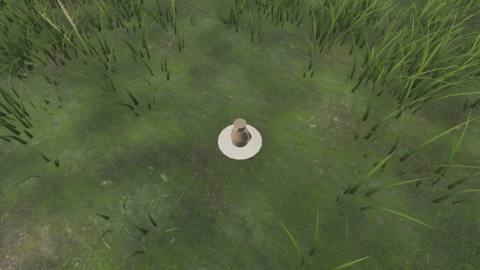
*Reference:* [Enamel wash basin and jug, South Africa.jpg](https://commons.wikimedia.org/wiki/File:Enamel_wash_basin_and_jug,_South_Africa.jpg) (CC BY-SA 4.0)
**KEEP: change request.** **Wrong:** white blobs; the jug's handle and spout and the basin rim do not read.
**Change:** keep 0.36 x 0.36 x 0.30. Basin 0.36 m diameter, 0.11 m deep with a 0.025 m rolled rim; jug 0.28 m tall standing in it, baluster body (max 0.16 m), flared spout, loop handle 0.02 m. Glaze: white enamel or faience (0.88, 0.86, 0.80, roughness 0.15) with a painted floral band (albedo) and a chip or two on the rims.

### `furn_lamp_wall_oil`: Wall oil lamp
*Rooms:* barn, cellar, kitchen, tavern, workshop. *Size:* 0.22 x 0.2 m footprint, h 0.32 m.
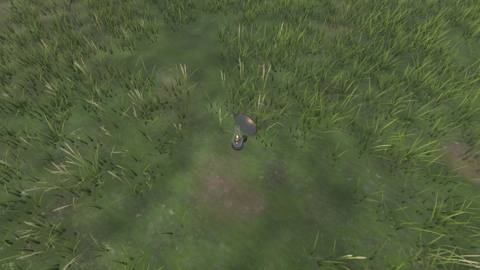
*Reference:* no usable reference photo found automatically; the request is written from the real object.
**KEEP: change request.** **Wrong (1 m capture, hung in the air without its wall):** a small grey blob; chimney and reflector not legible.
**Change:** Cast-iron bracket with a scroll, a glass font 0.08 m (paraffin visible), a brass burner, a 0.20 m glass chimney, a 0.15 m tin reflector disc behind.

### `furn_mirror`: Mirror
*Rooms:* bedroom, hall, sitting, tavern. *Size:* 0.52 x 0.04 m footprint, h 0.65 m.

*Reference:* no usable reference photo found automatically; the request is written from the real object.
*After:* 
**REPLACED** by the Poly Haven model `ornate_mirror_01`: gilt-framed looking glass Fitted: turn 0 degrees, scale 1.17; baked into `content/assets/models/fr_mirror/`.

### `furn_mod_cart`: Shopping cart
*Rooms:* shop. *Size:* 0.532 x 0.986 m footprint, h 1.03 m.

*Reference:* [Lone Shopping Cart Goes to School.webp](https://commons.wikimedia.org/wiki/File:Lone_Shopping_Cart_Goes_to_School.webp) (CC0)
**KEEP: change request.** **Wrong:** wire basket reads as tinted glass plates; no individual wires.
**Change:** keep sizes. Basket sides as alpha-tested wire grid texture (0.004 m wires at 0.025 m pitch, chrome) on the existing planes, two-sided, with a thicker 0.01 m top rim tube; red plastic handle grip; castors 0.10 m.

### `furn_mod_cart_row`: Nested shopping carts
*Rooms:* shop. *Size:* 0.532 x 2.026 m footprint, h 1.03 m.

*Reference:* [Nested Plastic Shopping Carts.jpg](https://commons.wikimedia.org/wiki/File:Nested_Plastic_Shopping_Carts.jpg) (CC BY 2.0)
**KEEP: change request.** **Wrong:** wire basket reads as tinted glass plates; no individual wires.
**Change:** keep sizes. Basket sides as alpha-tested wire grid texture (0.004 m wires at 0.025 m pitch, chrome) on the existing planes, two-sided, with a thicker 0.01 m top rim tube; red plastic handle grip; castors 0.10 m.

### `furn_mod_checkout`: Checkout counter
*Rooms:* shop. *Size:* 2.655 x 0.82 m footprint, h 1.95 m.

*Reference:* no usable reference photo found automatically; the request is written from the real object.
**KEEP: change request.** **Wrong:** reads; scanner and belt too plain.
**Change:** keep. Rubber belt black with transverse ribs (normal), end rollers chrome; scanner glass window (dark, roughness 0.05, red laser line emissive); a card terminal 0.08 x 0.16 m on a post; a divider bar on the belt.

### `furn_mod_clothes_rack`: Clothing rail
*Rooms:* shop. *Size:* 1.24 x 0.52 m footprint, h 1.61 m.

*Reference:* no usable reference photo found automatically; the request is written from the real object.
**KEEP: change request.** **Wrong:** garments are flat coloured planks; no hangers, sleeves or folds.
**Change:** keep 1.24 x 0.52 x 1.61. 10-12 garments: shirts and jackets each as a shoulder shape (0.45 m wide) + body with 3-5 vertical folds (normal + slight geometric wave), sleeves hanging at the sides, muted colours (navy, grey, olive, white, denim); visible hangers (0.003 m wire hook over the rail).

### `furn_mod_display_table`: Display table
*Rooms:* shop. *Size:* 1.5 x 0.9 m footprint, h 1.01 m.

*Reference:* no usable reference photo found automatically; the request is written from the real object.
**KEEP: change request.** **Wrong:** folded-goods stacks are plain colour blocks.
**Change:** keep. Stacks of folded garments (each layer 0.03 m with a rounded fold edge and slight offset), muted colours, a sign holder (blank).

### `furn_mod_end_cap`: End cap display
*Rooms:* shop. *Size:* 1.04 x 0.6 m footprint, h 2.10 m.

*Reference:* no usable reference photo found automatically; the request is written from the real object.
**KEEP: change request.** **Wrong:** packs are flat colour blocks.
**Change:** keep. Packaging atlas (shared fix); dump bin with loose bags (rounded pillows); header blank colour panel with a printed-look gradient.

### `furn_mod_fridge_case`: Glass-door drinks fridge
*Rooms:* shop. *Size:* 1.56 x 0.83 m footprint, h 2.05 m.

*Reference:* no usable reference photo found automatically; the request is written from the real object.
**KEEP: change request.** **Wrong:** glass doors read opaque black; contents invisible.
**Change:** keep 1.56 x 0.83 x 2.05. Glass doors alpha 0.25 with reflections, black frames; inside: lit (emissive white strip top) shelves with bottles and cans (packaging atlas, 6-8 designs), a blank lit header.

### `furn_mod_gondola`: Gondola shelving (2.4 m)
*Rooms:* shop. *Size:* 2.45 x 1 m footprint, h 1.85 m.

*Reference:* [GONDOLA DE PARED DE 80 X 50 X 180.JPG](https://commons.wikimedia.org/wiki/File:GONDOLA_DE_PARED_DE_80_X_50_X_180.JPG) (CC BY-SA 4.0), partial match
**KEEP: change request.** **Wrong:** stock is big flat colour blocks; shelves blotchy.
**Change:** keep sizes. Packaging atlas (shared fix), price-edge strips on shelf fronts (white with blank labels), shelves painted steel light grey (shared fix); stock rack: chrome wire shelves as alpha grid.

### `furn_mod_shop_wall_shelf`: Wall shelving bay (1.2 m)
*Rooms:* shop. *Size:* 1.25 x 0.512 m footprint, h 2.15 m.

*Reference:* no usable reference photo found automatically; the request is written from the real object.
*After:* 
**REPLACED** by the Poly Haven model `steel_frame_shelves_01`: shop shelving (PR3) Fitted: turn 0 degrees, scale 1.05; baked into `content/assets/models/fr_mod_shop_wall_shelf/`.
*(The in-house version's audit note, kept for the stand-in that shows while the bake is missing):* **Wrong:** stock is big flat colour blocks; shelves blotchy. **Change:** keep sizes. Packaging atlas (shared fix), price-edge strips on shelf fronts (white with blank labels), shelves painted steel light grey (shared fix); stock rack: chrome wire shelves as alpha grid.

### `furn_mod_wall_clock`: Wall clock
*Rooms:* bedroom_modern, class_modern, dining, gym, kitchen_modern, lobby, office_modern, prokitchen, shop, sitting_modern, ward. *Size:* 0.35 x 0.054 m footprint, h 0.35 m.

*Reference:* no usable reference photo found automatically; the request is written from the real object.
*After:* 
**REPLACED** by the Poly Haven model `wall_clock`: round wall clock Fitted: turn 0 degrees, scale 1.13; baked into `content/assets/models/fr_mod_wall_clock/`.

### `furn_plate_rack`: Plate rack
*Rooms:* kitchen, tavern. *Size:* 1.0 x 0.18 m footprint, h 0.57 m.

*Reference:* no usable reference photo found automatically; the request is written from the real object.
**KEEP: change request.** **Wrong (1 m capture, hung in the air without its wall):** reads: rack with white plates; plates plain white.
**Change:** Oak rack 1.0 m, two plate rails, faience plates as furn_crockery tilted on the rails, a top shelf with a jug.

### `furn_radio`: Wireless set
*Rooms:* attic, bedroom, bedroom_modern, mil_command, office, office_modern, sitting, tavern. *Size:* 0.36 x 0.22 m footprint, h 0.36 m.

*Reference:* [Vintage Gloritone Model 27 Cathedral-Tombstone Style Vacuum Tube Radio, AM Band, TRF, Circa 1930 (14663394535).jpg](https://commons.wikimedia.org/wiki/File:Vintage_Gloritone_Model_27_Cathedral-Tombstone_Style_Vacuum_Tube_Radio,_AM_Band,_TRF,_Circa_1930_(14663394535).jpg) (CC BY-SA 2.0)
**KEEP: change request.** **Wrong:** a tiny box; the 1930s cathedral-top radio in the reference has a pointed-arch cabinet, fretwork over speaker cloth, a dial and knobs.
**Change:** keep 0.36 x 0.22 x 0.36. Cabinet: walnut veneer (0.30, 0.16, 0.08, roughness 0.3), Gothic arch top (arch shape 0.36 m wide), front fretwork (cut-out pattern over a cloth backing, tan 0.55, 0.45, 0.30), amber dial window 0.06 m (emissive when on), three bakelite knobs 0.03 m, contrasting veneer strips (light 0.55, 0.38, 0.20) on the front.

### `furn_sideboard`: Sideboard
*Rooms:* sitting, tavern. *Size:* 1.84 x 0.51 m footprint, h 0.90 m.

*Reference:* no usable reference photo found automatically; the request is written from the real object.
**KEEP: change request.** **Wrong:** painted doors with a three-board top read as a kitchen unit; the enfilade lacks mouldings and handles.
**Change:** keep 1.84 x 0.51 x 0.90. Three doors with raised fields and brass escutcheons, a drawer row (three drawers with brass bail pulls) under a 0.03 m moulded top, a 0.08 m plinth with a shaped apron. Paint: grey-blue (0.40, 0.46, 0.48) worn to wood on edges, or polished oak.

### `furn_table_small`: Kitchen table
*Rooms:* kitchen, mil_command, mil_quarters, mil_radio, office, ruin, sitting, tavern. *Size:* 1.1 x 0.7 m footprint, h 0.76 m.

*Reference:* no usable reference photo found automatically; the request is written from the real object.
*After:* 
**REPLACED** by the Poly Haven model `wooden_table_02`: farmhouse kitchen table (PR3) Fitted: turn 0 degrees, scale 0.97; baked into `content/assets/models/fr_table_small/`.
*(The in-house version's audit note, kept for the stand-in that shows while the bake is missing):* **Wrong:** as furn_table_dining. **Change:** keep 1.10 x 0.70 x 0.76; as furn_table_dining with 3 boards and a cutlery drawer.

## Military: bunkers, command posts, quarters

### `furn_basket`: Basket of apples
*Rooms:* attic, barn, bedroom, bedroom_modern, cellar, kitchen, mil_command, office, office_modern, sitting, sitting_modern, utility, workshop. *Size:* 0.42 x 0.3 m footprint, h 0.33 m.

*Reference:* [Apples in basket 2018 G1.jpg](https://commons.wikimedia.org/wiki/File:Apples_in_basket_2018_G1.jpg) (Public domain)
**KEEP: change request.** **Wrong:** basket reads as a small smooth bowl; apples are featureless red spheres; handle too thin to see at 1 m.
**Change:** keep 0.42 x 0.30 x 0.33. Basket: oval, 0.20 m deep, straight flared sides, a 0.02 m rolled rim; wicker weave in the albedo / normal (horizontal weavers 0.008 m over vertical stakes every 0.03 m), colour straw-tan (0.45, 0.33, 0.18) with darker grime at the base. Bow handle: 0.025 m round, rising 0.13 m above the rim, wrapped. Apples: 10-12 spheres of 0.07-0.08 m, slightly squashed (y 0.9), varied red-to-yellow (two albedo variants), a dimple and stalk in the normal, heaped above the rim.

### `furn_lamp_table`: Table lamp
*Rooms:* bedroom, bedroom_modern, hall, kitchen, mil_command, office, office_modern, sitting, sitting_modern. *Size:* 0.24 x 0.24 m footprint, h 0.37 m.

*Reference:* no usable reference photo found automatically; the request is written from the real object.
**KEEP: change request.** **Wrong:** reads as a pale mushroom; the pleated silk shade and turned porcelain base are not legible.
**Change:** keep 0.24 x 0.24 x 0.37. Base: turned porcelain vase 0.10 m max, 0.16 m tall, glossy white with a gilt band; brass stem 0.012 m 0.05 m tall; shade: 0.22 m bottom / 0.12 m top, 0.14 m tall, 16-24 pleats (normal map), cream silk (0.85, 0.78, 0.62) with emissive glow when lit, a fringe line at the bottom edge.

### `furn_mil_ammo_rack`: Ammunition rack
*Rooms:* mil_ammo, mil_fighting. *Size:* 1.6 x 0.5 m footprint.

*Reference:* no usable reference photo found automatically; the request is written from the real object.
**KEEP: change request.** **Wrong:** structure ok; boxes are flat grey blocks with pale label bands; nothing reads as German ammunition.
**Change:** keep 1.6 x 0.5 x 1.8. Shelves: rough pine 0.03 m on 0.08 m uprights, diagonal brace at the back. Contents: MG belt boxes (Patronenkasten 34: 0.28 x 0.10 x 0.20, field grey 0.30, 0.31, 0.27, a hinged lid with a latch and a top carry handle), wooden shell crates with rope handles and stencilled lot bands (black stencil, no legible text needed), a row of Stielhandgranate crates. Painted metal roughness 0.55, chipped edges to bare steel.

### `furn_mil_bunk`: Steel bunk (two-tier)
*Rooms:* mil_quarters. *Size:* 2.0 x 0.86 m footprint.

*Reference:* [Bunks in the USS Pampanito.jpg](https://commons.wikimedia.org/wiki/File:Bunks_in_the_USS_Pampanito.jpg) (CC BY-SA 4.0), partial match
**KEEP: change request.** **Wrong:** frame reads; straw ticks are striped like modern mattresses and too thin.
**Change:** keep 2.0 x 0.86 x 1.8. Straw ticks 0.12 m thick, lumpy (2-3 sag lines in the normal), coarse jute / hessian (0.55, 0.46, 0.30) with a faint check, not stripes; folded grey wool blankets (0.20, 0.20, 0.19) with two darker stripes at the ends; a foot ladder with 4 rungs on one end. Frame: field-grey steel tube 0.03 m, chipped.

### `furn_mil_crates`: Ammunition crates
*Rooms:* mil_ammo, mil_command, mil_fighting, mil_passage, mil_plant, mil_quarters, mil_radio. *Size:* 1.64 x 0.44 m footprint.

*Reference:* [Box, ammunition belts (AM 1985.370-1).jpg](https://commons.wikimedia.org/wiki/File:Box,_ammunition_belts_(AM_1985.370-1).jpg) (CC BY 4.0), partial match
**KEEP: change request.** **Wrong:** boxes read; corners are clean, labels are pale blank bands, no rope handles visible.
**Change:** keep 1.64 x 0.44 x the stack. Crates: olive / field-grey painted wood (0.27, 0.29, 0.22), plank seams 0.005 m on the faces, iron corner straps 0.03 m, rope handles (0.015 m loop) on the ends, black stencilled lot band (generic characters / block shapes, no legible words), paint worn to wood on corners and lid edges (roughness 0.65).

### `furn_mil_fusebox`: Fuse box and conduits
*Rooms:* mil_ammo, mil_command, mil_passage, mil_plant, mil_quarters, mil_radio. *Size:* 0.45 x 0.2 m footprint.

*Reference:* no usable reference photo found automatically; the request is written from the real object.
**KEEP: change request.** **Wrong (1 m capture, hung in the air):** a grey box with a black switch and two long rods; reads, but plain.
**Change:** keep 0.45 x 0.2 x height. Box: pressed steel 0.30 x 0.40 x 0.15, field grey, a hinged door with a recessed latch and a lightning-flash plate (no text), a rotary switch 0.06 m with a handle; conduits 0.025 m steel tubes rising to the ceiling with saddle clips every 0.4 m; a cable gland and two ceramic fuse holders visible through a vent slot.

### `furn_mil_gasmask_hooks`: Gas-mask and helmet pegs
*Rooms:* mil_fighting, mil_passage, mil_quarters. *Size:* 1.4 x 0.22 m footprint.

*Reference:* no usable reference photo found automatically; the request is written from the real object.
**KEEP: change request.** **Wrong (1 m capture, hung in the air):** canisters and helmets read as grey lumps on a rail.
**Change:** keep 1.4 x 0.22 x height. Five GM-30/38 canisters: fluted cylinders 0.27 m x 0.11 m (8-10 flutes in the normal), field grey with a hinged lid and two straps hanging (canvas, 0.02 m); two M35/M40 helmets: the stepped flared rim profile (lathe of 8-10 points), field grey matte (roughness 0.7), leather liner inside visible.

### `furn_mil_generator`: Diesel generator set
*Rooms:* mil_plant. *Size:* 1.7 x 0.75 m footprint.

*Reference:* no usable reference photo found automatically; the request is written from the real object.
**KEEP: change request.** **Wrong:** stacked grey boxes and a flat disc; nothing reads as an engine.
**Change:** keep 1.7 x 0.75 x height. Skid: two 0.10 m steel channels. Engine: block 0.6 x 0.45 x 0.5 with cooling fins on the cylinder (6-8 fins 0.01 m, 0.025 m pitch), a rocker cover, exhaust pipe 0.05 m rising and bending, an air filter cylinder. Radiator 0.5 x 0.1 x 0.6 with a honeycomb grille. Flywheel 0.40 m disc with 6 spokes. Generator drum 0.30 m dia. with a terminal box. Field grey (0.30, 0.31, 0.27) with oil stains, rust on the exhaust (orange-brown).

### `furn_mil_jerrycans`: Jerrycans
*Rooms:* mil_fighting, mil_passage, mil_plant, mil_quarters. *Size:* 0.8 x 0.36 m footprint.

*Reference:* [Britische copy wehrmacht-einheitskanister 1943 jerrycan.jpg](https://commons.wikimedia.org/wiki/File:Britische_copy_wehrmacht-einheitskanister_1943_jerrycan.jpg) (CC BY-SA 3.0)
**KEEP: change request.** **Wrong:** grey slabs without the X pressing and the triple handle that make a Wehrmacht Kanister.
**Change:** keep 0.8 x 0.36 x height. Each can 0.345 x 0.165 x 0.47: the X pressing on both faces (0.008 m raised ridges, diagonal), a raised rim weld around the edge, three handles at the top (0.02 m tubes), a cam-lever spout cap. Paint: dunkelgelb or field grey with WH stencil band (generic), chipped to rusty steel on edges (use Poly Haven metal_jerrycan_green as the shape reference: it is the same can).

### `furn_mil_locker`: Steel locker (double)
*Rooms:* mil_command, mil_quarters, mil_radio. *Size:* 0.9 x 0.5 m footprint.

*Reference:* no usable reference photo found automatically; the request is written from the real object.
**KEEP: change request.** **Wrong:** reads, but grime is a uniform blotch over the whole door; vent louvres flat.
**Change:** keep 0.9 x 0.5 x 1.9. Louvres: 6 pressed vents per door top and bottom (0.06 x 0.012 m, protruding 0.004 m, dark gap). Handle: 0.12 m drop handle with a hasp and padlock. Paint: field grey semi-gloss (roughness 0.35), wear concentrated on edges and around handles (bare steel), not overall blotching; a small paper card holder 0.06 x 0.04 m.

### `furn_mil_map`: Situation map
*Rooms:* mil_command, mil_fighting, mil_quarters, mil_radio. *Size:* 1.5 x 0.04 m footprint.

*Reference:* no usable reference photo found automatically; the request is written from the real object.
**KEEP: change request.** **Wrong (1 m capture, hung in the air):** a plain grid on a pale board with a few dots.
**Change:** keep 1.5 x 0.04 x height. Plywood board 1.3 x 0.9 m with a printed topographic map (contours, woods green, roads red / black, coast blue, grid squares, no legible text), coloured map pins (red / blue heads) along a hand-drawn front line in red and blue pencil, a clipboard with sheets hung at the corner, thumb-tacked corners curling.

### `furn_mil_phone`: Field telephone
*Rooms:* mil_command, mil_radio. *Size:* 0.3 x 0.2 m footprint.

*Reference:* [Feldfernsprecher FF33.JPG](https://commons.wikimedia.org/wiki/File:Feldfernsprecher_FF33.JPG) (CC BY 3.0)
**KEEP: change request.** **Wrong:** a tiny brown box; the FF33 field telephone in the reference has a bakelite case with a lid, a handset with cord and a crank.
**Change:** keep 0.30 x 0.20 x height. Case: 0.28 x 0.12 x 0.24 brown bakelite (0.18, 0.09, 0.04, roughness 0.25) with rounded edges (radius 0.015), a hinged lid open at 100 degrees; handset 0.22 m dark bakelite in the cradle; coiled cord (torus segments); crank handle on the side; leather strap.

### `furn_mil_radio`: Radio desk
*Rooms:* mil_radio. *Size:* 1.5 x 0.65 m footprint.

*Reference:* [Victory Show Cosby UK 06-09-2015 WW2 re-enactment Military Vehicles etc zaphad1 Flickr CCBY2.0 Polish tent radio station communications reenactors camp area Niedziela etc IMG 3942.jpg](https://commons.wikimedia.org/wiki/File:Victory_Show_Cosby_UK_06-09-2015_WW2_re-enactment_Military_Vehicles_etc_zaphad1_Flickr_CCBY2.0_Polish_tent_radio_station_communications_reenactors_camp_area_Niedziela_etc_IMG_3942.jpg) (CC BY 2.0), partial match
**KEEP: change request.** **Wrong:** two grey boxes with dials on a desk; they do not read as Wehrmacht radio sets.
**Change:** keep 1.5 x 0.65 x height. Sets: Torn.Fu-style transceiver 0.36 x 0.20 x 0.30, field grey crackle paint, front panel with 2 large tuning dials (0.06 m with a scale window), 4 knobs, jacks; a battery box beside; headphones (two 0.07 m cups on a band) and a Morse key (brass on a black base); cables between. Desk: rough plank top 0.04 m on trestles, map / log sheets. Field grey paint roughness 0.6, chipped edges.

### `furn_mil_rifle_rack`: Rifle rack
*Rooms:* mil_fighting, mil_passage, mil_quarters. *Size:* 1.3 x 0.35 m footprint.

*Reference:* [6517 - Fürigen - Festung Fürigen - Gun rack.JPG](https://commons.wikimedia.org/wiki/File:6517_-_F%C3%BCrigen_-_Festung_F%C3%BCrigen_-_Gun_rack.JPG) (CC BY-SA 2.5), partial match
**KEEP: change request.** **Wrong:** rifles are uniform dark sticks; stocks and barrels not distinguishable.
**Change:** keep 1.3 x 0.35 x height. Six Kar98k: 1.11 m long each; walnut stock (0.25, 0.14, 0.07) with the bolt handle and a sling (leather 0.02 m strap); barrel and bands dark blued steel (0.06, 0.06, 0.07, metallic, roughness 0.35); stocks in a notched base rail (0.08 m), muzzles in a notched upper rail at 0.9 m. Use the game's own kar98k model if available instead of sticks.

### `furn_mil_table`: Map table (trestle)
*Rooms:* mil_command. *Size:* 1.8 x 0.9 m footprint.

*Reference:* no usable reference photo found automatically; the request is written from the real object.
**KEEP: change request.** **Wrong:** plank table reads; the map is a flat pale sheet without content.
**Change:** keep 1.8 x 0.9 x 0.78. Map: 1.0 x 0.7 m, printed topographic look (contours, grid squares, coloured pencil front lines, no legible text), corners curled 0.01 m, weighted by a compass and a mug; dividers, set square and pencils on it. Trestles: A-frame legs 0.05 m with a cross brace.

### `furn_pot`: Cooking pot
*Rooms:* barn, cellar, kitchen, mil_plant, prokitchen, utility, workshop. *Size:* 0.3 x 0.26 m footprint, h 0.34 m.

*Reference:* [An incomplete cast iron cauldron in two pieces probably dating from 17th-18th century. (FindID 823882).jpg](https://commons.wikimedia.org/wiki/File:An_incomplete_cast_iron_cauldron_in_two_pieces_probably_dating_from_17th-18th_century._(FindID_823882).jpg) (CC BY 2.0)
**KEEP: change request.** **Wrong:** a tiny black ball; the three legs, bail and lid of a cast-iron marmite do not read.
**Change:** keep 0.30 x 0.26 x 0.34. Pot: bellied 0.26 m dia., 0.20 m tall, 3 stubby legs 0.05 m, two lug ears holding a 0.006 m iron bail; lid with a knob; ladle resting across. Cast iron black (0.05, 0.05, 0.05), roughness 0.55, rust bloom near the legs, soot.

### `furn_stool`: Milking stool
*Rooms:* barn, bedroom, bedroom_modern, kitchen, mil_fighting, mil_quarters, mil_radio, office, sitting, sitting_modern, utility, workshop. *Size:* 0.34 x 0.34 m footprint, h 0.35 m.

*Reference:* no usable reference photo found automatically; the request is written from the real object.
*After:* 
**REPLACED** by the Poly Haven model `wooden_stool_01`: low turned stool Fitted: turn 0 degrees, scale 0.75; baked into `content/assets/models/fr_stool/`.

### `furn_tool_rack`: Tool board
*Rooms:* barn, cellar, kitchen, mil_plant, utility, workshop. *Size:* 1.2 x 0.08 m footprint, h 0.70 m.

*Reference:* no usable reference photo found automatically; the request is written from the real object.
**KEEP: change request.** **Wrong (1 m capture, hung in the air without its wall):** (not in the wall shots: the board and tools need the request below).
**Change:** Pine board 1.2 m with pegs; a bow saw (0.6 m wooden frame, blade, twisted cord), a hammer, an auger (T-handle), a carpenter's square, a coil of rope: each object to scale with its own material (steel, ash handles).

### `furn_workbench`: Workbench
*Rooms:* barn, kitchen, mil_plant, utility, workshop. *Size:* 1.94 x 0.85 m footprint, h 0.95 m.

*Reference:* no usable reference photo found automatically; the request is written from the real object.
**KEEP: change request.** **Wrong:** (not on the audit sheet: captured last) structure ok; top too clean.
**Change:** keep 1.94 x 0.85 x 0.95. Top 0.07 m thick beech with stains, saw cuts and dents; a front vice (wooden screw 0.05 m, chop 0.30 m); a tool well; tools on it; lower shelf with offcuts.

## Modern public buildings: school, gym, lobby, office, restaurant kitchen, hospital ward

### `furn_mod_armchair`: Modern armchair
*Rooms:* bedroom_modern, lobby, sitting_modern. *Size:* 0.86 x 0.843 m footprint, h 0.87 m.

*Reference:* no usable reference photo found automatically; the request is written from the real object.
*After:* 
**REPLACED** by the Poly Haven model `modern_arm_chair_01`: upholstered lounge armchair Fitted: turn 0 degrees, scale 0.88; baked into `content/assets/models/fr_mod_armchair/`.

### `furn_mod_bedside_cabinet`: Bedside locker
*Rooms:* ward. *Size:* 0.48 x 0.48 m footprint, h 0.89 m.

*Reference:* [Antique bedside table - Casa Loma.jpg](https://commons.wikimedia.org/wiki/File:Antique_bedside_table_-_Casa_Loma.jpg) (CC BY 2.0), partial match
**KEEP: change request.** **Wrong:** white box with blue doors; reads as a kitchen unit.
**Change:** keep 0.48 x 0.48 x 0.89. Hospital locker: white laminate (shared fix) with a pale grey drawer front and door, recessed handles, a swing-over table flap on a chrome arm, 4 castors 0.05 m.

### `furn_mod_bleachers`: Bleacher section
*Rooms:* gym. *Size:* 3.04 x 1.877 m footprint, h 2.30 m.

*Reference:* no usable reference photo found automatically; the request is written from the real object.
**KEEP: change request.** **Wrong:** reads.
**Change:** keep. Seat planks extruded aluminium with 3 ribs (normal), brushed (shared fix), grey steel frame with bolts; a few scuffs.

### `furn_mod_bookshelf`: Open bookshelf
*Rooms:* class_modern, office_modern, sitting_modern. *Size:* 0.9 x 0.34 m footprint, h 1.90 m.

*Reference:* no usable reference photo found automatically; the request is written from the real object.
**KEEP: change request.** **Wrong:** books are uniform saturated blocks.
**Change:** keep 0.9 x 0.34 x 1.90. Books as the period furn_bookcase request (height classes, muted spines, gaps, a few lying flat), plus 2-3 ornaments (a vase, a framed photo, a plant pot).

### `furn_mod_cafeteria_table`: Cafeteria table with benches
*Rooms:* lobby. *Size:* 2.41 x 1.54 m footprint, h 0.74 m.

*Reference:* [Calhan Colorado High School Cafeteria by David Shankbone.jpg](https://commons.wikimedia.org/wiki/File:Calhan_Colorado_High_School_Cafeteria_by_David_Shankbone.jpg) (CC BY-SA 3.0)
**KEEP: change request.** **Wrong:** reads.
**Change:** keep. Top: grey speckled laminate (shared fix with a fine fleck), 0.003 m aluminium edge; benches moulded blue plastic (roughness 0.35); chrome hinge brackets.

### `furn_mod_canvas_square`: Abstract canvas (square)
*Rooms:* bathroom_modern, bedroom_modern, class_modern, dining, kitchen_modern, lobby, office_modern, sitting_modern, ward. *Size:* 0.8 x 0.04 m footprint, h 0.80 m.

*Reference:* no usable reference photo found automatically; the request is written from the real object.
**KEEP: change request.** **Wrong (1 m capture, hung in the air without its wall):** flat colour fields read as intended (abstract); stretcher depth fine.
**Change:** Apply the shared material fixes; boards keep their frames, blank content (no legible text).

### `furn_mod_canvas_wide`: Abstract canvas (wide)
*Rooms:* bedroom_modern, dining, lobby, office_modern, sitting_modern. *Size:* 1.2 x 0.04 m footprint, h 0.60 m.

*Reference:* no usable reference photo found automatically; the request is written from the real object.
**KEEP: change request.** **Wrong (1 m capture, hung in the air without its wall):** flat colour fields read as intended (abstract); stretcher depth fine.
**Change:** Apply the shared material fixes; boards keep their frames, blank content (no legible text).

### `furn_mod_chalkboard`: Chalkboard
*Rooms:* class_modern. *Size:* 2.4 x 0.08 m footprint, h 1.23 m.

*Reference:* no usable reference photo found automatically; the request is written from the real object.
**KEEP: change request.** **Wrong (1 m capture):** board too blue-green and uniform; two white bars instead of chalk dust.
**Change:** keep 2.4 x 0.08 x 1.23. Slate-green (0.12, 0.20, 0.17) matte (0.85) with erased chalk swirls (pale, low contrast) and a few faint lines, no legible text; oak frame and chalk ledge with 3 sticks of chalk and a felt duster.

### `furn_mod_coffee_table`: Coffee table
*Rooms:* bedroom_modern, lobby, sitting_modern. *Size:* 1.2 x 0.6 m footprint, h 0.42 m.

*Reference:* [Miele, IFA 2018, Berlin (P1070072).jpg](https://commons.wikimedia.org/wiki/File:Miele,_IFA_2018,_Berlin_(P1070072).jpg) (CC BY-SA 4.0)
*After:* 
**REPLACED** by the Poly Haven model `coffeetable_01`: coffee table (PR3) Fitted: turn 0 degrees, scale 0.73; baked into `content/assets/models/fr_mod_coffee_table/`.
*(The in-house version's audit note, kept for the stand-in that shows while the bake is missing):* **Wrong:** reads (oak slab on a black frame with a slatted shelf); top plain. **Change:** keep 1.2 x 0.6 x 0.42. Oak top 0.03 m with a fine grain and a matt lacquer (0.45), slat shelf of 6 slats with 0.01 m gaps, black powder-coated 0.02 m steel tube frame with welded corners. (The Poly Haven coffee tables imported were of other styles and were not used.)

### `furn_mod_copier`: Photocopier
*Rooms:* office_modern. *Size:* 0.72 x 0.698 m footprint, h 1.13 m.

*Reference:* [Xerox photocopier in GlenOak High School library 2004.jpg](https://commons.wikimedia.org/wiki/File:Xerox_photocopier_in_GlenOak_High_School_library_2004.jpg) (CC BY-SA 3.0)
**KEEP: change request.** **Wrong:** reads.
**Change:** keep. Off-white plastic (0.82, 0.82, 0.78, roughness 0.5) with grey paper drawers (0.005 m shadow gaps), touch panel tilted 30 degrees with an emissive screen, a scanner lid hinge; output tray with a few sheets.

### `furn_mod_cubicle`: Cubicle partition
*Rooms:* office_modern. *Size:* 1.6 x 0.4 m footprint, h 1.40 m.

*Reference:* [CubeSpace.jpg](https://commons.wikimedia.org/wiki/File:CubeSpace.jpg) (CC BY-SA 2.0)
**KEEP: change request.** **Wrong:** reads.
**Change:** keep. Fabric panel with a fine weave normal (grey-blue 0.35, 0.40, 0.45), aluminium frame 0.03 m, feet; a few pinned papers.

### `furn_mod_desk`: Office desk
*Rooms:* bedroom_modern, office_modern. *Size:* 1.4 x 0.7 m footprint, h 0.75 m.

*Reference:* no usable reference photo found automatically; the request is written from the real object.
*After:* 
**REPLACED** by the Poly Haven model `metal_office_desk`: steel office desk (PR3) Fitted: turn 0 degrees, scale 0.79; baked into `content/assets/models/fr_mod_desk/`.
*(The in-house version's audit note, kept for the stand-in that shows while the bake is missing):* **Wrong:** top uses a stained white texture. **Change:** keep 1.4 x 0.7 x 0.75. White laminate top (shared fix) 0.025 m with a 0.002 m dark edge band, cable grommet 0.06 m; grey powder-coated steel T legs (0.30, 0.31, 0.32, roughness 0.45); modesty panel perforated (alpha dots).

### `furn_mod_desk_l`: L-shaped desk
*Rooms:* bedroom_modern, office_modern. *Size:* 1.6 x 1.5 m footprint, h 0.75 m.

*Reference:* no usable reference photo found automatically; the request is written from the real object.
**KEEP: change request.** **Wrong / change:** as furn_mod_desk; oak-veneer top variant (0.55, 0.40, 0.25, fine grain normal) and a grey 3-drawer pedestal with recessed pulls.

### `furn_mod_dining_table6`: Dining table (6 seats)
*Rooms:* kitchen_modern, office_modern, sitting_modern. *Size:* 1.9 x 0.95 m footprint, h 0.75 m.

*Reference:* no usable reference photo found automatically; the request is written from the real object.
*After:* 
**REPLACED** by the Poly Haven model `woodentable_01`: wooden dining table (PR3) Fitted: turn 0 degrees, scale 1.28; baked into `content/assets/models/fr_mod_dining_table6/`.
*(The in-house version's audit note, kept for the stand-in that shows while the bake is missing):* **Wrong:** reads. **Change:** keep. Oak top 0.035 m with a matt lacquer (roughness 0.45), plank joints (3-4 boards, 0.002 m lines), black steel sled legs 0.04 x 0.02 m flat bar.

### `furn_mod_dish_sink`: Dish pit sink
*Rooms:* prokitchen. *Size:* 1.8 x 0.71 m footprint, h 1.66 m.

*Reference:* no usable reference photo found automatically; the request is written from the real object.
**KEEP: change request.** **Wrong:** reads; steel blotchy.
**Change:** keep. Brushed stainless (shared fix); drain grilles; pre-rinse spray arm with a coiled spring hose; undershelf with stacked trays.

### `furn_mod_dumbbell_rack`: Dumbbell rack
*Rooms:* gym. *Size:* 1.42 x 0.6 m footprint, h 0.93 m.

*Reference:* [Woman standing in front of a dumbbell rack doing bicep curls.jpg](https://commons.wikimedia.org/wiki/File:Woman_standing_in_front_of_a_dumbbell_rack_doing_bicep_curls.jpg) (CC BY 2.0)
**KEEP: change request.** **Wrong:** reads.
**Change:** keep. Hex bells rubber-black (roughness 0.7) with chrome knurled handles (normal), graded sizes; frame matt black.

### `furn_mod_exercise_bike`: Exercise bike
*Rooms:* gym. *Size:* 0.56 x 1.123 m footprint, h 1.22 m.

*Reference:* [Magnetic resistance stationary bicycle exercise bike.JPG](https://commons.wikimedia.org/wiki/File:Magnetic_resistance_stationary_bicycle_exercise_bike.JPG) (CC BY-SA 3.0), partial match
**KEEP: change request.** **Wrong:** reads.
**Change:** keep. Flywheel housing glossy black plastic, frame white or grey, console with an emissive screen, saddle black vinyl, pedals with straps.

### `furn_mod_filing_cabinet`: Filing cabinet
*Rooms:* bedroom_modern, class_modern, office_modern. *Size:* 0.47 x 0.632 m footprint, h 1.32 m.

*Reference:* [Macey Vertical Filing Cabinet 1903.jpg](https://commons.wikimedia.org/wiki/File:Macey_Vertical_Filing_Cabinet_1903.jpg) (Public domain), partial match
**KEEP: change request.** **Wrong:** blotchy marbled grey.
**Change:** keep 0.47 x 0.63 x 1.32. Painted steel (shared fix) light grey (0.62, 0.63, 0.62); 4 drawers with recessed pull bars and label holders (chrome, blank cards).

### `furn_mod_floor_lamp`: Floor lamp
*Rooms:* bedroom_modern, lobby, sitting_modern. *Size:* 0.425 x 0.425 m footprint, h 1.60 m.

*Reference:* [Floor lamp 1 2016-07-06.jpg](https://commons.wikimedia.org/wiki/File:Floor_lamp_1_2016-07-06.jpg) (CC BY-SA 4.0)
**KEEP: change request.** **Wrong:** reads.
**Change:** keep. Linen drum shade (weave normal, warm emissive when lit), brushed steel stem, weighted disc base.

### `furn_mod_fryer`: Deep fryer (2-basket)
*Rooms:* prokitchen. *Size:* 0.4 x 0.827 m footprint, h 1.20 m.

*Reference:* [Namche Bazaar, Deep frying, Deep fryer, Nepal.jpg](https://commons.wikimedia.org/wiki/File:Namche_Bazaar,_Deep_frying,_Deep_fryer,_Nepal.jpg) (CC BY 4.0)
**KEEP: change request.** **Wrong:** read correctly; steel blotchy.
**Change:** keep sizes. Brushed stainless (shared fix); burners / grates cast-iron black (roughness 0.6); knobs black bakelite with white index lines; oil and grease darkening on the cooking surfaces only.

### `furn_mod_griddle`: Flat-top griddle
*Rooms:* prokitchen. *Size:* 0.9 x 0.807 m footprint, h 1.12 m.

*Reference:* [Potato pancake batter being ladled onto a hot griddle, Bremen Christmas market 2025.jpg](https://commons.wikimedia.org/wiki/File:Potato_pancake_batter_being_ladled_onto_a_hot_griddle,_Bremen_Christmas_market_2025.jpg) (CC BY 4.0)
**KEEP: change request.** **Wrong:** read correctly; steel blotchy.
**Change:** keep sizes. Brushed stainless (shared fix); burners / grates cast-iron black (roughness 0.6); knobs black bakelite with white index lines; oil and grease darkening on the cooking surfaces only.

### `furn_mod_gym_mat`: Rubber gym mat
*Rooms:* gym. *Size:* 2 x 1 m footprint, h 0.03 m.

*Reference:* no usable reference photo found automatically; the request is written from the real object.
**KEEP: change request.** **Wrong:** black slab with a blue square.
**Change:** keep 2.0 x 1.0. Interlocking rubber tiles (jigsaw edges in the normal, 0.5 m tiles), black speckled (EPDM flecks); two rolled blue foam mats (cylinders 0.15 m dia., 0.6 m long, foam texture).

### `furn_mod_hood`: Extraction hood
*Rooms:* prokitchen. *Size:* 2 x 1.1 m footprint, h 0.70 m.

*Reference:* no usable reference photo found automatically; the request is written from the real object.
**KEEP: change request.** **Wrong (1 m capture):** a dark blue-grey slab with a box on top: no sloped front, no filters, colour wrong.
**Change:** keep 2.0 x 1.1 x 0.70 (bottom at 2.0 m). Canopy: brushed stainless (shared fix), front face sloped 30 degrees back to the wall, 0.10 m vertical lip at the bottom; underside: a row of 4-5 baffle filters (0.5 x 0.4 m, chevron louvres in the normal) in a recessed channel, a grease gutter along the front with a drain cup at one end, two recessed light panels (emissive); a 0.35 x 0.35 m duct rising to the ceiling.

### `furn_mod_hoop`: Basketball hoop (wall)
*Rooms:* gym. *Size:* 1.8 x 1.189 m footprint, h 1.18 m.

*Reference:* no usable reference photo found automatically; the request is written from the real object.
**KEEP: change request.** **Wrong (1 m capture):** backboard painted with grey stripes; it should be clear (polycarbonate / glass) or plain white.
**Change:** keep. Backboard: 1.8 x 1.05 m white (or clear alpha 0.25) with a black or orange 0.05 m border and the 0.59 x 0.45 m shooter's square; steel wall bracket (A-frame of 0.05 m tubes) painted dark grey; orange rim 0.45 m with net hooks; net as an alpha mesh cone.

### `furn_mod_hospital_bed`: Hospital bed
*Rooms:* ward. *Size:* 1.012 x 2.16 m footprint, h 1.13 m.

*Reference:* [Inauguración del Hospital Regional de Apatzingán. (20503993770).jpg](https://commons.wikimedia.org/wiki/File:Inauguraci%C3%B3n_del_Hospital_Regional_de_Apatzing%C3%A1n._(20503993770).jpg) (CC BY 2.0)
**KEEP: change request.** **Wrong:** reads; sheets striped.
**Change:** keep. Plain white / pale blue sheets with folds, grey steel chassis with castors and a hand crank, side rails 0.02 m tubes.

### `furn_mod_ice_machine`: Ice machine
*Rooms:* prokitchen. *Size:* 0.76 x 0.79 m footprint, h 1.60 m.

*Reference:* no usable reference photo found automatically; the request is written from the real object.
**KEEP: change request.** **Wrong:** stainless reads as stained concrete.
**Change:** keep sizes. Brushed stainless (shared fix); door gaskets (dark 0.01 m); bar handles chrome round 0.025 m; a kick grille; status LEDs emissive.

### `furn_mod_iv_stand`: IV drip stand
*Rooms:* ward. *Size:* 0.544 x 0.538 m footprint, h 1.95 m.

*Reference:* [ICU IV 1.jpg](https://commons.wikimedia.org/wiki/File:ICU_IV_1.jpg) (CC BY-SA 3.0), partial match
**KEEP: change request.** **Wrong:** read.
**Change:** keep. Chrome pole (metallic, roughness 0.15); clear fluid bag (alpha 0.4) with a printed label; monitor screen emissive with coloured traces.

### `furn_mod_locker_bench`: Changing-room bench
*Rooms:* gym. *Size:* 1.5 x 0.35 m footprint, h 0.45 m.

*Reference:* no usable reference photo found automatically; the request is written from the real object.
**KEEP: change request.** **Wrong:** reads.
**Change:** keep. Ash slats with varnish (roughness 0.35), black steel legs and a shoe rail.

### `furn_mod_lockers`: Gym lockers (row of five)
*Rooms:* gym. *Size:* 1.5 x 0.5 m footprint, h 1.89 m.

*Reference:* [Lockers at The Gym Group, Strood Retail Park, Kent, 20 September 2025.jpg](https://commons.wikimedia.org/wiki/File:Lockers_at_The_Gym_Group,_Strood_Retail_Park,_Kent,_20_September_2025.jpg) (CC BY-SA 4.0)
**KEEP: change request.** **Wrong:** grime blotches over the whole door read as rust / concrete.
**Change:** keep 1.5 x 0.5 x 1.89. Painted steel (shared fix): grey (0.55, 0.57, 0.58) or school blue (0.15, 0.30, 0.55); louvres pressed (6 per door top and bottom); lift handles chrome; name plates; dents (normal) and edge wear only; a few stickers on the school ones.

### `furn_mod_lockers_school`: School lockers (row of five)
*Rooms:* class_modern, lobby. *Size:* 1.5 x 0.5 m footprint, h 1.89 m.

*Reference:* [School lockers, National University of Singapore.jpg](https://commons.wikimedia.org/wiki/File:School_lockers,_National_University_of_Singapore.jpg) (Public domain)
**KEEP: change request.** **Wrong:** grime blotches over the whole door read as rust / concrete.
**Change:** keep 1.5 x 0.5 x 1.89. Painted steel (shared fix): grey (0.55, 0.57, 0.58) or school blue (0.15, 0.30, 0.55); louvres pressed (6 per door top and bottom); lift handles chrome; name plates; dents (normal) and edge wear only; a few stickers on the school ones.

### `furn_mod_meeting_table`: Meeting table
*Rooms:* office_modern. *Size:* 2.4 x 1.1 m footprint, h 0.75 m.

*Reference:* [Putin and Macron meeting with a large table.jpg](https://commons.wikimedia.org/wiki/File:Putin_and_Macron_meeting_with_a_large_table.jpg) (CC BY 4.0), partial match
**KEEP: change request.** **Wrong:** reads.
**Change:** keep. Oak veneer (fine grain), satin (0.4); cable box flush with a brushed lid; steel pedestal bases.

### `furn_mod_mirror`: Wall mirror
*Rooms:* bathroom_modern, bedroom_modern, dining, gym, sitting_modern. *Size:* 0.6 x 0.024 m footprint, h 0.90 m.

*Reference:* no usable reference photo found automatically; the request is written from the real object.
**KEEP: change request.** **Wrong (1 m capture):** a flat grey panel with no reflection.
**Change:** keep 0.6 x 0.024 x 0.9. Mirror glass metallic 1, roughness 0.02, albedo 0.9 (it must pick up the environment / reflection probe), a 0.015 m black steel frame, a faint edge bevel line.

### `furn_mod_monitor`: Desk monitor and keyboard
*Rooms:* bedroom_modern, class_modern, office_modern. *Size:* 0.61 x 0.32 m footprint, h 0.45 m.

*Reference:* [Brown and beige, Computer desk, Rostov-on-Don, Russia.jpg](https://commons.wikimedia.org/wiki/File:Brown_and_beige,_Computer_desk,_Rostov-on-Don,_Russia.jpg) (CC BY 4.0)
**KEEP: change request.** **Wrong:** reads.
**Change:** keep. Thin bezel black, matte screen (dark, emissive desktop when 'on'), keyboard keys as a normal-mapped grid.

### `furn_mod_notice_board`: Notice board
*Rooms:* class_modern, lobby, office_modern, ward. *Size:* 1.2 x 0.035 m footprint, h 0.90 m.

*Reference:* no usable reference photo found automatically; the request is written from the real object.
**KEEP: change request.** **Wrong (1 m capture, hung in the air without its wall):** flat colour fields read as intended (abstract); stretcher depth fine.
**Change:** Apply the shared material fixes; boards keep their frames, blank content (no legible text).

### `furn_mod_nurse_station`: Nurse station counter
*Rooms:* ward. *Size:* 2.6 x 0.8 m footprint, h 1.20 m.

*Reference:* no usable reference photo found automatically; the request is written from the real object.
**KEEP: change request.** **Wrong:** counters use a stained white stone texture.
**Change:** keep sizes. Fronts: white laminate (shared fix) or walnut slats as authored; ledges quartz (light grey speckle, roughness 0.2); monitors and file trays on the work top.

### `furn_mod_office_chair`: Office chair
*Rooms:* bedroom_modern, class_modern, lobby, office_modern, ward. *Size:* 0.621 x 0.685 m footprint, h 1.07 m.

*Reference:* [Buerostuhl (fcm).jpg](https://commons.wikimedia.org/wiki/File:Buerostuhl_(fcm).jpg) (CC BY-SA 4.0)
**KEEP: change request.** **Wrong:** reads well.
**Change:** keep. Mesh back as an alpha mesh texture with the lumbar pad behind; seat fabric weave; chrome / black five-star base with castors.

### `furn_mod_patient_monitor`: Patient monitor on stand
*Rooms:* ward. *Size:* 0.544 x 0.538 m footprint, h 1.59 m.

*Reference:* [633rd SGCS on the 'cutting edge' 131217-F-FE339-137.jpg](https://commons.wikimedia.org/wiki/File:633rd_SGCS_on_the_%27cutting_edge%27_131217-F-FE339-137.jpg) (Public domain), partial match
**KEEP: change request.** **Wrong:** read.
**Change:** keep. Chrome pole (metallic, roughness 0.15); clear fluid bag (alpha 0.4) with a printed label; monitor screen emissive with coloured traces.

### `furn_mod_plant_small`: House plant (small)
*Rooms:* bedroom_modern, class_modern, dining, kitchen_modern, lobby, office_modern, sitting_modern, ward. *Size:* 0.325 x 0.299 m footprint, h 0.30 m.

*Reference:* no usable reference photo found automatically; the request is written from the real object.
**KEEP: change request.** **Wrong:** leaves are flat paper strips on bare stems; reads as cardboard.
**Change:** keep sizes. Foliage as alpha cards with a real leaf texture (ficus or monstera), 8-14 cards crossed at varied angles, two-sided with translucency; stems hidden in the canopy; pots: terracotta (0.62, 0.35, 0.22) with a rolled rim / pale concrete planter with a fine aggregate normal; soil top dark with a few pebbles.

### `furn_mod_plant_tall`: House plant (tall)
*Rooms:* bathroom_modern, bedroom_modern, dining, kitchen_modern, lobby, office_modern, sitting_modern, ward. *Size:* 0.589 x 0.574 m footprint, h 1.23 m.

*Reference:* no usable reference photo found automatically; the request is written from the real object.
**KEEP: change request.** **Wrong:** leaves are flat paper strips on bare stems; reads as cardboard.
**Change:** keep sizes. Foliage as alpha cards with a real leaf texture (ficus or monstera), 8-14 cards crossed at varied angles, two-sided with translucency; stems hidden in the canopy; pots: terracotta (0.62, 0.35, 0.22) with a rolled rim / pale concrete planter with a fine aggregate normal; soil top dark with a few pebbles.

### `furn_mod_prep_table`: Stainless prep table
*Rooms:* prokitchen. *Size:* 1.5 x 0.7 m footprint, h 1.00 m.

*Reference:* [DSCF1203 A small bustling backalley kitchen - a cook works at the stainless steel prep area while scooters and storage bins sit parked just outside.jpg](https://commons.wikimedia.org/wiki/File:DSCF1203_A_small_bustling_backalley_kitchen_-_a_cook_works_at_the_stainless_steel_prep_area_while_scooters_and_storage_bins_sit_parked_just_outside.jpg) (CC BY-SA 4.0), partial match
**KEEP: change request.** **Wrong:** steel top tinted blue-grey.
**Change:** keep. Brushed stainless (shared fix), a white polyethylene cutting board, stock boxes on the undershelf.

### `furn_mod_privacy_curtain`: Privacy curtain on track
*Rooms:* ward. *Size:* 2.047 x 1.047 m footprint, h 2.45 m.

*Reference:* no usable reference photo found automatically; the request is written from the real object.
**KEEP: change request.** **Wrong (1 m capture):** reads, but the stripes are too strong and the pleats are flat.
**Change:** keep. Pastel pattern (pale blue / green small geometric), 0.12 m pleats with real depth (wave geometry 0.04 m), a 0.4 m mesh band at the top (alpha), stainless ceiling track and drop rods.

### `furn_mod_range_oven`: Range with oven
*Rooms:* prokitchen. *Size:* 0.9 x 0.867 m footprint, h 1.39 m.

*Reference:* no usable reference photo found automatically; the request is written from the real object.
**KEEP: change request.** **Wrong:** read correctly; steel blotchy.
**Change:** keep sizes. Brushed stainless (shared fix); burners / grates cast-iron black (roughness 0.6); knobs black bakelite with white index lines; oil and grease darkening on the cooking surfaces only.

### `furn_mod_reception_desk`: Reception desk
*Rooms:* lobby. *Size:* 2.4 x 0.8 m footprint, h 1.25 m.

*Reference:* [Reception desks of Amantaka luxury Resort & Hotel in Luang Prabang Laos.jpg](https://commons.wikimedia.org/wiki/File:Reception_desks_of_Amantaka_luxury_Resort_%26_Hotel_in_Luang_Prabang_Laos.jpg) (CC BY-SA 4.0), partial match
**KEEP: change request.** **Wrong:** counters use a stained white stone texture.
**Change:** keep sizes. Fronts: white laminate (shared fix) or walnut slats as authored; ledges quartz (light grey speckle, roughness 0.2); monitors and file trays on the work top.

### `furn_mod_rug`: Modern rug
*Rooms:* bedroom_modern, lobby, sitting_modern. *Size:* 2 x 1.4 m footprint, h 0.01 m.

*Reference:* no usable reference photo found automatically; the request is written from the real object.
**KEEP: change request.** **Wrong:** pale field with an orange band and a speckled border reads as a doormat.
**Change:** keep 2.0 x 1.4. Low-pile wool: muted field (grey-beige 0.55, 0.52, 0.47), a dark charcoal border 0.08 m, an off-centre band in rust or teal; pile normal; no speckle.

### `furn_mod_server_rack`: Server rack
*Rooms:* office_modern. *Size:* 0.6 x 1.005 m footprint, h 2.00 m.

*Reference:* [Servers in a Rack.jpg](https://commons.wikimedia.org/wiki/File:Servers_in_a_Rack.jpg) (CC BY-SA 3.0)
**KEEP: change request.** **Wrong:** reads.
**Change:** keep. Perforated front door (alpha hex holes), server faces with drive bays and blinking LEDs (emissive green / amber), cable bundles.

### `furn_mod_soda_machine`: Drink dispenser
*Rooms:* prokitchen. *Size:* 0.8 x 0.63 m footprint, h 2.00 m.

*Reference:* [Cold drink dispenser at Clarion Hotel Helsinki.jpg](https://commons.wikimedia.org/wiki/File:Cold_drink_dispenser_at_Clarion_Hotel_Helsinki.jpg) (CC BY-SA 4.0), partial match
**KEEP: change request.** **Wrong:** read; vending glass front opaque.
**Change:** keep sizes. Vending: glass front alpha 0.3 showing spiral rows of coloured packs (packaging atlas), lit header (emissive, blank graphic), keypad; soda: coloured valve badges (abstract), drip tray grille.

### `furn_mod_sofa2`: Modern sofa (2-seat)
*Rooms:* bedroom_modern, lobby, sitting_modern. *Size:* 1.7 x 0.923 m footprint, h 0.87 m.

*Reference:* no usable reference photo found automatically; the request is written from the real object.
**KEEP: change request.** **Wrong:** pinstripe fabric reads as suit cloth; cushions are hard boxes.
**Change:** keep sizes. Fabric: plain woven (boucle or linen) in grey, sand or teal with a weave normal, roughness 0.85, no stripes; cushions rounded boxes (radius 0.05) with welt seams and a slight sag; one scatter cushion with a pattern; tapered walnut legs.

### `furn_mod_sofa3`: Modern sofa (3-seat)
*Rooms:* bedroom_modern, lobby, sitting_modern. *Size:* 2.2 x 0.923 m footprint, h 0.87 m.

*Reference:* no usable reference photo found automatically; the request is written from the real object.
**KEEP: change request.** **Wrong / change:** as furn_mod_sofa2 at 2.2 x 0.92 x 0.87 (pinstripe fabric to a plain weave, softer cushions). (Poly Haven sofa_03 was tried and not used: it is a buttoned leather period sofa.)

### `furn_mod_stock_rack`: Wire shelving with stock
*Rooms:* prokitchen. *Size:* 1.205 x 0.465 m footprint, h 1.80 m.

*Reference:* no usable reference photo found automatically; the request is written from the real object.
*After:* 
**REPLACED** by the Poly Haven model `steel_frame_shelves_01`: stock shelving (PR3) Fitted: turn 0 degrees, scale 0.95; baked into `content/assets/models/fr_mod_stock_rack/`.
*(The in-house version's audit note, kept for the stand-in that shows while the bake is missing):* **Wrong:** stock is big flat colour blocks; shelves blotchy. **Change:** keep sizes. Packaging atlas (shared fix), price-edge strips on shelf fronts (white with blank labels), shelves painted steel light grey (shared fix); stock rack: chrome wire shelves as alpha grid.

### `furn_mod_student_desk`: Student desk-chair combo
*Rooms:* class_modern. *Size:* 0.64 x 0.97 m footprint, h 0.77 m.

*Reference:* [Shaker student desk.JPG](https://commons.wikimedia.org/wiki/File:Shaker_student_desk.JPG) (CC BY-SA 3.0), partial match
**KEEP: change request.** **Wrong:** reads.
**Change:** keep. Laminate top (shared fix), chrome tube frame, moulded blue plastic seat (roughness 0.35), book rack wire.

### `furn_mod_table_lamp`: Table lamp
*Rooms:* bedroom_modern, kitchen_modern, lobby, sitting_modern. *Size:* 0.24 x 0.24 m footprint, h 0.44 m.

*Reference:* no usable reference photo found automatically; the request is written from the real object.
**KEEP: change request.** **Wrong:** pale mushroom with a striped shade.
**Change:** keep 0.24 x 0.24 x 0.44. Ceramic base (glazed, roughness 0.15) 0.12 m, linen drum shade 0.24 x 0.18 m with a weave normal, warm emissive when lit.

### `furn_mod_teacher_desk`: Teacher's desk
*Rooms:* class_modern. *Size:* 1.4 x 0.71 m footprint, h 0.76 m.

*Reference:* [Teacher's desk made of steel 2012-01-29.JPG](https://commons.wikimedia.org/wiki/File:Teacher%27s_desk_made_of_steel_2012-01-29.JPG) (CC0)
*After:* 
**REPLACED** by the Poly Haven model `metal_office_desk`: steel teacher's desk (PR3) Fitted: turn 0 degrees, scale 0.80; baked into `content/assets/models/fr_mod_teacher_desk/`.
*(The in-house version's audit note, kept for the stand-in that shows while the bake is missing):* **Wrong:** counters use a stained white stone texture. **Change:** keep sizes. Fronts: white laminate (shared fix) or walnut slats as authored; ledges quartz (light grey speckle, roughness 0.2); monitors and file trays on the work top.

### `furn_mod_treadmill`: Treadmill
*Rooms:* gym. *Size:* 0.8 x 1.8 m footprint, h 1.46 m.

*Reference:* no usable reference photo found automatically; the request is written from the real object.
**KEEP: change request.** **Wrong:** reads.
**Change:** keep. Belt black rubber with a fine texture, motor hood glossy black, console with an emissive screen, side rails grey plastic.

### `furn_mod_vending`: Vending machine
*Rooms:* lobby. *Size:* 0.9 x 0.835 m footprint, h 1.83 m.

*Reference:* [Vending machine, Rostock (LRM 20201205 124620).jpg](https://commons.wikimedia.org/wiki/File:Vending_machine,_Rostock_(LRM_20201205_124620).jpg) (CC BY-SA 4.0), partial match
**KEEP: change request.** **Wrong:** read; vending glass front opaque.
**Change:** keep sizes. Vending: glass front alpha 0.3 showing spiral rows of coloured packs (packaging atlas), lit header (emissive, blank graphic), keypad; soda: coloured valve badges (abstract), drip tray grille.

### `furn_mod_waiting_row`: Waiting seats (row of four)
*Rooms:* lobby, ward. *Size:* 2.4 x 0.591 m footprint, h 0.89 m.

*Reference:* no usable reference photo found automatically; the request is written from the real object.
**KEEP: change request.** **Wrong:** reads.
**Change:** keep. Seats perforated steel (alpha dots) or moulded with upholstered pads in blue fabric, beam brushed steel.

### `furn_mod_walkin_door`: Walk-in cooler door
*Rooms:* prokitchen. *Size:* 1.4 x 0.25 m footprint, h 2.30 m.

*Reference:* no usable reference photo found automatically; the request is written from the real object.
**KEEP: change request.** **Wrong:** stainless reads as stained concrete.
**Change:** keep sizes. Brushed stainless (shared fix); door gaskets (dark 0.01 m); bar handles chrome round 0.025 m; a kick grille; status LEDs emissive.

### `furn_mod_warming_station`: Heated holding station
*Rooms:* prokitchen. *Size:* 1.2 x 0.747 m footprint, h 1.58 m.

*Reference:* no usable reference photo found automatically; the request is written from the real object.
**KEEP: change request.** **Wrong:** read correctly; steel blotchy.
**Change:** keep sizes. Brushed stainless (shared fix); burners / grates cast-iron black (roughness 0.6); knobs black bakelite with white index lines; oil and grease darkening on the cooking surfaces only.

### `furn_mod_water_cooler`: Water cooler
*Rooms:* gym, lobby, office_modern. *Size:* 0.385 x 0.4 m footprint, h 1.43 m.

*Reference:* no usable reference photo found automatically; the request is written from the real object.
**KEEP: change request.** **Wrong:** reads.
**Change:** keep. Blue-tinted water bottle (alpha 0.35, blue 0.5, 0.7, 0.95) with water level, white cabinet, red / blue taps, drip tray grille, cup tube.

### `furn_mod_weight_bench`: Weight bench and rack
*Rooms:* gym. *Size:* 2 x 1.52 m footprint, h 1.40 m.

*Reference:* [Carrying the Weight- Camp Zama teen becomes youngest to join installation’s 1,000 Pound Club (9771679).jpg](https://commons.wikimedia.org/wiki/File:Carrying_the_Weight-_Camp_Zama_teen_becomes_youngest_to_join_installation%E2%80%99s_1,000_Pound_Club_(9771679).jpg) (Public domain)
**KEEP: change request.** **Wrong:** plates thin.
**Change:** keep. Bumper plates 0.06-0.10 m thick in rubber colours, chrome knurled barbell 0.028 m, padded bench black vinyl.

### `furn_mod_wheelchair`: Wheelchair
*Rooms:* ward. *Size:* 0.68 x 0.9 m footprint, h 0.99 m.

*Reference:* no usable reference photo found automatically; the request is written from the real object.
*After:* 
**REPLACED** by the Poly Haven model `wheelchair_01`: folding steel wheelchair Fitted: turn 0 degrees, scale 0.85; baked into `content/assets/models/fr_mod_wheelchair/`.

### `furn_mod_whiteboard`: Whiteboard
*Rooms:* class_modern, office_modern. *Size:* 1.8 x 0.07 m footprint, h 1.23 m.

*Reference:* no usable reference photo found automatically; the request is written from the real object.
**KEEP: change request.** **Wrong (1 m capture):** grey horizontal stripes across the board: it reads as a louvred panel, not a whiteboard.
**Change:** keep 1.8 x 0.07 x 1.23. Board: plain glossy white enamel (0.92, 0.92, 0.92, roughness 0.08, strong reflections), faint grey marker ghosting (two or three erased smudges in the albedo, no text); aluminium frame 0.025 m anodised (0.75, 0.76, 0.78, metallic, roughness 0.35) with mitred corners; marker tray 0.07 m with three markers (black / blue / red caps) and a felt eraser.

## Modern homes

### `furn_armchair`: Armchair
*Rooms:* attic, bedroom, bedroom_modern, office, sitting, sitting_modern. *Size:* 0.7 x 0.68 m footprint, h 1.09 m.

*Reference:* no usable reference photo found automatically; the request is written from the real object.
*After:* 
**REPLACED** by the Poly Haven model `greenchair_01`: upholstered fauteuil with show-wood frame Fitted: turn 0 degrees, scale 1.04; baked into `content/assets/models/fr_armchair/`.

### `furn_candlestick`: Candlestick
*Rooms:* attic, bedroom, bedroom_modern, hall, office, sitting, sitting_modern. *Size:* 0.11 x 0.11 m footprint, h 0.42 m.

*Reference:* [Edward L. Loper, Brass Candlestick, c. 1938, NGA 24283.jpg](https://commons.wikimedia.org/wiki/File:Edward_L._Loper,_Brass_Candlestick,_c._1938,_NGA_24283.jpg) (CC0)
**KEEP: change request.** **Wrong:** thin rod with a tiny base, reads as a stick, no turnings.
**Change:** keep 0.11 x 0.11 x 0.42. Brass, three turned knops on a baluster stem (radius profile 0.012 -> 0.022 -> 0.015 -> 0.02 m), a 0.10 m stepped square-to-round base 0.03 m tall, a 0.04 m bobèche at the top. Polished brass with darker tarnish in the turnings. Candle 0.022 m beeswax, half burnt with a drip.

### `furn_mod_bath`: Bath
*Rooms:* bathroom_modern. *Size:* 1.7 x 0.74 m footprint, h 0.68 m.

*Reference:* no usable reference photo found automatically; the request is written from the real object.
**KEEP: change request.** **Wrong:** box tub with a blue rim band; no rounded inner well, no taps legible.
**Change:** keep 1.70 x 0.74 x 0.68. Tub: white glossy ceramic (0.92, 0.92, 0.90, roughness 0.08) with a 0.06 m rim and an inner well with 0.10 m radius corners (rounded box subtracted look: an inner rounded box in a darker shade), sloped back end; chrome mixer and overflow (metallic, roughness 0.1); white front panel with a 0.003 m shadow gap; no blue band.

### `furn_mod_bed_double`: Modern bed (double)
*Rooms:* bedroom_modern. *Size:* 1.74 x 2.13 m footprint, h 1.10 m.

*Reference:* [Canopy bed of Amantaka Suite in Amantaka luxury Resort & Hotel in Luang Prabang Laos.jpg](https://commons.wikimedia.org/wiki/File:Canopy_bed_of_Amantaka_Suite_in_Amantaka_luxury_Resort_%26_Hotel_in_Luang_Prabang_Laos.jpg) (CC BY-SA 4.0), partial match
**KEEP: change request.** **Wrong:** flat saturated colours (yellow throw band), mattress stripes, no fabric softness.
**Change:** keep 1.74 x 2.13 x 1.10. Duvet: rounded box radius 0.06 with 3-4 soft folds over the edges (normal), white or light grey cotton (roughness 0.85); folded throw in a muted tone (ochre 0.55, 0.42, 0.20 or grey); two pillows 0.65 x 0.45 x 0.15 rounded; headboard upholstered in a woven fabric (normal) with piping; walnut frame (0.25, 0.15, 0.09) with a 0.005 m reveal.

### `furn_mod_bed_single`: Modern bed (single)
*Rooms:* bedroom_modern. *Size:* 1.04 x 2.13 m footprint, h 1.10 m.

*Reference:* no usable reference photo found automatically; the request is written from the real object.
**KEEP: change request.** **Wrong / change:** as furn_mod_bed_double at 1.04 x 2.13 x 1.10 with one pillow.

### `furn_mod_dining_chair`: Modern dining chair
*Rooms:* kitchen_modern, sitting_modern. *Size:* 0.44 x 0.445 m footprint, h 0.86 m.

*Reference:* [Modern chair sits in front of a dining table.jpg](https://commons.wikimedia.org/wiki/File:Modern_chair_sits_in_front_of_a_dining_table.jpg) (CC BY 2.0), partial match
*After:* 
**REPLACED** by the Poly Haven model `dining_chair_02`: dining chair (PR3) Fitted: turn 0 degrees, scale 0.88; baked into `content/assets/models/fr_mod_dining_chair/`.
*(The in-house version's audit note, kept for the stand-in that shows while the bake is missing):* **Wrong:** steel and slats read; seat pad flat. **Change:** keep. Upholstered seat pad 0.04 m with rounded edges in grey woven fabric; oak back rail curved (0.02 m bow); black powder-coated legs 0.02 m.

### `furn_mod_dining_table4`: Dining table (4 seats)
*Rooms:* kitchen_modern, sitting_modern. *Size:* 1.4 x 0.85 m footprint, h 0.75 m.

*Reference:* no usable reference photo found automatically; the request is written from the real object.
**KEEP: change request.** **Wrong:** reads.
**Change:** keep. Oak top 0.035 m with a matt lacquer (roughness 0.45), plank joints (3-4 boards, 0.002 m lines), black steel sled legs 0.04 x 0.02 m flat bar.

### `furn_mod_dishwasher`: Dishwasher
*Rooms:* kitchen_modern. *Size:* 0.6 x 0.63 m footprint, h 0.86 m.

*Reference:* [Loading Dishwasher with Detergent.jpg](https://commons.wikimedia.org/wiki/File:Loading_Dishwasher_with_Detergent.jpg) (CC BY-SA 4.0), partial match
**KEEP: change request.** **Wrong:** steel blotchy.
**Change:** keep. Brushed stainless door (shared fix), black control strip with 3 emissive LEDs, recessed handle shadow.

### `furn_mod_dresser`: Chest of drawers
*Rooms:* bedroom_modern, sitting_modern. *Size:* 1.2 x 0.481 m footprint, h 0.82 m.

*Reference:* [Chest of Drawers MET 85J ACF3111R7.jpg](https://commons.wikimedia.org/wiki/File:Chest_of_Drawers_MET_85J_ACF3111R7.jpg) (CC0), partial match
**KEEP: change request.** **Wrong:** reads.
**Change:** keep. Oak veneer (fine straight grain), finger pulls as a 0.02 m routed lip shadow on each drawer top, recessed plinth shadow.

### `furn_mod_fridge`: Fridge freezer
*Rooms:* kitchen_modern. *Size:* 0.7 x 0.71 m footprint, h 1.85 m.

*Reference:* no usable reference photo found automatically; the request is written from the real object.
**KEEP: change request.** **Wrong:** stainless reads as stained concrete.
**Change:** keep sizes. Brushed stainless (shared fix); door gaskets (dark 0.01 m); bar handles chrome round 0.025 m; a kick grille; status LEDs emissive.

### `furn_mod_kitchen_base`: Kitchen base run (2.4 m)
*Rooms:* kitchen_modern. *Size:* 2.4 x 0.61 m footprint, h 1.02 m.

*Reference:* [Kitchen, ‘Iolani Palace, King Street, Honolulu, HI - 52223584370.jpg](https://commons.wikimedia.org/wiki/File:Kitchen,_%E2%80%98Iolani_Palace,_King_Street,_Honolulu,_HI_-_52223584370.jpg) (CC BY-SA 2.0), partial match
**KEEP: change request.** **Wrong:** doors and worktop in a stained grey stone texture; no handles; reads as concrete.
**Change:** keep 2.4 x 0.61 x 1.02. Doors: matt white or sage-green laminate (shared fix) with 0.003 m shadow gaps and slim bar handles (brushed steel 0.12 m); worktop: quartz 0.03 m (light grey with fine speckle, roughness 0.2); plinth recessed 0.05 m dark.

### `furn_mod_kitchen_wall`: Kitchen wall cabinets
*Rooms:* kitchen_modern. *Size:* 1.8 x 0.36 m footprint, h 0.72 m.

*Reference:* no usable reference photo found automatically; the request is written from the real object.
**KEEP: change request.** **Wrong (1 m capture, hung in the air without its wall):** doors in the stained grey stone texture, no handles.
**Change:** As furn_mod_kitchen_base doors; an under-cabinet light strip (emissive) in the pelmet.

### `furn_mod_microwave`: Microwave
*Rooms:* kitchen_modern. *Size:* 0.5 x 0.395 m footprint, h 0.30 m.

*Reference:* no usable reference photo found automatically; the request is written from the real object.
*After:* 
**REPLACED** by the Poly Haven model `vintage_microwave`: countertop microwave (PR3) Fitted: turn 0 degrees, scale 0.52; baked into `content/assets/models/fr_mod_microwave/`.
*(The in-house version's audit note, kept for the stand-in that shows while the bake is missing):* **Wrong:** reads small; window not visible. **Change:** keep. Door window dark glass with a perforated mesh (alpha dots), a black control panel with an emissive display, brushed or white body.

### `furn_mod_nightstand`: Nightstand
*Rooms:* bedroom_modern, sitting_modern. *Size:* 0.45 x 0.42 m footprint, h 0.55 m.

*Reference:* [Antique bedside table - Casa Loma.jpg](https://commons.wikimedia.org/wiki/File:Antique_bedside_table_-_Casa_Loma.jpg) (CC BY 2.0), partial match
*After:* 
**REPLACED** by the Poly Haven model `painted_wooden_nightstand`: nightstand (PR3) Fitted: turn 0 degrees, scale 0.87; baked into `content/assets/models/fr_mod_nightstand/`.
*(The in-house version's audit note, kept for the stand-in that shows while the bake is missing):* **Wrong:** reads. **Change:** keep. Walnut veneer, black bar pulls 0.10 m, slim steel legs.

### `furn_mod_shower`: Shower enclosure
*Rooms:* bathroom_modern. *Size:* 0.904 x 0.932 m footprint, h 2.00 m.

*Reference:* [Shower enclosure from cnmonline.co.uk.jpg](https://commons.wikimedia.org/wiki/File:Shower_enclosure_from_cnmonline.co.uk.jpg) (CC BY-SA 4.0)
**KEEP: change request.** **Wrong:** reads.
**Change:** keep. Clear glass alpha 0.15 with a light frosted band, chrome posts, white tray, wall tiles behind if it stands at a wall.

### `furn_mod_sink_unit`: Sink unit
*Rooms:* kitchen_modern. *Size:* 1.2 x 0.61 m footprint, h 1.21 m.

*Reference:* [Bathroom sink, New Orleans, December 2024.jpg](https://commons.wikimedia.org/wiki/File:Bathroom_sink,_New_Orleans,_December_2024.jpg) (CC BY-SA 4.0), partial match
**KEEP: change request.** **Wrong:** sink unit doors and top in stained stone; vanity reads.
**Change:** keep sizes. As furn_mod_kitchen_base (laminate doors, quartz top), inset steel bowl brushed, chrome mixer.

### `furn_mod_sofa_l`: L-shaped sectional sofa
*Rooms:* sitting_modern. *Size:* 2.7 x 1.763 m footprint, h 0.87 m.

*Reference:* no usable reference photo found automatically; the request is written from the real object.
**KEEP: change request.** **Wrong:** pinstripe fabric reads as suit cloth; cushions are hard boxes.
**Change:** keep sizes. Fabric: plain woven (boucle or linen) in grey, sand or teal with a weave normal, roughness 0.85, no stripes; cushions rounded boxes (radius 0.05) with welt seams and a slight sag; one scatter cushion with a pattern; tapered walnut legs.

### `furn_mod_stove`: Cooker
*Rooms:* kitchen_modern. *Size:* 0.6 x 0.66 m footprint, h 0.92 m.

*Reference:* no usable reference photo found automatically; the request is written from the real object.
*After:* 
**REPLACED** by the Poly Haven model `electric_stove`: freestanding electric cooker Fitted: turn 0 degrees, scale 1.05; baked into `content/assets/models/fr_mod_stove/`.

### `furn_mod_toilet`: Toilet
*Rooms:* bathroom_modern. *Size:* 0.38 x 0.635 m footprint, h 0.83 m.

*Reference:* no usable reference photo found automatically; the request is written from the real object.
**KEEP: change request.** **Wrong:** blue cistern lid.
**Change:** keep. All white glossy ceramic, a chrome push button on the cistern, a white plastic seat and lid with hinges.

### `furn_mod_tv`: Flat-screen TV
*Rooms:* sitting_modern. *Size:* 1.1 x 0.2 m footprint, h 0.72 m.

*Reference:* [Flat panel display image.png](https://commons.wikimedia.org/wiki/File:Flat_panel_display_image.png) (CC BY-SA 4.0)
**KEEP: change request.** **Wrong:** read.
**Change:** keep. TV screen dark glossy (roughness 0.05) with reflections, thin bezel; TV unit walnut push doors with a shadow gap, a set-top box with an LED.

### `furn_mod_tv_stand`: TV unit
*Rooms:* sitting_modern. *Size:* 1.6 x 0.421 m footprint, h 0.47 m.

*Reference:* no usable reference photo found automatically; the request is written from the real object.
**KEEP: change request.** **Wrong:** read.
**Change:** keep. TV screen dark glossy (roughness 0.05) with reflections, thin bezel; TV unit walnut push doors with a shadow gap, a set-top box with an LED.

### `furn_mod_vanity`: Vanity unit
*Rooms:* bathroom_modern. *Size:* 0.82 x 0.47 m footprint, h 0.90 m.

*Reference:* [GX-283 - Marble-walled room with wooden shutters vanity medical equipment and a checkered floor leading to a bathtub.jpg](https://commons.wikimedia.org/wiki/File:GX-283_-_Marble-walled_room_with_wooden_shutters_vanity_medical_equipment_and_a_checkered_floor_leading_to_a_bathtub.jpg) (Public domain), partial match
**KEEP: change request.** **Wrong:** sink unit doors and top in stained stone; vanity reads.
**Change:** keep sizes. As furn_mod_kitchen_base (laminate doors, quartz top), inset steel bowl brushed, chrome mixer.

### `furn_mod_wardrobe`: Wardrobe
*Rooms:* bedroom_modern. *Size:* 1.2 x 0.61 m footprint, h 2.10 m.

*Reference:* [Infinity mirror, hand-washing sink and wardrobes in the spa of Amantaka luxury Resort & Hotel in Luang Prabang Laos.jpg](https://commons.wikimedia.org/wiki/File:Infinity_mirror,_hand-washing_sink_and_wardrobes_in_the_spa_of_Amantaka_luxury_Resort_%26_Hotel_in_Luang_Prabang_Laos.jpg) (CC BY-SA 4.0), partial match
**KEEP: change request.** **Wrong:** white laminate reads as weathered planks (stains, vertical grain).
**Change:** keep 1.2 x 0.61 x 2.10. White laminate (shared fix), oak plinth 0.08 m, long bar handles brushed steel 0.6 m.

### `furn_rug_kilim`: Rug (kilim)
*Rooms:* attic, bedroom, bedroom_modern, office, sitting, sitting_modern. *Size:* 1.6 x 0.9 m footprint, h 0.01 m.

*Reference:* [Traditional Bosnian kilim (1908) in Fojnica Franciscan Monastery museum, Bosnia and Herzegovina (2025)-bs.jpg](https://commons.wikimedia.org/wiki/File:Traditional_Bosnian_kilim_(1908)_in_Fojnica_Franciscan_Monastery_museum,_Bosnia_and_Herzegovina_(2025)-bs.jpg) (CC BY-SA 4.0)
**KEEP: change request.** **Wrong:** pale beige with faint stripes; kilims are saturated reds, ochres and indigos with geometric lozenges.
**Change:** keep 1.6 x 0.9. Albedo: madder red field (0.45, 0.10, 0.07), ochre (0.65, 0.45, 0.15) and indigo (0.12, 0.13, 0.30) lozenge rows, 0.10 m border of hooks, flat weave normal (fine horizontal ribs), fringes at both ends (alpha cards 0.04 m). Slight wear lighter in the middle.

### `furn_rug_large`: Rug (large)
*Rooms:* bedroom, kitchen, office, sitting, sitting_modern. *Size:* 4.0 x 3.0 m footprint, h 0.01 m.

*Reference:* [Oriental rugs, antique and modern (1922) (14780670785).jpg](https://commons.wikimedia.org/wiki/File:Oriental_rugs,_antique_and_modern_(1922)_(14780670785).jpg) (No restrictions)
**KEEP: change request.** **Wrong:** low-contrast brown with a muddy medallion; reads as a stain.
**Change:** keep 4.0 x 3.0. Persian-style: deep red field (0.40, 0.08, 0.07), navy main border (0.08, 0.10, 0.22) with a floral running pattern, ivory guard stripes, a large central medallion in ivory / navy / gold with corner spandrels; pile normal (fine noise), worn path lighter.

### `furn_sconce`: Wall sconce
*Rooms:* bedroom, bedroom_modern, office, sitting, sitting_modern. *Size:* 0.15 x 0.2 m footprint, h 0.23 m.

*Reference:* no usable reference photo found automatically; the request is written from the real object.
**KEEP: change request.** **Wrong (1 m capture, hung in the air without its wall):** a white blob on no visible arm.
**Change:** Brass back plate 0.10 x 0.14 m, a scrolled arm 0.15 m, a frosted glass tulip shade 0.10 m (emissive), polished brass.

### `furn_settee`: Settee
*Rooms:* bedroom, office, sitting, sitting_modern. *Size:* 1.9 x 0.82 m footprint, h 1.16 m.

*Reference:* [Strassburg 5922.jpg](https://commons.wikimedia.org/wiki/File:Strassburg_5922.jpg) (CC BY-SA 3.0), partial match
*After:* 
**REPLACED** by the Poly Haven model `sofa_01`: camelback settee (PR3) Fitted: turn 0 degrees, scale 1.31; baked into `content/assets/models/fr_settee/`.
*(The in-house version's audit note, kept for the stand-in that shows while the bake is missing):* **Wrong:** close; cushions are plaid boxes and the back is a flat slab. **Change:** keep 1.90 x 0.82 x 1.16. Back: upholstered with buttoning (3 x 6 buttons, diamond tufting in the normal), shaped top rail of carved cherry. Seat: three cushions with welted edges (rounded boxes radius 0.03). Fabric: damask or velvet (deep green 0.10, 0.20, 0.13 or wine), sheen (roughness 0.6), wear on the front edge. Turned legs 0.18 m.

### `furn_side_table`: Side table with drawer
*Rooms:* attic, bedroom, bedroom_modern, hall, office, sitting, sitting_modern. *Size:* 0.55 x 0.42 m footprint, h 0.72 m.

*Reference:* no usable reference photo found automatically; the request is written from the real object.
*After:* 
**REPLACED** by the Poly Haven model `classicnightstand_01`: side table with drawer (PR3) Fitted: turn 0 degrees, scale 1.00; baked into `content/assets/models/fr_side_table/`.
*(The in-house version's audit note, kept for the stand-in that shows while the bake is missing):* **Wrong:** reads; legs are square instead of turned, drawer pull missing at 1 m. **Change:** keep 0.55 x 0.42 x 0.72. Turned legs (vase-and-ring profile, 0.04 m max), a 0.12 m drawer with a 0.02 m brass knob, an undershelf 0.15 m from the floor; cherry (0.30, 0.13, 0.07), polished. (Poly Haven side_table_tall_01 is an alternative of the right size.)

### `furn_table_low`: Low table
*Rooms:* bedroom, office, sitting, sitting_modern. *Size:* 1.1 x 0.6 m footprint, h 0.46 m.

*Reference:* [American homes and gardens (1908) (18153805392).jpg](https://commons.wikimedia.org/wiki/File:American_homes_and_gardens_(1908)_(18153805392).jpg) (No restrictions), partial match
**KEEP: change request.** **Wrong:** reads; legs square, top plain.
**Change:** keep 1.10 x 0.60 x 0.46. Turned legs (vase-and-ring), a moulded top edge 0.025 m, a slatted undershelf 0.10 m from the floor; oak, waxed, wear rings and a few cup marks. (Poly Haven small_wooden_table_01 was tried and refused: 30 % too low once fitted.)

## Period homes and farms: bedroom, dining, sitting, kitchen, hall, cellar, attic, barn, workshop, utility, office, ruins

### `furn_armoire`: Armoire normande
*Rooms:* bedroom. *Size:* 1.4 x 0.67 m footprint, h 2.17 m.

*Reference:* [Musée Normandie armoire normande.JPG](https://commons.wikimedia.org/wiki/File:Mus%C3%A9e_Normandie_armoire_normande.JPG) (CC BY-SA 3.0)
**KEEP: change request.** **Wrong:** reads as a flat two-door slab: no cornice profile, no carved apron, no feet, door panels are plain recesses, wood is a uniform mid-brown with straight grain. The armoire normande in the reference has a deep moulded cornice with a carved crest, doors with two shaped raised fields each (top field arched), a scalloped carved apron and short cabriole feet.
**Change:** keep 1.40 x 0.67 x 2.17. Cornice: 0.10 m tall, projecting 0.06 m front and sides, three-step ogee (bevelled boxes 0.03 / 0.04 / 0.03 m), with a 0.45 x 0.12 m carved crest centred on top (flat relief panel, basket-of-flowers outline in the normal map). Doors: each 0.58 x 1.70 m, frame stiles 0.08 m, two raised fields per door (upper 0.42 x 0.95 m with a 0.21 m radius arch at the top, lower 0.42 x 0.45 m), fields raised 0.012 m with a 0.01 m chamfer. Centre muntin 0.10 m with a brass escutcheon 0.05 x 0.18 m and a hinge pin pair per door (0.01 m brass cylinders, 0.12 m long). Apron: 0.12 m tall, scalloped lower edge (three arcs), floral relief in normal map. Feet: four 0.10 m cabriole stubs (tapered 0.08 -> 0.05 m, bent forward 0.02 m). Material: oak, warm honey-brown (albedo ~ 0.32, 0.20, 0.11), vertical grain on stiles, horizontal on rails, polished (roughness 0.35) with wear to 0.55 and lighter albedo (+15 %) on door edges, handles and the cornice front; dust darkening in field corners. At 10 m it must still read: crest, two tall doors with arched fields, cornice shadow line.

### `furn_bed`: Bed
*Rooms:* bedroom. *Size:* 1.4 x 2.0 m footprint, h 1.15 m.

*Reference:* no usable reference photo found automatically; the request is written from the real object.
*After:* 
**REPLACED** by the Poly Haven model `gothicbed_01`: carved oak bed with posts, made up Fitted: turn 0 degrees, scale 0.98; baked into `content/assets/models/fr_bed/`.

### `furn_bed_iron`: Iron bedstead
*Rooms:* attic, bedroom. *Size:* 1 x 2 m footprint, h 1.23 m.

*Reference:* no usable reference photo found automatically; the request is written from the real object.
*After:* 
**REPLACED** by the Poly Haven model `old_bed_frame`: iron bedstead (PR3) Fitted: turn 0 degrees, scale 1.05; baked into `content/assets/models/fr_bed_iron/`.
*(The in-house version's audit note, kept for the stand-in that shows while the bake is missing):* **Wrong:** frame reads as thin black tubes OK, but the mattress is a grey box with stripes like slats, the knobs are invisible, no spindles visible in head / footboard at 1 m. **Change:** keep 1.00 x 2.00 x 1.23. Headboard 1.23 m, footboard 0.95 m; posts 0.035 m tubes, black enamel (roughness 0.3) with chips to grey iron on top rails; 7 vertical spindles 0.012 m in each end panel plus one cast-iron rosette (0.12 m disc) centred; brass ball finials 0.045 m on all four posts, polished brass (0.75, 0.55, 0.25, roughness 0.2). Mattress: 0.90 x 1.90 x 0.18, cotton ticking (narrow blue-grey stripes 0.01 m on off-white, running head to foot), rounded edges (rounded box, radius 0.04), a slight sag 0.02 m in the middle; a folded grey wool blanket across the foot and a bolster at the head.

### `furn_candle`: Candle
*Rooms:* bedroom. *Size:* 0.13 x 0.12 m footprint, h 0.15 m.

*Reference:* [Archibald Knox candle holder.jpg](https://commons.wikimedia.org/wiki/File:Archibald_Knox_candle_holder.jpg) (CC BY-SA 4.0), partial match
**KEEP: change request.** **Wrong:** at 1 m it is a white dot; the enamelled chamberstick and finger ring are not readable.
**Change:** keep 0.13 x 0.12 x 0.15. Pan 0.12 m dish, 0.02 m deep with a rolled rim, white enamel with a blue rim line and chips showing black iron at the rim; socket 0.03 m tube 0.04 m high; finger ring 0.035 m loop on the side. Tallow candle 0.02 m, yellowish white, burnt to 0.07 m with a drip down one side and a black wick.

### `furn_clock`: Long-case clock
*Rooms:* hall, sitting. *Size:* 0.5 x 0.32 m footprint, h 2.20 m.

*Reference:* [Horloge Comtoise A.jpg](https://commons.wikimedia.org/wiki/File:Horloge_Comtoise_A.jpg) (CC0)
*After:* 
**REPLACED** by the Poly Haven model `vintage_grandfather_clock_01`: long-case clock with hood, dial and pendulum trunk Fitted: turn 0 degrees, scale 0.78; baked into `content/assets/models/fr_clock/`.

### `furn_coat_stand`: Coat stand
*Rooms:* hall. *Size:* 0.56 x 0.56 m footprint, h 2.00 m.

*Reference:* [Wrought iron coat stand and umbrella stand (4858064613).jpg](https://commons.wikimedia.org/wiki/File:Wrought_iron_coat_stand_and_umbrella_stand_(4858064613).jpg) (CC BY 2.0), partial match
**KEEP: change request.** **Wrong:** the hanging coats are smooth grey slabs that hide the stand; no folds, no hooks visible, the bentwood feet do not read.
**Change:** keep 0.56 x 0.56 x 2.00. Stand: 0.04 m pole, four bentwood feet curving out 0.25 m with brass toe caps, a 0.36 m drip ring at 0.55 m, crown of six bent hooks at 1.80 m. Coats: one greatcoat (field-grey or brown wool, 1.1 m long) hanging from a hook with 4-5 vertical folds (rounded boxes rotated ±5 degrees, normal map fold lines), collar and shoulder shape on the hook; a cap or hat on a top hook; a scarf over another. Leave 50 % of the pole and all four feet visible from the front.

### `furn_crate`: Crate
*Rooms:* attic, barn, bedroom, cellar, kitchen, office, ruin, utility, workshop. *Size:* 0.5 x 0.5 m footprint, h 0.45 m.

*Reference:* [CratesHidalgoExpoMAP.jpg](https://commons.wikimedia.org/wiki/File:CratesHidalgoExpoMAP.jpg) (CC BY-SA 3.0), partial match
**KEEP: change request.** **Wrong:** fine at 10 m; at 1 m the slats are uniform and spotless, no nails, no stencil.
**Change:** keep 0.50 x 0.50 x 0.45. Slats 0.09 m with 0.02 m gaps, 0.012 m thick, rough-sawn pine (0.55, 0.42, 0.28) with grey weathering on top edges; corner posts 0.03 m; nail heads (dark 0.006 m dots, two per slat end) in the normal / albedo; a faded black stencil (a Calvados / cidre mark, no legible text needed) on one side; straw sticking out between slats on top.

### `furn_frame_portrait`: Painting (portrait)
*Rooms:* bedroom, hall, office, sitting. *Size:* 0.42 x 0.05 m footprint, h 0.57 m.

*Reference:* no usable reference photo found automatically; the request is written from the real object.
**KEEP: change request.** **Wrong (1 m capture, hung in the air without its wall):** frames read (thin wood moulding); paintings blurry, frames too thin and flat.
**Change:** Gilt frames: moulded profile 0.05-0.08 m (two steps and a bead), gold leaf (0.75, 0.58, 0.28, metallic, roughness 0.3) worn to red bole on the corners; canvas with craquelure in the normal and a slight varnish sheen (roughness 0.35). Since DEC1 most wall pictures are the imported paintings (furn_art_*): keep these as the fallback.

### `furn_hay_bales`: Hay bales
*Rooms:* barn. *Size:* 1.0 x 0.8 m footprint, h 0.81 m.

*Reference:* no usable reference photo found automatically; the request is written from the real object.
**KEEP: change request.** **Wrong:** two smooth beige boxes; no straw texture, no twine, the loose hay is a flat slab.
**Change:** keep 1.00 x 0.80 x 0.81. Bales 0.90 x 0.45 x 0.36 each (small square), edges rounded (0.03), straw albedo (0.62, 0.52, 0.30) with a strong fibre normal along the bale's length and cut ends showing short stubble; two twine bands per bale (0.008 m, dark orange) 0.25 m from each end. Loose hay: 3-4 scattered tufts made of crossed alpha cards (straw texture), 0.2-0.4 m.

### `furn_hutch`: Vaisselier (hutch)
*Rooms:* kitchen. *Size:* 1.34 x 0.53 m footprint, h 1.96 m.

*Reference:* no usable reference photo found automatically; the request is written from the real object.
**KEEP: change request.** **Wrong:** plates show stripes like stamped labels; the plate rack has no rails; lower cupboard plain; no cornice.
**Change:** keep 1.34 x 0.53 x 1.96. Upper: open rack with three shelves, each with a 0.02 m plate rail 0.06 m above the shelf; a 0.10 m shaped cornice with a scalloped valance. Plates: faience as in furn_crockery (cream glaze, blue / manganese border and centre motif, no stripes), tilted 12 degrees against the back, 4-5 per shelf, a jug and two bowls between. Lower: two framed doors with raised fields and brass escutcheons over two drawers with brass pulls, top 0.03 m overhanging 0.03 m. Oak or cherry polished (as furn_armoire).

### `furn_hutch_glazed`: Glazed hutch
*Rooms:* kitchen. *Size:* 1.34 x 0.53 m footprint, h 1.96 m.

*Reference:* no usable reference photo found automatically; the request is written from the real object.
*After:* 
**REPLACED** by the Poly Haven model `vintage_cabinet_01`: glazed dresser cabinet (PR3) Fitted: turn 0 degrees, scale 0.77; baked into `content/assets/models/fr_hutch_glazed/`.
*(The in-house version's audit note, kept for the stand-in that shows while the bake is missing):* **Wrong:** as furn_hutch: plates read as striped labels; the glazed doors are clear sheets without glazing bars. **Change:** keep 1.34 x 0.53 x 1.96. Upper cabinet: two doors with 0.025 m glazing bars making 3 x 2 panes each, old glass (slight green tint, waves in the normal, roughness 0.05); faience inside as furn_hutch. Lower and cornice as furn_hutch.

### `furn_mod_bar_stool`: Bar stool
*Rooms:* dining. *Size:* 0.42 x 0.42 m footprint, h 0.80 m.

*Reference:* [Barhocker (fcm).jpg](https://commons.wikimedia.org/wiki/File:Barhocker_(fcm).jpg) (CC BY-SA 4.0)
*After:* 
**REPLACED** by the Poly Haven model `bar_chair_round_01`: round bar stool Fitted: turn 0 degrees, scale 0.89; baked into `content/assets/models/fr_mod_bar_stool/`.

### `furn_mod_booth_double`: Booth seat (double)
*Rooms:* dining. *Size:* 1.2 x 1.24 m footprint, h 1.13 m.

*Reference:* [Booth seat in Kei Hing Restaurant.jpg](https://commons.wikimedia.org/wiki/File:Booth_seat_in_Kei_Hing_Restaurant.jpg) (CC0), partial match
**KEEP: change request.** **Wrong:** reads well; vinyl too matte, channels uniform.
**Change:** keep. Red vinyl (0.50, 0.08, 0.07) roughness 0.3 with highlights; channel tufts 0.10 m with welt seams; a scuffed lighter patch on the seat front edge; walnut base with a kick plate.

### `furn_mod_booth_single`: Booth seat (single)
*Rooms:* dining. *Size:* 1.2 x 0.64 m footprint, h 1.13 m.

*Reference:* [Booth seat in Kei Hing Restaurant.jpg](https://commons.wikimedia.org/wiki/File:Booth_seat_in_Kei_Hing_Restaurant.jpg) (CC0), partial match
**KEEP: change request.** **Wrong:** reads well; vinyl too matte, channels uniform.
**Change:** keep. Red vinyl (0.50, 0.08, 0.07) roughness 0.3 with highlights; channel tufts 0.10 m with welt seams; a scuffed lighter patch on the seat front edge; walnut base with a kick plate.

### `furn_mod_condiment_station`: Condiment station
*Rooms:* dining. *Size:* 0.9 x 0.572 m footprint, h 1.30 m.

*Reference:* no usable reference photo found automatically; the request is written from the real object.
**KEEP: change request.** **Wrong:** marble top on a wood box reads oddly; dispensers tiny.
**Change:** keep. Body: black or brushed steel cabinet (shared fix), a trash flap 0.25 x 0.15 m with a 'push' plate (no text), napkin dispensers 0.15 m chrome, pump bottles 0.25 m (red / yellow / white caps), straw and lid holders.

### `furn_mod_high_chair`: High chair
*Rooms:* dining. *Size:* 0.44 x 0.547 m footprint, h 1.11 m.

*Reference:* [Baby High Chair (50841207558).jpg](https://commons.wikimedia.org/wiki/File:Baby_High_Chair_(50841207558).jpg) (CC BY 2.0)
**KEEP: change request.** **Wrong:** reads.
**Change:** keep. Beech (0.70, 0.55, 0.38) with a clear lacquer, rounded edges 0.01 m, a white plastic tray.

### `furn_mod_menu_board`: Menu board
*Rooms:* dining. *Size:* 2.4 x 0.085 m footprint, h 0.90 m.

*Reference:* no usable reference photo found automatically; the request is written from the real object.
**KEEP: change request.** **Wrong (1 m capture, hung in the air without its wall):** flat colour fields read as intended (abstract); stretcher depth fine.
**Change:** Apply the shared material fixes; boards keep their frames, blank content (no legible text).

### `furn_mod_rest_chair`: Restaurant chair
*Rooms:* dining. *Size:* 0.42 x 0.427 m footprint, h 0.80 m.

*Reference:* [Restaurant room of Amantaka luxury Resort & Hotel in Luang Prabang Laos.jpg](https://commons.wikimedia.org/wiki/File:Restaurant_room_of_Amantaka_luxury_Resort_%26_Hotel_in_Luang_Prabang_Laos.jpg) (CC BY-SA 4.0), partial match
**KEEP: change request.** **Wrong:** read; table laminate plain white.
**Change:** keep. Beech-look seat / back with grain (0.65, 0.50, 0.33); table top a wood-look or marble-look laminate with a steel edge band; cast-iron cross base visible.

### `furn_mod_rest_table`: Restaurant table
*Rooms:* dining. *Size:* 0.81 x 0.81 m footprint, h 0.75 m.

*Reference:* [Restaurant table at Amantaka luxury Resort & Hotel in Luang Prabang Laos.jpg](https://commons.wikimedia.org/wiki/File:Restaurant_table_at_Amantaka_luxury_Resort_%26_Hotel_in_Luang_Prabang_Laos.jpg) (CC BY-SA 4.0), partial match
*After:* 
**REPLACED** by the Poly Haven model `round_wooden_table_02`: café table (PR3) Fitted: turn 0 degrees, scale 1.01; baked into `content/assets/models/fr_mod_rest_table/`.
*(The in-house version's audit note, kept for the stand-in that shows while the bake is missing):* **Wrong:** read; table laminate plain white. **Change:** keep. Beech-look seat / back with grain (0.65, 0.50, 0.33); table top a wood-look or marble-look laminate with a steel edge band; cast-iron cross base visible.

### `furn_mod_service_counter`: Service counter
*Rooms:* dining. *Size:* 2.4 x 0.955 m footprint, h 1.46 m.

*Reference:* no usable reference photo found automatically; the request is written from the real object.
**KEEP: change request.** **Wrong:** reads.
**Change:** keep. Tiled front (0.10 m tiles with grout lines in red or white), brushed top, glass sneeze guard alpha 0.2 with reflections, tray slide rails.

### `furn_pan_rail`: Pan rail
*Rooms:* kitchen. *Size:* 1.2 x 0.14 m footprint, h 0.62 m.

*Reference:* no usable reference photo found automatically; the request is written from the real object.
**KEEP: change request.** **Wrong (1 m capture, hung in the air without its wall):** pans are dark discs edge-on to the rail, no handles legible, copper reads brown-grey.
**Change:** Requirements from the description and the reference type: oak rail 1.2 m with 6 S-hooks; cast-iron skillets (0.25 m, black, roughness 0.5, rust bloom on the base), a copper saucepan (0.75, 0.40, 0.25, metallic, roughness 0.25, darker tarnish), a ladle and skimmer. Pans must hang straight down from their hooks (no clipping into the rail), handles toward the viewer.

### `furn_pantry`: Pantry shelves
*Rooms:* cellar, kitchen, utility. *Size:* 1.1 x 0.36 m footprint, h 1.85 m.

*Reference:* [New Mexico. Mrs. Fidel Romero proudly exhibits her canned food.. (Two women standing in a kitchen pantry. Pantry... - NARA - 513405.tif](https://commons.wikimedia.org/wiki/File:New_Mexico._Mrs._Fidel_Romero_proudly_exhibits_her_canned_food.._(Two_women_standing_in_a_kitchen_pantry._Pantry..._-_NARA_-_513405.tif) (Public domain)
**KEEP: change request.** **Wrong:** jars read as green and brown cylinders, all one size; crocks, cheese and cloths are not legible.
**Change:** keep 1.1 x 0.36 x 1.85. Shelves 4, pine 0.025 m. Contents per shelf: jars as furn_jars (glass with contents), stoneware crocks (0.15-0.25 m, salt-glaze grey-brown with a darker top), a round cheese (Camembert box 0.11 m), folded linen cloths, two bottles of cider (corked). Vary heights and leave gaps.

### `furn_rug_medallion`: Rug (medallion)
*Rooms:* attic, bedroom, kitchen, office, sitting. *Size:* 2.2 x 1.5 m footprint, h 0.01 m.

*Reference:* [Toranj - special circular design of Iranian carpets.JPG](https://commons.wikimedia.org/wiki/File:Toranj_-_special_circular_design_of_Iranian_carpets.JPG) (CC BY-SA 4.0)
**KEEP: change request.** **Wrong:** flat terracotta field with a faint lozenge; reference medallion rugs are dense floral patterns.
**Change:** keep 2.2 x 1.5. As furn_rug_large at smaller scale: navy field, ivory and red medallion, floral infill, three borders.

### `furn_rug_runner`: Hall runner
*Rooms:* hall. *Size:* 0.85 x 3.2 m footprint, h 0.01 m.

*Reference:* [Oriental carpets, runners and rugs and some Jacquard reproductions (1910) (14762404981).jpg](https://commons.wikimedia.org/wiki/File:Oriental_carpets,_runners_and_rugs_and_some_Jacquard_reproductions_(1910)_(14762404981).jpg) (No restrictions)
**KEEP: change request.** **Wrong:** reads; field motifs are plain bars.
**Change:** keep 0.85 x 3.2. Red field with a repeating boteh / lozenge pattern, navy border with a running floral, ivory guards, fringed ends.

### `furn_sacks`: Grain sacks
*Rooms:* attic, barn, cellar, kitchen, office, ruin, utility, workshop. *Size:* 0.9 x 0.7 m footprint, h 0.75 m.

*Reference:* no usable reference photo found automatically; the request is written from the real object.
**KEEP: change request.** **Wrong:** smooth beige rounded blocks; no hessian weave, no tied necks, no slump.
**Change:** keep 0.90 x 0.70 x 0.75. Three sacks: slumped bodies (rounded boxes with a wider base, tops 30 % narrower), tied necks gathered with twine (a 0.08 m knot of folds), hessian albedo / normal (coarse plain weave 0.003 m), colour (0.55, 0.45, 0.30), one with a stencilled mill mark (generic), flour dust (pale) on one.

### `furn_screen_folding`: Folding screen
*Rooms:* bedroom. *Size:* 1.62 x 0.36 m footprint, h 1.82 m.

*Reference:* [Korean - Ten-panel Folding Screen with Scenes of Filial Piety - Walters 35199.jpg](https://commons.wikimedia.org/wiki/File:Korean_-_Ten-panel_Folding_Screen_with_Scenes_of_Filial_Piety_-_Walters_35199.jpg) (Public domain), partial match
**KEEP: change request.** **Wrong:** panels read as plaid fabric; the reference type is toile or painted panels in carved frames.
**Change:** keep 1.62 x 0.36 x 1.82. Three leaves in zig-zag (open 25 degrees). Frames: walnut 0.04 m with a carved arched top rail. Panels: toile de Jouy (red or blue monochrome pastoral scenes on cream) in the albedo; brass hinges between leaves.

### `furn_suitcases`: Suitcases
*Rooms:* attic, bedroom. *Size:* 0.72 x 0.46 m footprint, h 0.37 m.

*Reference:* no usable reference photo found automatically; the request is written from the real object.
**KEEP: change request.** **Wrong:** two brown boxes; no brass corners, straps or handles readable at 1 m.
**Change:** keep 0.72 x 0.46 x 0.37. Larger case 0.70 x 0.40 x 0.20, smaller 0.55 x 0.35 x 0.16 set askew on top. Leather (0.35, 0.20, 0.10, roughness 0.55), edges rounded (0.01), brass corner caps 0.04 m, two leather straps with buckles, a top handle (0.12 m loop), stitching lines in the normal. (Poly Haven vintage_suitcase was tried and refused: it stands two cases side by side.)

### `furn_utensil_rack`: Utensil rack
*Rooms:* kitchen. *Size:* 1.0 x 0.1 m footprint, h 0.42 m.

*Reference:* no usable reference photo found automatically; the request is written from the real object.
**KEEP: change request.** **Wrong (1 m capture, hung in the air without its wall):** (not in the wall shots).
**Change:** Iron rail 1.0 m, copper pans (metallic copper 0.75, 0.40, 0.25, tarnish), ladle, skimmer, colander (perforated in alpha).

### `furn_washstand`: Washstand
*Rooms:* bedroom. *Size:* 0.91 x 0.47 m footprint, h 1.03 m.

*Reference:* [Commode, antique w pitcher.jpg](https://commons.wikimedia.org/wiki/File:Commode,_antique_w_pitcher.jpg) (CC0)
**KEEP: change request.** **Wrong:** close to the reference; the marble top is plain white and the splash-back flat.
**Change:** keep 0.91 x 0.47 x 1.03. Marble top 0.025 m, grey-veined white (veins in albedo, roughness 0.15), a shaped splash-back with a small shelf; cupboard with two panelled doors and a drawer; the jug and basin as furn_jug_bowl.

### `furn_wood_pile`: Firewood stack
*Rooms:* barn, cellar, kitchen, utility, workshop. *Size:* 0.92 x 0.46 m footprint, h 0.64 m.

*Reference:* [Firewood in Russia.jpg](https://commons.wikimedia.org/wiki/File:Firewood_in_Russia.jpg) (CC BY-SA 4.0)
**KEEP: change request.** **Wrong:** reads well; logs are too uniform.
**Change:** keep 0.92 x 0.46 x 0.64. Vary log diameters 0.08-0.15 m, split faces (pale 0.70, 0.55, 0.35 with radial cracks) vs bark faces, a few small kindling sticks on top.

## Placed by hand or by map scripts only (not in room_dressing.json)

### `furn_candelabra`: Candelabra
*Rooms:* none in room_dressing.json. *Size:* 0.52 x 0.18 m footprint, h 0.61 m.

*Reference:* [StMartiniBremen-02a.jpg](https://commons.wikimedia.org/wiki/File:StMartiniBremen-02a.jpg) (CC BY-SA 2.0 de), partial match
**KEEP: change request.** **Wrong:** arms are straight sticks at one height; no base drip pans, no turned stem.
**Change:** keep 0.52 x 0.18 x 0.61. Turned stem 0.03-0.05 m with three knops, on a 0.16 m trefoil base. Five arms: centre straight up; two pairs curving out in S-curves (2 segments each) to 0.13 m and 0.25 m from centre, cups stepping down 0.04 m outward. Drip pans 0.05 m discs under each candle. Beeswax candles 0.022 m, cream-yellow, two burnt down to different heights with drips (normal). Brass: polished (0.78, 0.58, 0.28, roughness 0.18), tarnish in recesses (darker, roughness 0.5).

### `furn_curtains`: Curtains
*Rooms:* none in room_dressing.json. *Size:* 1.5 x 0.08 m footprint, h 1.45 m.

*Reference:* no usable reference photo found automatically; the request is written from the real object.
**KEEP: change request.** **Wrong (1 m capture, hung in the air without its wall):** two flat plaid strips hanging straight from the rod, no pleat depth, check pattern faint.
**Change:** Pair of curtains on an iron rod (0.015 m with ball finials): checked cotton (red / white or blue / white 0.03 m check), 8-10 deep pleats each (normal + geometry wave 0.03 m), hem 0.04 m, tie-backs.

### `furn_curtains_half`: Curtains (half-drawn)
*Rooms:* none in room_dressing.json. *Size:* 1.5 x 0.08 m footprint, h 1.47 m.

*Reference:* no usable reference photo found automatically; the request is written from the real object.
**KEEP: change request.** **Wrong (1 m capture, hung in the air without its wall):** as furn_curtains; the drawn curtain is a flat corrugated sheet.
**Change:** As furn_curtains, one curtain drawn half across in deep pleats.

### `furn_debris_glass`: Broken glass
*Rooms:* none in room_dressing.json. *Size:* 0.6 x 0.5 m footprint, h 0.02 m.

*Reference:* [Broken window glass on apartment floor after break-in by firefighters due to water leak, Paris 2004.jpg](https://commons.wikimedia.org/wiki/File:Broken_window_glass_on_apartment_floor_after_break-in_by_firefighters_due_to_water_leak,_Paris_2004.jpg) (CC0)
**KEEP: change request.** **Wrong:** at 1 m almost invisible: a few dark specks; the reference shows bright shards catching light.
**Change:** keep 0.60 x 0.50 x 0.02. 15-25 shards, triangles / slivers 0.02-0.15 m, 0.003 m thick, scattered denser toward one side, three larger pieces still attached to a 0.40 m split glazing bar (0.03 x 0.04 m painted white, paint flaking). Glass: slight green tint (0.80, 0.86, 0.82), roughness 0.05, alpha 0.3 with strong specular so they sparkle; a light dust patch (decal) under them.

### `furn_debris_plaster`: Plaster debris
*Rooms:* none in room_dressing.json. *Size:* 1.1 x 0.8 m footprint, h 0.07 m.

*Reference:* [Lath and plaster in the Tower of London.jpg](https://commons.wikimedia.org/wiki/File:Lath_and_plaster_in_the_Tower_of_London.jpg) (CC0), partial match
**KEEP: change request.** **Wrong:** flat white sheets with one brick; reads like paper. Real fallen lime plaster is thick, broken in chunks with lath strips and dust.
**Change:** keep 1.10 x 0.80 x 0.07. 8-12 chunks 0.08-0.30 m, 0.015-0.03 m thick, irregular outlines (wedges / cut boxes), off-white lime (0.78, 0.75, 0.68) on one face and grey-brown scratch coat on the broken edges; 4-5 split laths (0.025 x 0.006 m, 0.3-0.6 m long, grey-brown) with plaster still keyed on; one broken brick half; a 1.0 x 0.7 m dust decal (pale, soft edge). Roughness 0.9.

### `furn_fire_hearth`: Fireplace fire
*Rooms:* none in room_dressing.json. *Size:* 0.56 x 0.3 m footprint, h 0.38 m.

*Reference:* [Flames of fire burning wood close-up (2026)-bs.jpg](https://commons.wikimedia.org/wiki/File:Flames_of_fire_burning_wood_close-up_(2026)-bs.jpg) (CC BY-SA 4.0)
**KEEP: change request.** **Wrong:** logs are flat cards, flames are two flat quads that disappear edge-on.
**Change:** keep 0.56 x 0.30 x 0.38. Logs: 3-4 cylinders 0.08-0.11 m, 0.45 m long, bark normal, charred black ends with glowing orange cracks (emissive 2-4 on the underside); two iron firedogs (0.30 m tall, front scroll). Flames: 3 crossed card pairs at 60 degrees with animated flame texture (or the engine's fire FX) so they read from any angle; ember bed with emissive flicker.

### `furn_fireplace`: Fireplace surround
*Rooms:* none in room_dressing.json. *Size:* 1.8 x 0.9 m footprint, h 1.32 m.

*Reference:* no usable reference photo found automatically; the request is written from the real object.
**KEEP: change request.** **Wrong:** surround reads; firebox back is flat black, mantel shelf is a plain board.
**Change:** keep 1.80 x 0.90 x 1.32. Jambs: dressed limestone blocks 0.30 m wide, alternating 0.20 / 0.30 m courses, chamfered 0.02 m, pale cream (0.72, 0.66, 0.55). Lintel: one 1.80 x 0.30 m stone with a 0.05 m moulding under the mantel. Mantel shelf: oak 0.08 m, 0.25 m deep, overhang 0.05 m. Firebox: firebrick back in herringbone (albedo / normal), soot gradient (black up to 0.6 of the height, fading on the jambs' inner faces), a cast-iron fireback plate 0.5 x 0.45 m with relief.

### `furn_lamp_caged`: Caged bulkhead lamp
*Rooms:* none in room_dressing.json. *Size:* 0.2 x 0.2 m footprint, h 0.18 m.

*Reference:* no usable reference photo found automatically; the request is written from the real object.
**KEEP: change request.** **Wrong (1 m capture, hung in the air without its wall):** a white blob; globe and guard wires not visible at 1 m.
**Change:** Electric bunker lamp: cast-iron ceiling base 0.16 m, glass globe 0.12 m (frosted, emissive when lit), a steel wire guard of 4 meridians and 2 rings (0.006 m), field grey paint. (Poly Haven caged_hanging_light is a later industrial alternative.)

### `furn_lamp_ceiling`: Ceiling lamp
*Rooms:* none in room_dressing.json. *Size:* 0.32 x 0.32 m footprint, h 0.55 m.

*Reference:* no usable reference photo found automatically; the request is written from the real object.
**KEEP: change request.** **Wrong (1 m capture, hung in the air):** a white disc on a thin stem; the green enamel shade and the rose do not read.
**Change:** keep 0.32 x 0.32 x 0.55. Ceiling rose 0.08 m bakelite; braided cord 0.006 m; shade: conical enamelled steel 0.30 m wide, 0.12 m tall, outside dark green (0.10, 0.25, 0.15, roughness 0.2), inside white with emissive bulb glow, a rolled rim, enamel chipped to black at two spots on the rim; a pear bulb visible from below. (Poly Haven hanging_industrial_lamp was tried and refused: too tall for the drop.)

### `furn_lamp_pendant_glass`: Hall pendant
*Rooms:* none in room_dressing.json. *Size:* 0.27 x 0.27 m footprint, h 0.53 m.

*Reference:* no usable reference photo found automatically; the request is written from the real object.
**KEEP: change request.** **Wrong (1 m capture, hung in the air without its wall):** a glowing white crescent; chain, gallery and cup not legible.
**Change:** Brass ceiling cup 0.10 m, a 0.25 m chain, a pierced brass gallery holding an opal-glass bowl 0.25 m (white translucent, emissive), polished brass with tarnish.

## Check after replacement (walk-throughs and tests)

Three buildings per era, furnished on placement and shot from inside at eye height (1 m and 4 m from points in the back rooms): the Norman farmhouse, the corner café and the notary's house (period); the family house, the small diner and the school (modern). The replaced long-case clock, commode, painted chairs, cask, bucket and armchair stand on their floors, against their walls and upright; nothing floats or pokes through a wall in these views (a few modern aims landed outside the walls and show façades).

**Collision, doors and bots.** A replaced piece keeps every part of the in-house asset as its collider and stand-in (only their visibility changes), so its collision boxes, the furnishing envelope, door and walkway clearances and the nav mesh built from them are the same as before; broken and crushed pieces still leave the old remains.

**--selftest-interiors, with and without the replacements** (same build; the run without them empties content/settings/furniture_models.json): the same 13 checks fail in both runs, so none comes from this change; they fail on the merged branch as it stands and are listed for whoever owns them:

- 202/294 built from bevelled / rounded boxes and turned or curved parts (smooth normals) or flat sheets
- nothing floats: every piece stands on a floor or a furniture top, wall-hung pieces have a wall behind (12 unsupported furn_curtains@r0/curta
- fixed furniture: an HE shell and a grenade beside it break no room furniture (4 breaks, 0 fragments, 0 panes, 4 pieces broken)
- an armoire in the front door's swing is refused: "Valid placement (resting on #379)."
- AP up through the floor under furn_chair_ladder: it falls and breaks; nothing in the house floats (2)
- room detection: 0 of 0 vil_* buildings have rooms (earth and dressed-stone floors count: the barn is furnished now (0), the ruined church ha
- the church gets pews: 0 pews
- fixture: the grand chateau
- interior lights: 40 of 52 intact furnished buildings lit (840 lights at night, ids unique 1, bad 0); brm_cell_service #1396 (no light pieces
- open-topped emplacements (no ceiling over any room) get no lamp: aw_tobruk_mg aw_tobruk_mortar mod_bld_bigbox mod_bld_bigbox_ruin (1 lit)
- rooms lit: 345 of 539 rooms of those buildings have their own light (gate 80 %)
- ruins stay dark: 2 of 2 ruin / rubble / unfinished buildings without a light; 2 of 2 landing craft dark
- doorways: 1 of 4704 portals in 309 furnished buildings blocked by a generated piece; first: mod_bld_mixed_use_ruin opening <- furn_mod_bed_s

**Frame time** (kitchen view, 1920x1080, wall-clock on a GPU shared with other sessions): furnished 25.0 ms / 850 draws with the replacements, 25.2 ms / 867 draws without; during a room blast 25.5 vs 25.6 ms (p95 27.7 vs 27.6). Unchanged within noise.
