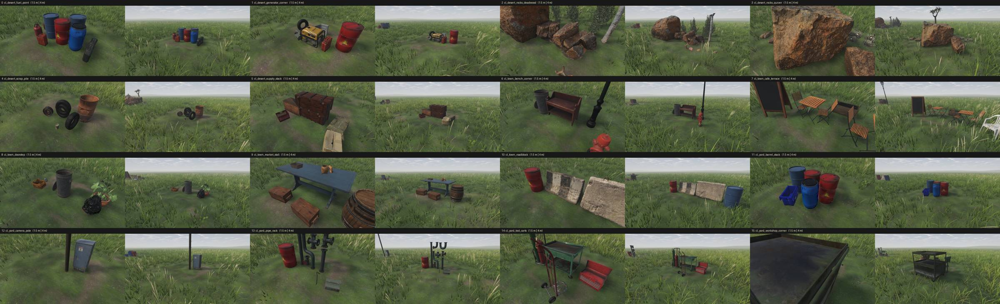

# Prop clusters for the Search and Destroy maps (PR4)

Ready-made groups of the imported Poly Haven props (and a few in-house pieces) for dressing the three Search and Destroy maps. Built by `tools/props/clusters.py` from `tools/props/ph_props.json`.

**Two ways to use them**
- **One placeable asset** (`cl_*`, editor categories *Clusters: Desert compound / Container yard / Town quarter*): the members' baked models attached at their offsets, their collider boxes turned into place, cover points on all four sides when the cluster is at least 0.8 m tall (low) or 1.3 m (high). Rotate the whole asset with the instance yaw. Nav carves it like any blocking prop.
- **Member list** in `tools/props/clusters.json` (for mapgen): `members[].asset`, `pos` [x, y, z] (y = standing height, e.g. a crate on a crate) and `yaw` (degrees) relative to the cluster origin; `footprint` [x, z] m, `height` m, `cover` none / low / high. Clusters marked *prefab* mix in-house assets (sandbag walls, the guard tower, cable reels, the farm cart, brick rubble) and exist only as member lists: place the members one by one.

Turning a member list into instances: world = cluster position + R(cluster yaw) * pos, member yaw + cluster yaw (yaw turns +x toward -z, as `yawQuat`).

## Desert compound (Sun Fort, sd_desert)

| Cluster | Use | Asset | Footprint (m) | Height | Cover | Members |
|---|---|---|---|---|---|---|
| Supply stack | Crates stacked two high against a wall or in the open: low and high cover. | `cl_desert_supply_stack` | 2.9 x 1.4 | 0.9 m | low | wooden_military_crate, wooden_military_crate, old_military_crate, wooden_crate_02, cardboard_box_01, plastic_crate_01 |
| Fuel point | Drums, jerrycans and gas bottles by a vehicle stand: low cover (and a reason not to shoot near it). | `cl_desert_fuel_point` | 2.6 x 1.6 | 0.9 m | low | barrel_01, barrel_02, barrel_03, barrel_03, metal_jerrycan_green, metal_jerrycan_green, metal_jerrycan, propane_tank, small_lpg_tank |
| Generator corner | Generator, fuel, toolbox and a work light: the compound's power point. | `cl_desert_generator_corner` | 2.5 x 1.1 | 0.9 m | low | portable_generator, metal_jerrycan, metal_toolbox, power_box_01, old_tyre, barrel_01 |
| Tyre and scrap pile | Tyres, rims, a burnt drum and cans: low cover, a hiding place in the open. | `cl_desert_scrap_pile` | 1.8 x 1.4 | 0.9 m | low | old_tyre, old_tyre, old_tyre, rusted_wheel_rim_01, rusted_wheel_rim_02, barrel_stove, can_rusted |
| Rocks with quiver tree | Boulders, a quiver tree and succulents: hard cover and a landmark. | `cl_desert_rocks_quiver` | 4.4 x 3.3 | 2.6 m | high | namaqualand_boulder_03, namaqualand_boulder_06, namaqualand_boulders_01, quiver_tree_01, cheiridopsis_succulent |
| Rocks and deadwood | A boulder pile with a dead quiver trunk and branches: low and high cover. | `cl_desert_rocks_deadwood` | 6.0 x 4.7 | 2.0 m | high | namaqualand_boulder_02, namaqualand_boulder_04, namaqualand_rocks_01, dead_quiver_trunk, dead_quiver_branch_01, othonna_cerarioides |
| Sandbag position (prefab) | Curved sandbag wall with ammunition and a jerrycan behind it. | prefab | - | 0.5 m | none | def_sandbag_curved, wooden_military_crate, metal_jerrycan_green |
| Guard post (prefab) | The steel guard tower with a supply stack and a work light at its foot. | prefab | - | 1.8 m | high | mod_guard_tower, wooden_military_crate, flood_lights |

## Container yard (night)

| Cluster | Use | Asset | Footprint (m) | Height | Cover | Members |
|---|---|---|---|---|---|---|
| Pipe rack | The industrial pipe set with tools at its foot: high cover between containers. | `cl_yard_pipe_rack` | 2.5 x 0.7 | 1.9 m | high | modular_industrial_pipes_01, metal_toolbox, crowbar_01, barrel_01 |
| Camera pole | An electricity pole with a security camera and a utility box: a landmark and a sightline hint. | `cl_yard_camera_pole` | 1.4 x 1.1 | 6.0 m | high | modular_electricity_poles, security_camera_01, utility_box_01 |
| Tool carts | Tool cart, tool chest, welding cart and hand truck: low and medium cover. | `cl_yard_tool_carts` | 3.1 x 1.6 | 1.6 m | high | tool_cart, metal_tool_chest, portable_welding_cart, hand_truck |
| Barrel stack | Drums two deep with a plastic tote: low cover. | `cl_yard_barrel_stack` | 1.9 x 1.5 | 0.9 m | low | barrel_01, barrel_01, barrel_02, barrel_03, industrial_pastic_container |
| Workshop corner | Drill presses, a compressor and a storage cart: medium cover in a shed or under a lamp. | `cl_yard_workshop_corner` | 3.2 x 2.0 | 1.4 m | high | drill_press_01, old_drill_press, old_military_compressor, industrial_storage_cart |
| Cable drums (prefab) | Cable reels with barrels and a tote. | prefab | - | 0.9 m | low | tun_cable_reel, tun_cable_reel, barrel_03, plastic_container |

## Town quarter (Normandy)

| Cluster | Use | Asset | Footprint (m) | Height | Cover | Members |
|---|---|---|---|---|---|---|
| Cafe terrace | Two table-and-chair sets, a chalkboard and a planter on the pavement. | `cl_town_cafe_terrace` | 5.6 x 2.4 | 1.4 m | high | outdoor_table_chair_set_01, outdoor_table_chair_set_01, standing_chalkboard_01, planter_box_01, plastic_monobloc_chair_01 |
| Market stall | A painted table with baskets and crates: low cover in a square. | `cl_town_market_stall` | 3.2 x 1.7 | 1.2 m | low | painted_wooden_table, wicker_basket_01, wicker_basket_02, wooden_crate_01, wooden_crate_01, wine_barrel_01 |
| Doorstep clutter | Bin, bags, a crate, a watering can and a plant by a door. | `cl_town_doorstep` | 3.1 x 1.2 | 0.9 m | low | metal_trash_can, trashbag, plastic_crate_02, watering_can_metal_01, potted_plant_02 |
| Bench corner | Bench, street lamp, bin and hydrant at a street corner. | `cl_town_bench_corner` | 2.9 x 1.3 | 3.7 m | high | painted_wooden_bench, street_lamp_01, metal_trash_can, fire_hydrant |
| Roadblock | Concrete barriers, drums and a covered car across a street: hard and low cover. | `cl_town_roadblock` | 4.5 x 1.0 | 1.1 m | low | concrete_road_barrier, concrete_road_barrier_02, barrel_01, barrel_03 |
| Rubble (prefab) | Brick rubble with a tyre and a barrier: low cover in a shelled street. | prefab | - | 1.1 m | low | rub_brick_pile_m, old_tyre, concrete_road_barrier_02 |
| Cart with sacks (prefab) | The farm cart with sacks and a barrel beside it. | prefab | - | 0.9 m | low | drs_cart, cement_bag, wine_barrel_01 |

## Adding a cluster

Add an entry to `C` in `tools/props/clusters.py` (members: asset id, x, z, yaw, y) and run `python -I tools/props/clusters.py`; it rewrites the `cl_*` assets and `clusters.json`. A cluster asset reuses the members' existing bakes (`content/assets/models/ph_*`): its `models` entries carry no `bake` block, so `--import-weapon-models` never re-bakes or claims those folders.