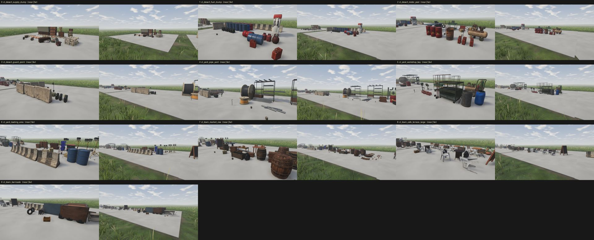

# Prop clusters for the Search and Destroy maps (PR4)

Ready-made groups of the imported Poly Haven props for dressing the three Search and Destroy maps, written by `tools/props/clusters.py` (run `python -I tools/props/clusters.py`) from `tools/props/ph_props.json`.

**Two tiers.** *Small* clusters (1.5-4 m, 3-9 objects) for doorsteps and corners; *large* clusters (6-10 m, 22-43 objects, stacks up to 2.4 m) to dress a bomb site or a yard: stacks two to four high, rows, pieces leaning on each other or lying on their side (attached-model `tilt`), seeded jitter and ground clutter so nothing sits on a grid.

**Two ways to use them.**
- **One placeable asset** (`cl_*`, editor categories *Clusters: Desert compound / Container yard / Town quarter*): the members' baked models attached at their offsets (with tilt), collider boxes turned into place, and nav cover points in front of and behind every member a body can hide behind (marked *stand* when it is at least 1.3 m tall, *crouch* from 0.8 m). Turn the whole asset with the instance yaw; nav carves it.
- **Member list** in `tools/props/clusters.json` (for mapgen): `members[]` with `asset`, `pos` [x, y, z] (y = standing height), `yaw`, optional `tilt` [pitch, roll] and `cover` (stand / crouch / null); plus `footprint` [x, z] m, `height`, `cover`, `count`. Members with a tilt only keep it inside the cluster asset (map instances have a yaw only), so place the large clusters as their asset. Clusters marked *prefab* mix in-house pieces (sandbag walls, the guard tower, cable reels, the farm cart, brick rubble) and exist only as member lists. A few in-house part assets (`mod_pallet`, `mod_cable_spool_large` / `_small`, listed in `INLINE`) are copied part by part into a cluster asset, and a canvas tarp (`Lay.tarp`) is drawn as cluster parts, so the supply dump and the pipe yard stay placeable assets.

Member list to instances: world = cluster position + R(cluster yaw) * pos, member yaw + cluster yaw (yaw turns +x toward -z, as `yawQuat`).

**Ground pads** for yards and compounds (and the hard ground under these captures): `pad_concrete_12`, `pad_dirt_12` (12 x 12 m, 4 cm).

## Desert compound (Sun Fort, sd_desert)

| Cluster | Tier | Use | Asset | Footprint (m) | Height | Objects | Stand / crouch cover pieces |
|---|---|---|---|---|---|---|---|
| Supply stack | small | Crates stacked two high against a wall or in the open: low and high cover. | `cl_desert_supply_stack` | 2.9 x 1.4 | 0.9 m | 6 | 0 / 1 |
| Fuel point | small | Drums, jerrycans and gas bottles by a vehicle stand: low cover (and a reason not to shoot near it). | `cl_desert_fuel_point` | 2.6 x 1.6 | 0.9 m | 9 | 0 / 3 |
| Generator corner | small | Generator, fuel, toolbox and a work light: the compound's power point. | `cl_desert_generator_corner` | 2.5 x 1.1 | 0.9 m | 6 | 0 / 1 |
| Tyre and scrap pile | small | Tyres, rims, a burnt drum and cans: low cover, a hiding place in the open. | `cl_desert_scrap_pile` | 1.8 x 1.4 | 0.9 m | 7 | 0 / 1 |
| Rocks with quiver tree | small | Boulders, a quiver tree and succulents: hard cover and a landmark. | `cl_desert_rocks_quiver` | 4.4 x 3.3 | 2.6 m | 5 | 2 / 0 |
| Rocks and deadwood | small | A boulder pile with a dead quiver trunk and branches: low and high cover. | `cl_desert_rocks_deadwood` | 6.0 x 4.7 | 2.0 m | 6 | 2 / 1 |
| Sandbag position (prefab) | small | Curved sandbag wall with ammunition and a jerrycan behind it. | prefab | - | 0.5 m | 3 | 0 / 0 |
| Guard post (prefab) | small | The steel guard tower with a supply stack and a work light at its foot. | prefab | - | 1.8 m | 3 | 1 / 0 |
| Supply dump (large) | large | Crates three high on pallets, one block under a tarp, empty pallets stacked and loose, cement sacks and boxes in front: standing cover behind the pallet stacks (1.5 m), crouch cover behind the sacks and the empty pallets. | `cl_desert_supply_dump` | 7.4 x 4.4 | 1.6 m | 43 | 4 / 5 |
| Fuel dump (large) | large | Three rows of drums behind a barrier bund, jerrycan rows, a fuel pump and gas bottles: crouch cover along the drums, standing cover at the pump. | `cl_desert_fuel_dump` | 8.2 x 5.5 | 1.9 m | 43 | 1 / 19 |
| Motor-pool corner (large) | large | Tyre stacks, a tool cart and chests, a generator and compressor, oil drums and a work table: crouch cover at the tyre stacks, standing cover at the compressor. | `cl_desert_motor_pool` | 7.2 x 4.1 | 1.3 m | 40 | 1 / 10 |
| Guard point (large) | large | An L of concrete barriers with crate seats, a radio, water cans and a lantern: standing cover along the L. | `cl_desert_guard_point` | 5.9 x 5.0 | 1.1 m | 24 | 0 / 6 |

## Container yard (night)

| Cluster | Tier | Use | Asset | Footprint (m) | Height | Objects | Stand / crouch cover pieces |
|---|---|---|---|---|---|---|---|
| Pipe rack | small | The industrial pipe set with tools at its foot: high cover between containers. | `cl_yard_pipe_rack` | 2.5 x 0.7 | 1.9 m | 4 | 1 / 1 |
| Camera pole | small | An electricity pole with a security camera and a utility box: a landmark and a sightline hint. | `cl_yard_camera_pole` | 1.4 x 1.1 | 6.0 m | 3 | 1 / 0 |
| Tool carts | small | Tool cart, tool chest, welding cart and hand truck: low and medium cover. | `cl_yard_tool_carts` | 3.1 x 1.6 | 1.6 m | 4 | 2 / 1 |
| Barrel stack | small | Drums two deep with a plastic tote: low cover. | `cl_yard_barrel_stack` | 1.9 x 1.5 | 0.9 m | 5 | 0 / 3 |
| Workshop corner | small | Drill presses, a compressor and a storage cart: medium cover in a shed or under a lamp. | `cl_yard_workshop_corner` | 3.2 x 2.0 | 1.4 m | 4 | 1 / 2 |
| Cable drums (prefab) | small | Cable reels with barrels and a tote. | prefab | - | 0.9 m | 4 | 0 / 1 |
| Pipe yard (large) | large | Two steel racks loaded with pipe on every shelf and across the top, some lengths poking out, a pipe pyramid, two cable drums, the pipe manifold, crates and drums: standing cover behind the racks and the big drum. | `cl_yard_pipe_yard` | 9.6 x 4.9 | 2.4 m | 87 | 4 / 2 |
| Workshop bay (large) | large | Steel shelving along the back, a compressor, welding cart, drill presses, a tool cart with a vice, storage cart and bins: standing cover at the shelving and compressor. | `cl_yard_workshop_bay` | 7.6 x 4.5 | 2.1 m | 25 | 7 / 4 |
| Loading area (large) | large | Crate and tote stacks three high, hand trucks, a barrier line, a floodlight and loose boxes: standing cover behind the stacks, crouch cover at the barriers. | `cl_yard_loading_area` | 9.7 x 4.9 | 1.5 m | 35 | 3 / 12 |

## Town quarter (Normandy)

| Cluster | Tier | Use | Asset | Footprint (m) | Height | Objects | Stand / crouch cover pieces |
|---|---|---|---|---|---|---|---|
| Cafe terrace | small | Two table-and-chair sets, a chalkboard and a planter on the pavement. | `cl_town_cafe_terrace` | 5.6 x 2.4 | 1.4 m | 5 | 1 / 3 |
| Market stall | small | A painted table with baskets and crates: low cover in a square. | `cl_town_market_stall` | 3.2 x 1.7 | 1.2 m | 6 | 0 / 2 |
| Doorstep clutter | small | Bin, bags, a crate, a watering can and a plant by a door. | `cl_town_doorstep` | 3.1 x 1.2 | 0.9 m | 5 | 0 / 2 |
| Bench corner | small | Bench, street lamp, bin and hydrant at a street corner. | `cl_town_bench_corner` | 2.9 x 1.3 | 3.7 m | 4 | 1 / 2 |
| Roadblock | small | Concrete barriers, drums and a covered car across a street: hard and low cover. | `cl_town_roadblock` | 4.5 x 1.0 | 1.1 m | 4 | 0 / 4 |
| Rubble (prefab) | small | Brick rubble with a tyre and a barrier: low cover in a shelled street. | prefab | - | 1.1 m | 3 | 0 / 1 |
| Cart with sacks (prefab) | small | The farm cart with sacks and a barrel beside it. | prefab | - | 0.9 m | 3 | 0 / 1 |
| Market row (large) | large | Four stalls of tables with baskets, pots and crates, barrels and a chalkboard: crouch cover behind the tables and crates. (No awning model exists yet.) | `cl_town_market_row` | 9.5 x 3.2 | 1.4 m | 30 | 1 / 6 |
| Cafe terrace (large) | large | Four table-and-chair sets and two round tables, chairs knocked over, planters along the kerb, a signboard: crouch cover behind the planters, little else. | `cl_town_cafe_terrace_large` | 9.3 x 4.5 | 1.4 m | 22 | 1 / 8 |
| Street barricade (large) | large | A street-wide barricade of barriers, a tipped table, cabinet and sofa, drums, tyres and sandbag-like cement sacks: standing and crouch cover along its length. | `cl_town_barricade` | 10.5 x 3.6 | 1.1 m | 29 | 0 / 9 |

## Adding a cluster

Small: an entry in `C` (members: asset id, x, z, yaw, y[, (pitch, roll)]). Large: a function in `big_clusters()` built with `Lay` (put, stack, row, lean, lie, litter). A cluster asset reuses the members' existing bakes (`content/assets/models/<dir>`): its `models` entries carry no `bake` block, so `--import-weapon-models` never re-bakes or claims those folders.
