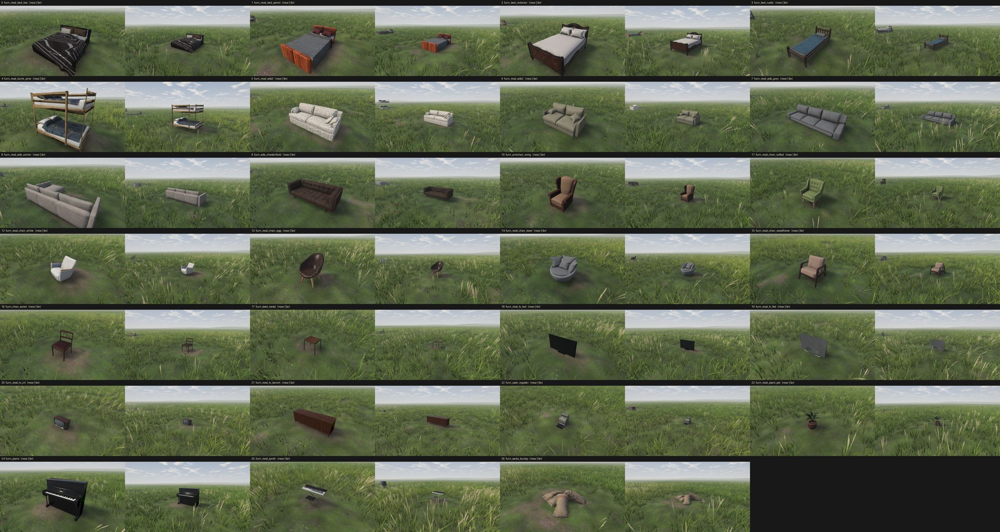
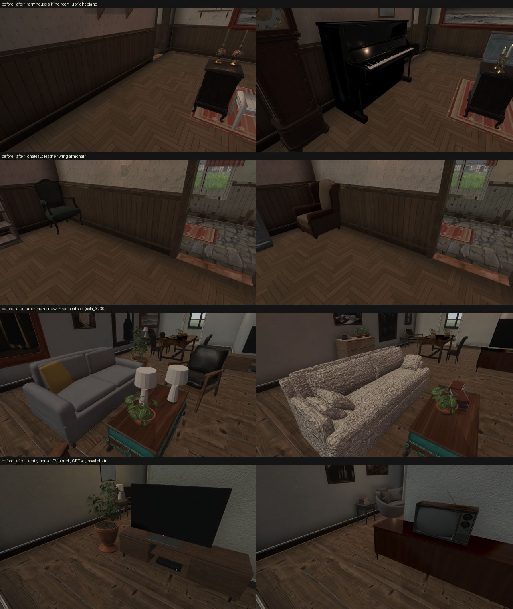

# User-supplied furniture models (PR5)

28 files the user supplied (Sketchfab downloads, `Downloads/`), copied each into its own folder under `E:/nmk/incoming/pr5/` and opened only by Blender background scripts. One was a byte-identical duplicate (`tv_bench__tv_table__tv_stand_wood (1).glb`, same SHA-256) and is not used; `928c4eb3...glb` is a low-poly flat-screen TV ("Tv" by Algirdas Lalys). `sofa (1).glb` is not a copy of `living_room_sofa__furniture.glb` (different author, 2 k vs 117 k triangles): the first is a leather egg chair, the second a leather wing armchair. Several "sofa" files are armchairs (named by what they are below).

`tools/props/user_models.py` converts them (Blender: metres, front +z, ground pivot, per-piece colliders) at a checked real-world size, writes the registry `tools/props/user_models.json`, a furniture asset per new piece (its prop envelope is the model's size; a box stand-in shows until the bake is on disk), the `furn_replace.json` rows and the credits table; `tools/props/furn_fit.py` fits them (`exact` for new pieces, a per-axis `stretch` within 30 % for the two that replace an in-house sofa) into `content/settings/furniture_models.json`; `--import-weapon-models` bakes them (textures 2K / 1K JPEG, heavy meshes simplified to about 20 k triangles, LOD1). New pieces join the furnishing rules (`content/settings/room_dressing.json`) as alternatives (`a|b`), so a building picks among them by its seed.

Licences: read from each file's own Sketchfab metadata (`asset.extras`). 26 are CC BY 4.0 and committed with credits (docs/credits.md). `old_stool` is under the Sketchfab Standard licence: its bake is local-only (git-ignored `content/assets/models/fr_stool_metal/`), the committed game shows its box stand-in.

| Asset | Model (author) | Size (m) | Licence | Where it goes |
|---|---|---|---|---|
| `furn_mod_bed_low` | Bed (khanhnguyen1189) | 2.08 x 2.10 x 0.81 | CC-BY-4.0 | modern bedrooms (double-bed alternative) |
| `furn_mod_bed_panel` | Bed (rerwandi) | 1.48 x 2.13 x 0.84 | CC-BY-4.0 | modern bedrooms (double-bed alternative) |
| `furn_bed_victorian` | Victorian Bed (BATRIC_18) | 1.52 x 2.15 x 1.24 | CC-BY-4.0 | period bedrooms: houses, inn, chateau (double-bed alternative) |
| `furn_bed_rustic` | Old Bed (donnichols) | 0.87 x 1.95 x 0.76 | CC-BY-4.0 | period bedrooms (small-room single alternative) |
| `furn_mod_bunk_pine` | Simple Bunk Bed (Blender3D) | 2.00 x 1.24 x 1.79 | CC-BY-4.0 | modern bedrooms (small-room alternative to the single bed); placeable for barracks |
| `furn_mod_sofa3` | Sofa_3230 (vasycrukov) | 3.23 x 1.17 x 0.92 | CC-BY-4.0 | replaces the in-house 3-seat sofa's look (modern lounges) |
| `furn_mod_sofa2` | Sofa 202205_001 (vegu) | 2.00 x 0.94 x 0.88 | CC-BY-4.0 | replaces the in-house 2-seat sofa's look (modern lounges) |
| `furn_mod_sofa_grey` | Grey Sofa (Raphael Escamilla) | 2.70 x 0.89 x 0.73 | CC-BY-4.0 | modern lounges (sofa alternative) |
| `furn_mod_sofa_corner` | Corner Sofa (trystyrobot) | 3.07 x 1.97 x 0.86 | CC-BY-4.0 | modern sitting rooms (wall sofa alternative) |
| `furn_sofa_chesterfield` | Sofa Free (Siba Santosh Das) | 2.20 x 0.90 x 0.79 | CC-BY-4.0 | period lounges (settee alternative) |
| `furn_armchair_wing` | Living room sofa / Furniture (maxsbond.work) | 0.87 x 0.78 x 1.10 | CC-BY-4.0 | period sitting rooms, reading corners, lounges (armchair alternative) |
| `furn_mod_chair_tufted` | Modern Upholstered Armchair - 4096px² (Mark Peters) | 0.69 x 0.65 x 0.89 | CC-BY-4.0 | modern lounges and reading corners |
| `furn_mod_chair_white` | Old Sofa (Amad Junaid) | 0.90 x 0.94 x 0.78 | CC-BY-4.0 | modern lounges |
| `furn_mod_chair_egg` | Sofa (andree) | 0.84 x 0.96 x 1.04 | CC-BY-4.0 | modern reading corners |
| `furn_mod_chair_bowl` | sofa (Jagguz_wrld) | 1.22 x 1.01 x 0.89 | CC-BY-4.0 | modern reading corners |
| `furn_mod_chair_woodframe` | Sofa_LowPoly (LEE2021) | 0.84 x 0.82 x 0.82 | CC-BY-4.0 | modern lounges |
| `furn_chair_soviet` | Old soviet chair (Annelida) | 0.54 x 0.60 x 0.90 | CC-BY-4.0 | period desks and offices (chair alternative) |
| `furn_stool_metal` | Old Stool (MaX3Dd) | 0.55 x 0.46 x 0.50 | SKETCHFAB Standard (local-only) | barns and period lounges (stool alternative) |
| `furn_mod_tv_led` | Led Tv (Daniyal Malik) | 1.23 x 0.20 x 0.73 | CC-BY-4.0 | modern TV wall (on the stand or bench) |
| `furn_mod_tv_flat` | Tv (Algirdas Lalys) | 1.23 x 0.16 x 0.79 | CC-BY-4.0 | modern TV wall |
| `furn_mod_tv_crt` | Old TV (shadowowy) | 0.60 x 0.38 x 0.51 | CC-BY-4.0 | modern TV wall (an old set) |
| `furn_mod_tv_bench` | TV Bench / TV Table / TV Stand Wood (slls666) | 1.80 x 0.49 x 0.62 | CC-BY-4.0 | modern TV wall (stand alternative) |
| `furn_cash_register` | cash register (pokhodenkodana) | 0.31 x 0.45 x 0.44 | CC-BY-4.0 | shop checkout; café / tavern sideboard |
| `furn_mod_plant_pot` | Plant Pot (Pixel Life) | 0.73 x 0.73 x 0.71 | CC-BY-4.0 | modern TV wall and sitting rooms (tall-plant alternative) |
| `furn_piano` | Black Piano (Shaboldik) | 1.58 x 0.71 x 1.25 | CC-BY-4.0 | period sitting rooms (houses, chateau), cafés / taverns; modern sitting rooms |
| `furn_mod_synth` | Synthesizer free (Gerhald) | 0.95 x 0.55 x 0.69 | CC-BY-4.0 | modern bedrooms and sitting rooms |
| `furn_sacks_burlap` | Burlap Bags (carlcapu9) | 1.83 x 1.73 x 0.58 | CC-BY-4.0 | barns, cellars, ammunition stores |

Before / after in furnished interiors (same building, seed and camera):

